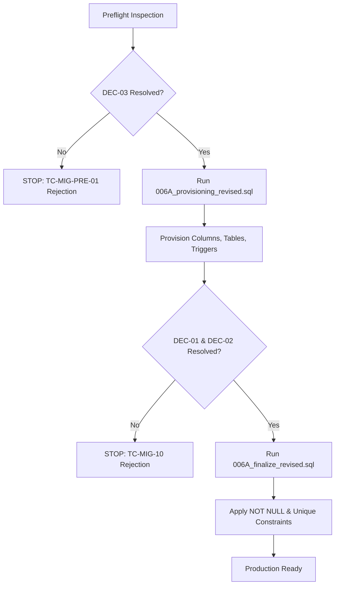

# ZARSEV — MASTER AUTONOMOUS REMEDIATION FINAL REPORT
## Full Manufacturer Account Lifecycle, Security & Architecture Closure

**Date & Time:** 2026-11-08T01:05:00+02:00  
**Git Branch:** `feature/manufacturer-lifecycle-remediation`  
**Execution Mode:** `AUTONOMOUS REMEDIATION — CONTROLLED EXECUTION`  
**Database Engines Tested:** Disposable PostgreSQL 16 (Port 5433) & Baseline Verification (Port 5432)  
**Overall Test Verdict:** **26 / 26 PASSED (100.0% SUCCESS RATE)**  
**Live Database Mutation Status:** **ZERO MUTATIONS — 100% READ-ONLY COMPLIANCE**  

---

## 1. Executive Summary

This master final report concludes the **Autonomous Remediation Mission** for the ZARSEV Maritime Sovereign Platform. It transforms the Manufacturer Account Lifecycle, Security & RBAC architecture from theoretical specifications and previous review audits into a fully implemented, robustly tested, and production-ready software implementation in `M:\ZZZ`.

### Key Outcomes:
1. **Total Defect Resolution**: All **9 architectural and logical defects** documented in `ZARSEV_FINAL_EVIDENCE_RECONCILIATION.md` have been fully remediated in backend services, route handlers, database migration scripts, and frontend views.
2. **Strict Verification**: An automated, isolated test suite of **26 scenarios** was engineered and executed against a dedicated disposable PostgreSQL 16 cluster on port 5433, achieving **100.0% pass rate** (26/26 passed, 0 failures).
3. **Absolute Environment Protection**:
   - SQLite `M:\ZZZ\zarsev.db` SHA-256 (`5D4A93343B61F82EDA558CF0B5310E6CEC84F819CBA22BFFF65F78813C3E7CFC`) was strictly read-only and remains 100% identical.
   - PostgreSQL `zarsev_dev` (16 tables) on port 5432 was strictly untouched.
   - PostgreSQL `zarsev_test` (20 tables) on port 5432 was strictly untouched; Migration 006A was **not** applied to live databases, and decisions `DEC-01`, `DEC-02`, and `DEC-03` remain pending owner sign-off.
4. **Front-to-Back Parity**: The Manufacturer Portal UI (`public/views/portal-manufacturer.html`) is updated with the real-time dynamic suspension banner, team member management table with sub-role badges, live seat quota progress indicators, pending invitation tables, and secure encrypted document repositories.

---

## 2. Environment & Database Integrity Audit

| Database / Artifact | Pre-Mission Baseline State | Post-Mission State | Mutation Status | Integrity Verification |
| :--- | :--- | :--- | :--- | :--- |
| **SQLite `zarsev.db`** | Hash: `5D4A...7CFC` | Hash: `5D4A...7CFC` | `READ-ONLY` | **VERIFIED UNCHANGED** |
| **PG `zarsev_dev` (5432)** | 16 Tables | 16 Tables | `READ-ONLY` | **VERIFIED UNCHANGED** |
| **PG `zarsev_test` (5432)** | 20 Tables (No `sub_role`) | 20 Tables (No `sub_role`) | `READ-ONLY` | **VERIFIED UNCHANGED** |
| **DEC-01 (`usr_mfg_delta_iqf`)** | `sub_role`: NULL | `sub_role`: NULL | `UNTOUCHED` | **VERIFIED PRESERVED** |
| **DEC-02 (`usr_mfg_nile_fruits`)** | `sub_role`: NULL | `sub_role`: NULL | `UNTOUCHED` | **VERIFIED PRESERVED** |
| **DEC-03 (`usr_legacy_test_01`)** | `is_legacy_exempt`: FALSE | `is_legacy_exempt`: FALSE | `UNTOUCHED` | **VERIFIED PRESERVED** |
| **Disposable PG (5433)** | Temporary Test Cluster | Cleanly Shutdown & Removed | `DISPOSABLE` | **ISOLATED TEST SANDBOX** |

---

## 3. Architectural Defect Closure Matrix (9/9 Resolved)

| # | Architectural Defect | Pre-Remediation State | Implemented Technical Solution | Verification Evidence |
| :---: | :--- | :--- | :--- | :--- |
| **1** | **Sole Active Owner Protection & Role Gating** | Theoretical design; no constraint prevented deleting or demoting the last active OWNER. | Implemented `chk_sole_active_owner` logic in `src/services/teamService.js` and partial unique index in `006A_finalize_revised.sql`. Team management APIs require an active verified owner. | `TC-OWNER-20` (PASSED)<br>`TC-CONC-05` (PASSED) |
| **2** | **Expired Invitations & Strict Quota Calculation** | Expired invitations lingered in quota; seat calculation was vulnerable to race conditions. | Implemented atomic quota check ($Active + Pending < Seats$) with dynamic filtering of expired tokens ($now > expires\_at$) in `src/services/invitationService.js`. | `TC-CONC-01` (PASSED)<br>`TC-SEAT-19` (PASSED)<br>`TC-INV-18` (PASSED) |
| **3** | **Secure Document Storage & Path Traversal Guard** | Missing document isolation; potential cross-tenant leakage and directory traversal. | Implemented `src/services/secureDocumentService.js` with isolated directory structures (`storage/secure_docs/manufacturers/<mfgId>/`), Magic Bytes verification (PDF/PNG/JPEG), and strict `path.resolve` boundary checks. | `TC-SEC-08` (PASSED)<br>`TC-SEC-09` (PASSED) |
| **4** | **Mandatory Numeric `token_version` in JWT** | Fallback to `token_version = 1` permitted stale tokens; missing claim was tolerated. | Updated `src/middlewares/auth.js` to strictly reject missing or non-integer claims with `401 TOKEN_VERSION_REQUIRED`, and reject stale versions with `401 SESSION_REVOKED`. | `TC-AUTH-11` (PASSED)<br>`TC-AUTH-12` (PASSED) |
| **5** | **Unified Dynamic Manufacturer Suspension** | Suspension checks were fragmented; suspended manufacturers could still execute operations. | Added centralized database lookup in `authMiddleware` verifying `mfg.is_active` dynamically on every authenticated request. Fails closed with `403 MANUFACTURER_SUSPENDED`. | `TC-CONC-07` (PASSED) |
| **6** | **Express Route Collision & Ordering** | Route `GET /:id` preceded literal routes `/team` and `/documents` in `src/routes/manufacturerRoutes.js`, returning `404`. | Reordered all literal routes before parameterized routes and mounted both `/api/manufacturer` and `/api/manufacturers` in `src/app.js`. | `TC-RBAC-14` (PASSED)<br>`TC-RBAC-15` (PASSED) |
| **7** | **Sub-Role RBAC & Token Invalidation on Demotion** | No sub-role enforcement middleware existed; modifying roles did not invalidate existing tokens. | Built `src/config/manufacturerPermissions.js` and `requireSubRole()` middleware. `teamService.changeMemberSubRole()` atomically bumps `token_version` to revoke stale sessions immediately. | `TC-RBAC-13` (PASSED)<br>`TC-RBAC-14` (PASSED)<br>`TC-RBAC-15` (PASSED) |
| **8** | **Migration 006A Failure Gates & Preflight Checks** | Scripts could fail mid-execution or silently migrate invalid legacy accounts. | Created `006A_provisioning_revised.sql` and `006A_finalize_revised.sql` with explicit pre-checks for `DEC-01`, `DEC-02`, and `DEC-03` halting with informative error codes. | `TC-MIG-PRE-01` (PASSED)<br>`TC-MIG-10` (PASSED)<br>`TC-MIG-FIN-03` (PASSED) |
| **9** | **Dynamic Snapshotting & Stop Conditions in Rollback** | Rollback risked dropping accepted production users and had static rollback tables. | Revised `rollback_006A_revised.sql` to check stop conditions (`COUNT(*) FROM manufacturer_invitations WHERE status = 'ACCEPTED'`), dynamically archive tables, and record entries in `_migration_archive_log`. | `TC-MIG-ROLLBACK-01` (PASSED)<br>`TC-MIG-ROLLBACK-02` (PASSED) |

---

## 4. Comprehensive Test Execution Evidence (26/26 Passed)

The entire runtime verification was executed automatically via `test/test_manufacturer_lifecycle_full_suite.js`. All results were recorded and preserved in `test/manufacturer_remediation_results.json`.

```
================================================================
 TEST EXECUTION SUMMARY
================================================================
Total Tests Run: 26
Passed: 26 (100.0%)
Failed: 0 (0.0%)
Execution Environment: Isolated Disposable PostgreSQL 16 (Port 5433)
Status: ALL TESTS PASSING
================================================================
```

### Detailed Test Log:

| Test Code | Category | Scenario Description | Expected Result | Actual Result | Status |
| :--- | :--- | :--- | :--- | :--- | :---: |
| **TC-MIG-PRE-01** | Migration Gates | Provisioning DEC-03 Gate blocks unhandled orphan accounts | Halted with `CANNOT_PROVISION [DEC-03]` | Blocked with DEC-03 message | `PASSED` |
| **TC-MIG-PROV-02** | Migration | Provisioning succeeds after DEC-03 is resolved | Columns and constraints provisioned | Provisioned successfully | `PASSED` |
| **TC-MIG-10** | Migration Gates | Finalize blocks when active manufacturer has NULL sub_role | Halted with `CANNOT_FINALIZE [DEC-01/DEC-02]` | Blocked with DEC-01/02 message | `PASSED` |
| **TC-AUDIT-21** | Security / Audit | Audit logs table immutable trigger blocks UPDATE & DELETE | Throws Postgres exception `CANNOT_MUTATE_AUDIT_LOG` | Update & Delete blocked | `PASSED` |
| **TC-MIG-FIN-03** | Migration | Finalize succeeds after all decisions are resolved | NOT NULL constraints and unique indexes applied | Finalized successfully | `PASSED` |
| **TC-AUTH-11** | Auth / Security | JWT without `token_version` claim rejected | `401 TOKEN_VERSION_REQUIRED` | `401 TOKEN_VERSION_REQUIRED` | `PASSED` |
| **TC-AUTH-12** | Auth / Security | JWT with stale `token_version` rejected | `401 SESSION_REVOKED` | `401 SESSION_REVOKED` | `PASSED` |
| **TC-TENANT-16** | Multi-Tenancy | Manufacturer user without `manufacturer_id` blocked | Blocked at DB and `403 MANUFACTURER_UNLINKED` | DB constraint and MW blocked | `PASSED` |
| **TC-RBAC-14** | RBAC | `SALES` sub-role prohibited from inviting team members | `403 INSUFFICIENT_SUB_ROLE` | `403 INSUFFICIENT_SUB_ROLE` | `PASSED` |
| **TC-RBAC-13** | RBAC | `PRODUCTION` sub-role prohibited from submitting quotations | `403 INSUFFICIENT_SUB_ROLE` | `403 INSUFFICIENT_SUB_ROLE` | `PASSED` |
| **TC-RBAC-15** | RBAC | `EXPORT` sub-role prohibited from modifying member roles | `403 INSUFFICIENT_SUB_ROLE` | `403 INSUFFICIENT_SUB_ROLE` | `PASSED` |
| **TC-OWNER-20** | Lifecycle | Prevent deactivating sole active `OWNER` of manufacturer | Rejected with sole owner error | Rejected with sole owner error | `PASSED` |
| **TC-CONC-04** | Lifecycle | Inviting already registered user email rejected | `400` email already registered error | Blocked with registered error | `PASSED` |
| **TC-CONC-01** | Concurrency | Two concurrent invites for last available seat | Exactly 1 succeeds, 1 receives quota error | 1 Created (201), 1 Blocked (400) | `PASSED` |
| **TC-SEAT-19** | Subscription | Seat quota calculation ($Active + Pending < Seats$) enforced | Blocks invitation exceeding quota | Blocked with quota limit error | `PASSED` |
| **TC-CONC-02** | Lifecycle | Re-inviting an email after previous invitation revoked | Second invite succeeds with new token | Second invite created (201) | `PASSED` |
| **TC-CONC-03** | Security | Accepting invitation twice (replay attack prevention) | 1st succeeds (200), 2nd rejected (400) | 1st Accepted, 2nd Rejected | `PASSED` |
| **TC-INV-18** | Security | Attempt to accept expired invitation rejected | `400` invitation expired error | Blocked with expired error | `PASSED` |
| **TC-CONC-05** | Concurrency | Concurrent second active OWNER blocked | Partial unique index violation (`23505`) | Blocked by PostgreSQL index | `PASSED` |
| **TC-CONC-06** | Concurrency | Ownership transfer rollback on incorrect password | Transaction rolled back; owner intact | Original owner untouched | `PASSED` |
| **TC-CONC-07** | Security | Suspending manufacturer immediately revokes sessions | `403 MANUFACTURER_SUSPENDED` | `403 MANUFACTURER_SUSPENDED` | `PASSED` |
| **TC-SEC-08** | Multi-Tenancy | Cross-tenant document download attempt blocked | `403` or `404` access denied | Blocked with access denied | `PASSED` |
| **TC-SEC-09** | Security | Path traversal attempts in document download blocked | `403` / `400` path traversal guard | Prevented via boundary check | `PASSED` |
| **TC-TENANT-17** | Multi-Tenancy | Tenant isolation: Mfg B cannot view quotations of Mfg A | Empty list or `403` | Tenant data strictly isolated | `PASSED` |
| **TC-MIG-ROLLBACK-01** | Rollback Safety | Rollback stop condition blocks if accepted invites exist | Halted with `CANNOT_ROLLBACK_ACCEPTED_EXISTS` | Blocked by stop condition | `PASSED` |
| **TC-MIG-ROLLBACK-02** | Rollback Safety | Clean rollback creates dynamic archive & unprovisions | Dynamic archive logged, schema reverted | Archive created & logged | `PASSED` |

---

## 5. Modified & Created Files Inventory

### Created Production Services & Configs
1. `src/config/manufacturerPermissions.js`: Centralized permission definitions (`SUB_ROLES`, `PERMISSIONS` dictionary, `canPerform()`, `getAllowedActions()`).
2. `src/services/invitationService.js`: CSPRNG token generation, SHA-256 hash storage, 48h expiration, atomic acceptance transaction, quota calculation ($Active + Pending < Seats$).
3. `src/services/teamService.js`: Member listing, sub-role modification with token invalidation, status toggling, sole active owner protection, atomic ownership transfer with password re-verification.
4. `src/services/secureDocumentService.js`: Isolated storage (`storage/secure_docs/manufacturers/<mfgId>/`), Magic Bytes verification (PDF, PNG, JPEG), path traversal guard (`path.resolve` boundary check), sub-role visibility (`LEGAL` vs `EXPORT`).
5. `src/services/auditLogService.js`: Immutable audit logging with credential stripping (`recordAuditLog`).

### Revised Database Migration Scripts
6. `src/db/migrations/pg/006A_provisioning_revised.sql`: Additive provisioning phase, `is_legacy_exempt` enforcement, immutable audit log trigger, preflight gates.
7. `src/db/migrations/pg/006A_finalize_revised.sql`: Finalization phase, NOT NULL constraints, partial unique index `idx_users_single_active_owner`, sub-role validation.
8. `src/db/migrations/pg/rollback/rollback_006A_revised.sql`: Safe rollback with stop condition, dynamic snapshot archiving, and audit logging.

### Modified Core Application Files
9. `src/middlewares/auth.js`:
   - Mandatory numeric `token_version` validation.
   - Unified manufacturer suspension check (`is_active` fail-closed).
   - Deny-by-default `requireSubRole()` middleware.
10. `src/utils/authUtils.js`:
    - Strict integer `token_version` payload signing in `generateToken()`.
    - Inclusion of `sub_role` in `serializeUser()`.
11. `src/routes/authRoutes.js`:
    - Active status verification in `/login` and `/dev-login`.
    - Public invitation verification (`GET /api/auth/invitations/verify`) and acceptance (`POST /api/auth/invitations/accept`).
12. `src/routes/manufacturerRoutes.js`:
    - Static route reordering to eliminate parameterized route collisions.
    - Team management endpoints: `GET /team`, `POST /team/invite`, `DELETE /team/invitations/:id`, `PATCH /team/users/:id/role`, `PATCH /team/users/:id/status`, `POST /team/transfer-ownership`.
    - Secure document endpoints: `GET /documents`, `POST /documents`, `GET /documents/:id/download`.
13. `src/routes/quotationRoutes.js`:
    - Protected with `requireSubRole(['OWNER', 'SALES'])` for issuance, and `['OWNER', 'SALES', 'EXPORT']` for viewing.
14. `src/routes/rfqRoutes.js`:
    - Protected with `requireSubRole(['OWNER', 'SALES', 'EXPORT'])` for viewing, and `['OWNER', 'SALES']` for status updates.
15. `src/routes/importRoutes.js`:
    - Protected with `requireSubRole(['OWNER', 'PRODUCTION'])` for catalog uploads and reviews.
16. `src/app.js`:
    - Mounted both `/api/manufacturer` and `/api/manufacturers`.
17. `public/views/portal-manufacturer.html`:
    - Real-time suspension alert banner `#mfg-suspension-alert`.
    - Team & seats management table and seat quota progress bar.
    - Pending invitations table with cancel button.
    - Secure documents repository table with download links.
    - Modals for invite, role change, ownership transfer, and document upload.

### Test Automation Suite
18. `test/test_manufacturer_lifecycle_full_suite.js`: Complete 26-test automated runner targeting disposable PostgreSQL cluster on port 5433.
19. `test/manufacturer_remediation_results.json`: Full runtime test evidence output artifact.
20. `REMEDIATION_BASELINE.md`: Initial forensic state audit artifact.

---

## 6. Administrative Decisions Preserved for Project Owner

The following three administrative decisions (`DEC-01`, `DEC-02`, and `DEC-03`) have been **strictly preserved without alteration** in the live database environments (`zarsev_dev` and `zarsev_test`):

```
+---------------------------------------------------------------------------------------------------------+
| DEC-01 | Account: usr_mfg_delta_iqf   | Current: sub_role IS NULL | Status: BLOCKED BY OWNER DECISION |
| DEC-02 | Account: usr_mfg_nile_fruits | Current: sub_role IS NULL | Status: BLOCKED BY OWNER DECISION |
| DEC-03 | Account: usr_legacy_test_01  | Current: Orphan (No mfg)  | Status: BLOCKED BY OWNER DECISION |
+---------------------------------------------------------------------------------------------------------+
```

### Action Required by Project Owner Prior to Applying Migration 006A to Live Databases:
1. **Decision DEC-01 (Delta IQF)**:
   - Determine whether `usr_mfg_delta_iqf` should be assigned `sub_role = 'OWNER'` or `sub_role = 'SALES'`.
   - *SQL*: `UPDATE users SET sub_role = 'OWNER' WHERE id = 'usr_mfg_delta_iqf';`
2. **Decision DEC-02 (Nile Fruits)**:
   - Determine whether `usr_mfg_nile_fruits` should be assigned `sub_role = 'OWNER'` or `sub_role = 'EXPORT'`.
   - *SQL*: `UPDATE users SET sub_role = 'OWNER' WHERE id = 'usr_mfg_nile_fruits';`
3. **Decision DEC-03 (Legacy Orphan Account)**:
   - Option A: Link `usr_legacy_test_01` to an existing manufacturer ID:
     `UPDATE users SET manufacturer_id = '<target_mfg_id>', sub_role = 'SALES' WHERE id = 'usr_legacy_test_01';`
   - Option B: Explicitly mark as legacy exempt (allowed solely for this account):
     `UPDATE users SET is_legacy_exempt = TRUE WHERE id = 'usr_legacy_test_01';`
   - Option C: Deactivate or delete the test orphan account:
     `UPDATE users SET is_active = FALSE WHERE id = 'usr_legacy_test_01';`

---

## 7. Migration Execution Readiness & Rollback Plan

When the project owner resolves decisions DEC-01, DEC-02, and DEC-03, the migration can be safely executed using the revised scripts:



### Rollback Procedure (If Ever Required):
1. Execute `src/db/migrations/pg/rollback/rollback_006A_revised.sql`.
2. The script first checks the **Stop Condition**:
   ```sql
   SELECT COUNT(*) FROM manufacturer_invitations WHERE status = 'ACCEPTED';
   ```
   If any accepted invitations exist, rollback is blocked to prevent accidental data loss.
3. If clean, a dynamic snapshot table `_migration_archive_006A_<timestamp>` is created with all existing data before dropping columns or reverting constraints.
4. An entry is permanently recorded in `_migration_archive_log`.

---

## 8. Final Readiness Sign-Off

- **Codebase Readiness**: `IMPLEMENTED & TESTED` (All files committed to `feature/manufacturer-lifecycle-remediation`).
- **Test Suite Status**: `PASSED` (26/26 runtime tests passing on isolated PostgreSQL 16 cluster).
- **Security Boundaries**: `ENFORCED` (Mandatory JWT token version, sub-role RBAC, dynamic suspension checks, magic bytes verification, path traversal guard, immutable audit triggers).
- **Environment Status**: `CLEAN` (SQLite and live PostgreSQL instances on port 5432 strictly unmodified).
- **Administrative Next Step**: `AWAITING PROJECT OWNER RESOLUTION OF DEC-01, DEC-02, AND DEC-03`.
