# ZARSEV — خارطة طريق استكمال منظومة التجارة والتصدير الدولي
## ZARSEV Next Business Workflows Roadmap: From Account Hardening to Sovereign Global Export Platform

---

**معرف الوثيقة:** `ROADMAP-ZARSEV-2026-BUSINESS-WORKFLOWS`  
**تاريخ الإعداد والتوثيق:** 8 نوفمبر 2026 (12:15:00+02:00)  
**حالة الحماية:** `STRICT READ-ONLY — ZERO CODE/DB MODIFICATIONS — DEMO DATA PRESERVED`  
**الهدف الاستراتيجي:** نقل ZARSEV من مرحلة "إصلاح حسابات المصانع" إلى "منصة تصدير وتجارة بحرية دولية متكاملة" جاهزة للعرض الحي أمام صاحب المصنع والمستثمرين.

---

## 1. المصفوفة الجنائية الشاملة لوظائف المنصة الحالية

تم إجراء مسح دقيق ومحايد وشامل لكافة مسارات النظام، ونماذج قواعد البيانات، وواجهات العرض، وملفات الاختبارات لتحديد ما تم إنجازه فعلياً وما يزال في طور التصميم النظري:

| الوظيفة التجارية | الحالة الواقعية | وجود الـ API في الخادم | اتصال الواجهة بالـ API | حالة الاختبارات (HTTP / Browser) | النواقص الأساسية للإكمال |
| :--- | :---: | :---: | :---: | :---: | :--- |
| **1. دورة طلب عرض السعر (RFQ)** | **موجودة ومحققة 100%** | متوفر بالكامل (`POST /api/rfqs`, `GET /api/rfqs/track`, `GET /api/rfqs`) | متصل في `zarsev_4/code.html`، وبوابة المصنع، وبوابة الإدارة | مختبر عبر HTTP (`rfq_e2e_verification.js`) وعبر المتصفح الحقيقي (`browser_phase2_quotation_acceptance.js`) | إمكانية إرفاق ملفات مواصفات من المشتري، وإعادة توجيه الطلبات العامة من الإدارة. |
| **2. عروض الأسعار والقرار (Quotations)** | **موجودة ومحققة 100%** | متوفر بالكامل (`POST /api/quotations`, `GET /api/quotations/rfq/:id`, `POST /:id/decision`) | متصل في بوابة المصنع لإصدار العرض، وفي واجهة المشتري لقبوله أو رفضه | مختبر عبر HTTP ومختبر في متصفح Chrome Puppeteer | دعم التفاوض (Counter-Offer)، وتوليد وثيقة Proforma Invoice بصيغة PDF. |
| **3. ما بعد قبول العرض (عقود، إنتاج، QC/QA)** | **تصميم فقط (0% برمجياً)** | **غير موجود** (لا توجد مسارات `/api/contracts` أو `/api/production` أو `/api/qc`) | غير متصل (توجد فقط نصوص تسويقية في `zarsev_4` و `zarsev_5`) | **غير مختبر (0%)** | جداول العقود، أوامر الإنتاج، تقارير فحص المتبقيات MRLs، ومحاضر الجودة الميدانية. |
| **4. الشحن البحري واللوجستيات (B/L والحاويات)** | **تصميم شكلي (0% برمجياً)** | **غير موجود** (لا توجد مسارات للشحنات أو الحاويات أو بوالص الشحن) | غير متصل (صفحة `portal-logistics.html` تقتصر على قائمة المصانع فقط) | **غير مختبر (0%)** | جداول الشحنات والحاويات وبوالص الشحن B/L، وشاشات إدخال خطوط السير وتتبع الحاويات. |
| **5. بوابة المصنع (Manufacturer Portal)** | **محققة بنسبة 80%** | متوفر للفريق، والمقاعد، والمنتجات، وطلبات RFQ، وعروض الأسعار، والمستندات | متصل بالكامل في `portal-manufacturer.html` عبر `zarsevFetch` | مختبر بالكامل في `test_manufacturer_lifecycle_full_suite.js` (28/28 اختباراً) | مركز إشعارات داخلي (In-App Notification Center)، وتبويب متابعة أوامر الإنتاج. |
| **6. بوابة الإدارة (Admin Portal)** | **محققة بنسبة 40%** | متوفر للاعتمادات والمصانع والـ RFQs والاشتراكات والاستفسارات | متصل للاعتمادات والمصانع والـ RFQs فقط في `portal-admin.html` | مختبر للاعتمادات والـ RFQs | إدارة موظفي الإدارة، شاشة التحكم بالاشتراكات، صندوق الاستفسارات، ومستكشف سجلات التدقيق. |
| **7. واجهة المشتري (Buyer Interface)** | **محققة بنسبة 70%** | متوفر للكتالوج والبحث وتقديم RFQ وتتبع العرض وقبوله/رفضه | متصل في `zarsev_2` (الكتالوج) و `zarsev_4` (تفاصيل المنتج والنافذة المنبثقة للتتبع) | مختبر بالمتصفح الحقيقي | تتبع مراحل الشحن والحاويات، وبوابة حساب مشتري دائم (Customer Portal). |

---

## 2. ترتيب المراحل والاعتماديات الهندسية (Phased Implementation Roadmap)

```mermaid
flowchart TD
    subgraph Phase3_Frozen["المرحلة الحالية: مُثبتة ومجمدة (Frozen)"]
        P3["Phase 3.1: حسابات المصانع + الصلاحيات + الحماية"]
    end

    subgraph Phase4["المرحلة 4.0: استكمال واجهات الإدارة والمصنع القائمة"]
        P4_1["إدارة موظفي النظام (Staff Management)"]
        P4_2["إدارة باقات المصانع (Subscription Plans UI)"]
        P4_3["مركز استفسارات الموقع العام (Inquiries Inbox)"]
        P4_4["مستكشف سجلات التدقيق المركزي (Audit Explorer)"]
        P4_5["مركز الإشعارات اللحظية في بوابة المصنع (Notifications)"]
    end

    subgraph Phase5["المرحلة 5.0: دورة التعاقد وإدارة الإنتاج والجودة (QC/QA)"]
        P5_1["نموذج وجداول العقود وأوامر التوريد (Contracts / POs)"]
        P5_2["توليد الفاتورة المبدئية الرسمية (Proforma Invoice PDF)"]
        P5_3["تتبع خطوط التعبئة وجاهزية الشحنة (Production Milestones)"]
        P5_4["منظومة فحص الجودة ومتبقيات المبيدات (MRLs / PSI Reports)"]
    end

    subgraph Phase6["المرحلة 6.0: المنظومة اللوجستية البحرية وإدارة الشحن"]
        P6_1["نموذج الحجز الملاحي ومحطات التبريد (Shipment Bookings)"]
        P6_2["تتبع الحاويات ودرجات الحرارة (Container Reefer Tracking)"]
        P6_3["إصدار وحفظ بوالص الشحن والمستندات (B/L, Phytosanitary)"]
        P6_4["بوابة ضابط العمليات اللوجستية (Logistics Portal Overhaul)"]
    end

    subgraph Phase7["المرحلة 7.0: بوابة المشتري والتسوية المالية"]
        P7_1["بوابة المشتري الدائم (International Buyer Portal)"]
        P7_2["تتبع مسار الباخرة والحاوية على الخريطة (Live Tracking)"]
        P7_3["شروط الدفع والتسوية المالية والتخليص الجمركي (Final Settlement)"]
    end

    Phase3_Frozen --> Phase4
    Phase4 --> Phase5
    Phase5 --> Phase6
    Phase6 --> Phase7
```



---

## 3. التفصيل الفني لمراحل التطوير القادمة

### المرحلة 4.0: استكمال واجهات الإدارة والمصانع الحالية (Low-Hanging Fruit)
**الهدف:** تفعيل الـ APIs المتوفرة بالفعل في الخادم والتي تفتقر إلى واجهات تفاعلية داخل `portal-admin.html` و `portal-manufacturer.html`.

#### 1. متطلبات بوابة الإدارة (`portal-admin.html`):
- **إدارة الموظفين (Staff Management):** شاشة لإنشاء وإلغاء تفعيل حسابات موظفي الإدارة واللوجستيات (`SUPER_ADMIN`, `LOGISTICS_OFFICER`).
- **شاشة الاشتراكات (Subscription Plans UI):** ربط الـ API المتوفر بالفعل `GET /api/subscriptions/plans` و `PUT /api/subscriptions/plans/:id` للسماح للمدير بتعديل سعة باقات المصانع (عدد المقاعد، حد المنتجات، صيغ الملفات المسموحة).
- **صندوق الاستفسارات (Contact Inquiries Inbox):** ربط الـ API المتوفر `GET /api/rfqs/inquiries/all` لعرض الرسائل الواردة من صفحة `zarsev_7/code.html` مع إمكانية تحديث حالتها (`RESOLVED`, `IN_PROGRESS`).
- **مستكشف سجلات التدقيق (Central Audit Explorer):** واجهة مخصصة لعرض سجلات `rfq_audit_logs`, `quotation_audit_logs`, `manufacturer_audit_logs`, `import_logs` مع إمكانية الفلترة بالمنشأة، والمستخدم، ونطاق التاريخ.

#### 2. متطلبات بوابة المصنع (`portal-manufacturer.html`):
- **مركز الإشعارات الداخلي (In-App Notification Center):** إضافة جدول `notifications` في قاعدة البيانات وإظهار أيقونة الإشعارات مع شارة عدد الرسائل غير المقروءة عند تلقي دعوة جديدة، أو تحديث طلب RFQ، أو صدور قرار مشتري.

---

### المرحلة 5.0: دورة ما بعد قبول العرض — التعاقد وإدارة الإنتاج والجودة (QC/QA Subsystem)
**الهدف:** تحويل موافقة المشتري على العرض التجاري إلى دورة إنتاج حقيقية مثبتة بالوثائق المخبرية وشهادات الفحص، وهو العنصر الأهم لعرض النظام على أصحاب محطات الفرز ومصانع الأغذية.

#### 1. بنية البيانات المقترحة (Database Schema):
```sql
-- 1. جدول العقود التجارية
CREATE TABLE contracts (
    id VARCHAR(50) PRIMARY KEY,
    rfq_id VARCHAR(50) NOT NULL REFERENCES rfqs(id),
    quotation_id VARCHAR(50) NOT NULL REFERENCES quotations(id),
    manufacturer_id VARCHAR(50) NOT NULL REFERENCES manufacturers(id),
    contract_number VARCHAR(100) UNIQUE NOT NULL,
    buyer_company VARCHAR(255) NOT NULL,
    total_amount NUMERIC(15, 2) NOT NULL,
    currency VARCHAR(10) NOT NULL,
    incoterm VARCHAR(10) NOT NULL,
    payment_terms TEXT NOT NULL,
    status VARCHAR(30) NOT NULL DEFAULT 'DRAFT', -- DRAFT, SIGNED_BY_BUYER, SIGNED_BY_MFG, ACTIVE, FULFILLED, CANCELLED
    proforma_invoice_url TEXT,
    signed_contract_url TEXT,
    created_at TIMESTAMP WITH TIME ZONE DEFAULT CURRENT_TIMESTAMP
);

-- 2. جدول مراحل الإنتاج والتجهيز
CREATE TABLE production_milestones (
    id VARCHAR(50) PRIMARY KEY,
    contract_id VARCHAR(50) NOT NULL REFERENCES contracts(id),
    milestone_name VARCHAR(100) NOT NULL, -- HARVESTING, SORTING_PACKING, COOLING, READY_FOR_INSPECTION
    status VARCHAR(30) NOT NULL DEFAULT 'PENDING', -- PENDING, IN_PROGRESS, COMPLETED
    planned_date DATE,
    actual_date DATE,
    notes TEXT,
    updated_by VARCHAR(50) REFERENCES users(id),
    updated_at TIMESTAMP WITH TIME ZONE DEFAULT CURRENT_TIMESTAMP
);

-- 3. جدول تقارير فحص الجودة والمطابقة الدولية
CREATE TABLE quality_inspections (
    id VARCHAR(50) PRIMARY KEY,
    contract_id VARCHAR(50) NOT NULL REFERENCES contracts(id),
    inspector_type VARCHAR(30) NOT NULL, -- INTERNAL_QC, EXTERNAL_LAB, SGS, BUREAU_VERITAS, QUARANTINE
    inspection_stage VARCHAR(30) NOT NULL, -- PRE_HARVEST, IN_PROCESS, PRE_SHIPMENT
    test_result VARCHAR(20) NOT NULL, -- PASSED, CONDITIONAL, REJECTED
    mrl_compliance_status VARCHAR(20) NOT NULL, -- COMPLIANT_EU, COMPLIANT_GCC, NON_COMPLIANT
    report_file_url TEXT NOT NULL,
    inspection_date DATE NOT NULL,
    issued_by VARCHAR(255) NOT NULL,
    created_at TIMESTAMP WITH TIME ZONE DEFAULT CURRENT_TIMESTAMP
);
```

#### 2. مسارات الـ API المطلوبة:
- `POST /api/contracts/generate` (توليد مسودة العقد والفاتورة المبدئية Proforma Invoice).
- `POST /api/contracts/:id/sign` (اعتماد وتوقيع العقد من الطرفين).
- `GET /api/production/:contractId` (استعراض مراحل الإنتاج).
- `PATCH /api/production/:milestoneId` (تحديث تقدم الفرز والتجهيز والتبريد).
- `POST /api/quality/inspections` (رفع تقرير الجودة وشهادة فحص متبقيات المبيدات).
- `GET /api/quality/inspections/:contractId` (استعراض الشهادات للمشتري والمصنع).

#### 3. الواجهات:
- نافذة **"أمر التشغيل ومطابقة الجودة"** في بوابة المصنع لمتابعة خطوط الفرز.
- نافذة **"تقرير فحص الجودة الرسمي"** في نافذة تتبع المشتري لعرض تقارير المختبر قبل الشحن.

---

### المرحلة 6.0: المنظومة اللوجستية البحرية وإدارة الشحن (Maritime Logistics & Shipping)
**الهدف:** تفعيل بوابة اللوجستيات الحقيقية وإدارة حجز الحاويات وبوالص الشحن وتتبع السفن من موانئ مصر إلى الموانئ العالمية.

#### 1. بنية البيانات المقترحة (Database Schema):
```sql
-- 1. جدول الشحنات البحرية
CREATE TABLE shipments (
    id VARCHAR(50) PRIMARY KEY,
    contract_id VARCHAR(50) NOT NULL REFERENCES contracts(id),
    booking_number VARCHAR(100) NOT NULL,
    shipping_line VARCHAR(100) NOT NULL, -- Maersk, MSC, CMA CGM, Hapag-Lloyd, ONE
    vessel_name VARCHAR(100) NOT NULL,
    voyage_number VARCHAR(50),
    loading_port VARCHAR(100) NOT NULL, -- Alexandria, Damietta, Port Said, Sokhna
    discharge_port VARCHAR(100) NOT NULL, -- Rotterdam, Jebel Ali, Hamburg, Jeddah, Koper
    etd DATE NOT NULL, -- Estimated Time of Departure
    atd DATE,         -- Actual Time of Departure
    eta DATE NOT NULL, -- Estimated Time of Arrival
    ata DATE,         -- Actual Time of Arrival
    status VARCHAR(30) NOT NULL DEFAULT 'BOOKED', -- BOOKED, GATED_IN, LOADED, ON_VOYAGE, ARRIVED, CLEARED, DELIVERED
    created_at TIMESTAMP WITH TIME ZONE DEFAULT CURRENT_TIMESTAMP
);

-- 2. جدول الحاويات وحساسات التبريد
CREATE TABLE shipment_containers (
    id VARCHAR(50) PRIMARY KEY,
    shipment_id VARCHAR(50) NOT NULL REFERENCES shipments(id),
    container_number VARCHAR(30) NOT NULL,
    container_type VARCHAR(20) NOT NULL, -- 40ft High Cube Reefer, 20ft Standard, etc.
    seal_number VARCHAR(50) NOT NULL,
    set_temperature_celsius NUMERIC(4, 1), -- e.g. +3.5 C for citrus
    cargo_weight_tons NUMERIC(8, 2) NOT NULL,
    status VARCHAR(30) NOT NULL DEFAULT 'PLANNED'
);

-- 3. مستندات الشحن السيادية
CREATE TABLE shipping_documents (
    id VARCHAR(50) PRIMARY KEY,
    shipment_id VARCHAR(50) NOT NULL REFERENCES shipments(id),
    document_type VARCHAR(50) NOT NULL, -- BILL_OF_LADING, PHYTOSANITARY, CERTIFICATE_OF_ORIGIN, EUR1, PACKING_LIST
    document_number VARCHAR(100),
    file_url TEXT NOT NULL,
    verification_hash VARCHAR(64) NOT NULL,
    is_original_released BOOLEAN DEFAULT false,
    uploaded_at TIMESTAMP WITH TIME ZONE DEFAULT CURRENT_TIMESTAMP
);
```

#### 2. تطوير بوابة اللوجستيات (`public/views/portal-logistics.html`):
- تحويلها من مجرد صفحة استعراض مصانع إلى **مركز عمليات لوجستي متكامل** يتيح لضابط اللوجستيات:
  1. إنشاء حجوزات الشحن وإسنادها إلى الخطوط الملاحية.
  2. تسجيل أرقام الحاويات وحرارة التبريد.
  3. رفع المستندات الرسمية (بوليصة الشحن B/L، والشهادة النباتية، وشهادة المنشأ).
  4. تحديث حالة إبحار السفينة ووصولها للميناء.

---

### المرحلة 7.0: بوابة المشتري والتسوية المالية (International Buyer Portal & Settlement)
**الهدف:** نقل تجربة المشتري من الاعتماد الحصري على التوكن السري في نافذة منبثقة إلى بوابة متكاملة متعددة اللغات تتيح له إدارة كافة طلباته وعقوده وتتبع سفنه.

#### 1. الميزات الرئيسية:
- **تسجيل دخول المشتري المعتمد (Buyer Authentication):** إمكانية إنشاء حساب دائم لشركات الاستيراد الدولية مع حماية الجلسات بـ JWT.
- **لوحة متابعة الشحنات الحية (Shipment Tracker):** مؤشر تقدم زمني (Milestone Progress Bar) يوضح مسار الشحنة:
  `تم التعاقد` ➔ `بدء الفرز والتعبئة` ➔ `اجتياز فحص الجودة` ➔ `دخول الميناء والتحميل` ➔ `إبحار السفينة` ➔ `الوصول والتخليص الجمركي`.
- **خزينة مستندات الشحنة:** إمكانية تنزيل نسخ طبق الأصل من بوليصة الشحن البحرية وشهادة الفحص الحجري وقائمة التعبئة.
- **التسوية المالية:** تسجيل شروط الاعتماد المستندي L/C أو التحويل البنكي والتأكيد النهائي لاستلام الشحنة وإغلاق الصفقة مالياً.

---

## 4. خطة الحفاظ على بيانات العرض والتجربة الحالية (Demo Data Protection)

لضمان جاهزية النظام للعرض الحي أمام صاحب المصنع دون أي خلل أو فقدان للبيانات:

> [!IMPORTANT]
> **قواعد صارمة غير قابلة للمساس:**
> 1. الحسابات التجريبية الثلاثة:
>    - `usr_mfg_delta_iqf` (Delta IQF)
>    - `usr_mfg_nile_fruits` (Nile Fruits)
>    - `usr_legacy_test_01` (Legacy Showcase User)
>    تظل محفوظة بالكامل في جميع البيئات التجريبية لتنفيذ العروض الحية.
> 2. يُمنع تنفيذ أي كود تنظيف أو حذف على جدول `products` أو `manufacturers` أو `rfqs` أو `quotations`.
> 3. الترحيلات المستقبلية (Migrations 007, 008, 009) يجب أن تعتمد استراتيجية **الإضافة غير الكاسرة (Non-breaking Additive DDL)** بحيث تضاف الجداول الجديدة للعقود والشحن مع الحفاظ على البيانات القائمة دون أي تأثير رجعي.
> 4. تظل قواعد البيانات الحقيقية (`zarsev.db` و PostgreSQL على المنفذ 5432) في حالة حماية مطلقة دون تنفيذ أي ترحيل إلا بعد موافقة صاحب المصنع في جلسة العرض واعتماد الإدارة لنافذة صيانة رسمية.

---

## 5. استراتيجية الاختبارات والتحقق الآلي لكل مرحلة

لكل مرحلة مستقبلية، يُشترط استيفاء ثلاثة مستويات من الاختبارات الآلية قبل اعتبارها منجزة:

1. **المستوى الأول: اختبارات سلامة قواعد البيانات والقيود (Constraint Integration Tests):**
   - التحقق من تكامل المفاتيح الأجنبية (`FOREIGN KEY`)، ومنع الحالات المتناقضة عبر قيود الفحص (`CHECK constraints`)، وضمان سلامة الفهارس الجزئية.
   - تشغيل الترحيل والتراجع على بيئة PostgreSQL مؤقتة ومعزولة لإثبات قابلية التراجع النظيف.
2. **المستوى الثاني: اختبارات مسارات الـ API وصلاحيات الأدوار (REST API & RBAC Tests):**
   - اختبار كل مسار HTTP جديد برمز الاستجابة المتوقع (200, 201, 400, 401, 403, 404).
   - التحقق من تطبيق العزل التام بين المصانع والمشترين ومنع محاولات Cross-Tenant Access و Path Traversal.
3. **المستوى الثالث: اختبارات رحلة المستخدم عبر المتصفح الحقيقي (Browser E2E Automation):**
   - تنفيذ اختبارات رحلة كاملة عبر Google Chrome الحقيقي (Puppeteer) تحاكي:
     - تقديم المشتري لطلب RFQ.
     - دخول المصنع وإصدار عرض السعر.
     - قبول المشتري للعرض وتوليد العقد المبدئي.
     - تحديث مرحلة الإنتاج ورفع شهادة الفحص.
     - تسجيل بيانات الشحن والحاوية ومتابعة الوصول.

---

## 6. جدول الأولويات والجاهزية للعرض المباشر (Showcase Readiness)

| الأولوية | المرحلة | زمن التنفيذ التقديري | الأثر المباشر على العرض أمام صاحب المصنع |
| :---: | :--- | :---: | :--- |
| **P1 (عاجل)** | **المرحلة 4.0: استكمال واجهات الإدارة والمصنع القائمة** | 1 - 2 يوم عمل | إظهار بوابة إدارة متكاملة وبوابة مصنع متقدمة مع مركز إشعارات حي، مما يعطي انطباعاً فورياً بجاهزية المنصة واستقرارها. |
| **P2 (رئيسي)** | **المرحلة 5.0: دورة التعاقد والإنتاج ومطابقة الجودة (QC/QA)** | 3 - 4 أيام عمل | جوهر اهتمام صاحب المصنع: كيف يرى أوامر التشغيل، وكيف توثق المنصة جودة منتجاته الزراعية وتضمن مطابقتها للمواصفات الأوروبية والخليجية. |
| **P3 (مكمل)** | **المرحلة 6.0: المنظومة اللوجستية البحرية وإدارة الحاويات** | 3 - 4 أيام عمل | يبرز القيمة الفريدة لـ ZARSEV كمنصة موانئ وشحن بحري وليست مجرد متجر إلكتروني، عبر إدارة الحاويات وبوالص الشحن B/L. |
| **P4 (توسعي)** | **المرحلة 7.0: بوابة المشتري الدولي والتسوية المالية** | 2 - 3 أيام عمل | إكمال الحلقة التجارية بالكامل لتجربة مشتري فاخرة تليق بالشركات الدولية المستوردة. |

---

> [!NOTE]
> **إقرار الالتزام بشروط التوقف:**
> تم إعداد وتوثيق هذه الخارطة في وضع القراءة فقط التام؛ ولم يتم إجراء أي تعديل على كود المشروع أو قواعد البيانات أو ملفات الاختبارات القائمة، والمنصة جاهزة تماماً للعرض على الحالة البرمجية المعتمدة لـ Phase 3.
