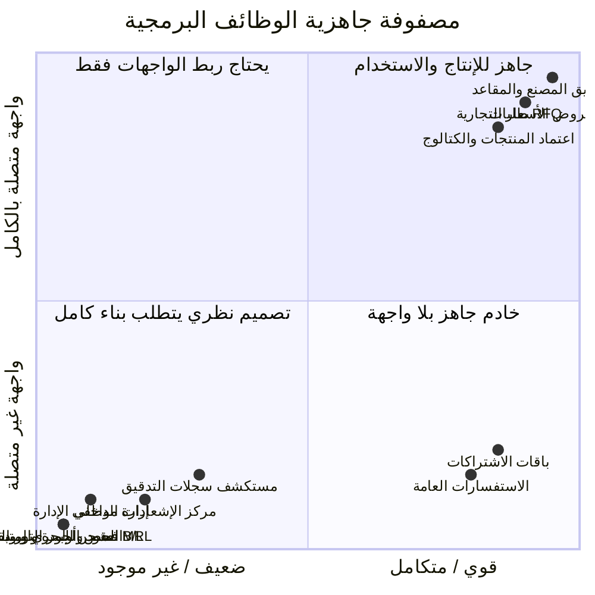
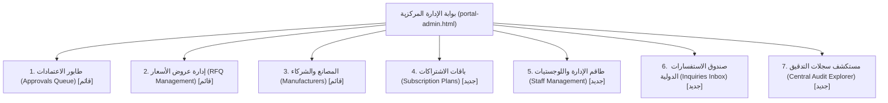
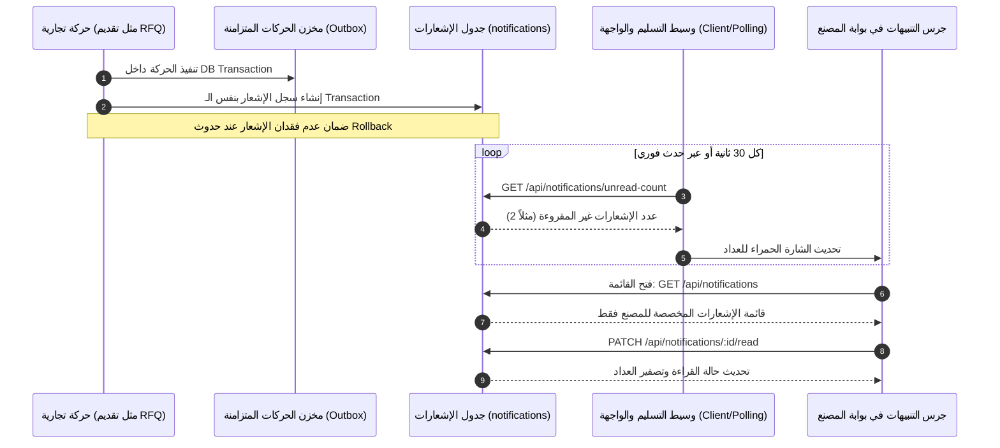
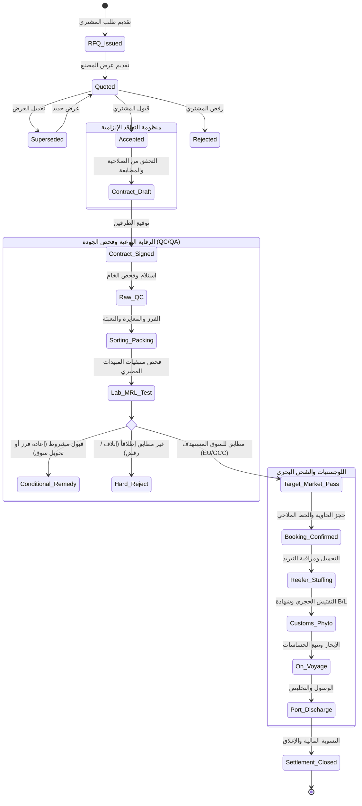

# ZARSEV — المخطط التنفيذي والتصميم المعماري للمرحلة 4.0
## ZARSEV Phase 4.0 Implementation Blueprint & Business Architecture Validation
### استكمال بوابات الإدارة والمصانع وتأسيس منظومة التعاقد والرقابة النوعية واللوجستيات البحرية

---

**معرف الوثيقة:** `BLUEPRINT-ZARSEV-2026-PHASE-4-0`  
**تاريخ الإصدار:** 8 نوفمبر 2026 (12:20:00+02:00)  
**حالة الحماية:** `STRICT READ-ONLY — PLANNING & DESIGN ONLY — NO DB/CODE WRITES`  
**الهدف المحوري:** توفير الدليل الهندسي الدقيق لبناء وتشغيل واجهات المرحلة 4.0 والتحقق المعماري الصارم من منظومة المراحل التجارية التالية (العقود، فحص الجودة ومتبقيات المبيدات MRLs، وسلاسل الشحن البحري بالحاويات المبردة).

---

## 1. الملخص التنفيذي وضوابط الحماية المطلقة

تمثل هذه الوثيقة **المخطط التنفيذي (Implementation Blueprint)** لنقل منصة **زارسيف الدولية (ZARSEV)** من مرحلة "حماية وتدقيق حسابات المصانع" إلى "منظومة تشغيل تجارية مكتملة الأركان". 

### ضوابط الحماية الإلزامية السارية أثناء إعداد وتنفيذ هذا المخطط:
1. **حظر الكتابة والتعديل:** تظل قواعد البيانات الحقيقية (`zarsev.db` على SQLite و `zarsev_dev` و `zarsev_test` على PostgreSQL المنفذ 5432) في حالة قراءة فقط تامة.
2. **صيانة بيانات العرض (Demo Data Safeguard):** يُحظر حظراً باتاً حذف أو تنظيف أو تعديل حسابات وبيانات:
   - منشأة `mfg_delta_iqf` ومستخدمها `usr_mfg_delta_iqf` (DEC-01).
   - منشأة `mfg_nile_fruits` ومستخدمها `usr_mfg_nile_fruits` (DEC-02).
   - الحساب التجريبي التاريخي المعفى `usr_legacy_test_01` (DEC-03).
   - كافة المنتجات المسجلة، وطلبات عروض الأسعار (RFQs)، وعروض الأسعار (Quotations) القائمة؛ حيث تمثل هذه البيانات ركيزة العرض المباشر أمام صاحب المصنع.
3. **تجميد الترحيلات الإنتاجية:** لا يتم تشغيل أو تطبيق أي ترحيلات (`Migration 006A` أو أي ترحيل جديد) على قواعد البيانات الحقيقية إلا بعد اعتماد المالك لجلسة العرض المباشر وتحديد نافذة صيانة رسمية.

---

## 2. التدقيق الجنائي للـ APIs القائمة عبر الوظائف السبع

تم إجراء تدقيق برمجي مباشر في شجرة الكود (`src/routes`, `src/services`, `test`) لتوثيق الوضع الفعلي لكل وظيفة:

---

### 2.1 إدارة موظفي النظام (Staff Management)
- **الحالة الراهنة (Current State):** **غير موجودة إطلاقاً (Non-Existent API & UI).**
- **الدليل من الكود:**
  - فحص ملفات المسارات `src/routes/authRoutes.js` و `src/routes/manufacturerRoutes.js` يؤكد عدم وجود أي مسار لإنشاء أو تعديل أو جلب موظفي الإدارة (`SUPER_ADMIN` أو `LOGISTICS_OFFICER`).
  - مسار `GET /api/auth/personas` في [`src/routes/authRoutes.js:338-360`](file:///M:/ZZZ/src/routes/authRoutes.js#L338-L360) مخصص فقط لأغراض التبديل أثناء التطوير المحلي (`is_active = true`).
- **المكونات الناقصة:** مسارات CRUD لموظفي النظام، وإلغاء تفعيل حسابات موظفي الإدارة، وشاشة مخصصة في `portal-admin.html`.
- **الواجهة المقترحة:** تبويب **"إدارة طاقم المنظومة المركزية"** في بوابة الإدارة.
- **الـ APIs المطلوبة:**
  - `GET /api/admin/staff` (استعراض موظفي الإدارة واللوجستيات).
  - `POST /api/admin/staff` (إنشاء موظف جديد وتحديد الدور: `SUPER_ADMIN` أو `LOGISTICS_OFFICER`).
  - `PATCH /api/admin/staff/:id/status` (تجميد أو إعادة تنشيط الموظف).
- **اعتمادية قاعدة البيانات:** تعتمد على جدول `users` القائم مع قيد عدم إسناد `manufacturer_id` لحسابات الإدارة.
- **الصلاحيات:** مقتصرة حصرياً على `SUPER_ADMIN`.
- **معايير القبول:** منع أي موظف من إلغاء تفعيل نفسه إذا كان المدير العام النشط الوحيد.

---

### 2.2 إدارة باقات واشتراكات المصانع (Subscription Plans)
- **الحالة الراهنة (Current State):** **الـ API يعمل ومختبر برمجياً بنسبة 100%، لكن الواجهة غائبة تماماً (Headless API).**
- **الدليل من الكود:**
  - المسار: `GET /api/subscriptions/plans` في [`src/routes/subscriptionRoutes.js:15-30`](file:///M:/ZZZ/src/routes/subscriptionRoutes.js#L15-L30) يعيد باقات الاشتراك من جدول `subscriptions`.
  - المسار: `PUT /api/subscriptions/plans/:id` في [`src/routes/subscriptionRoutes.js:88-125`](file:///M:/ZZZ/src/routes/subscriptionRoutes.js#L88-L125) محمي بـ `authMiddleware, requireRole(['SUPER_ADMIN'])` ويحدث حدود المنتجات (`product_limit`) وصيغ الملفات (`allowed_formats`) وسعة الدفعات.
  - الاختبار: مختبر آلياً برمز HTTP 200 في [`test/test_authorization.js:50-70`](file:///M:/ZZZ/test/test_authorization.js#L50-L70).
- **المكونات الناقصة:** شاشة في `portal-admin.html` لاستعراض وتعديل الباقات دون الحاجة لاستخدام أدوات برمجية مثل Postman أو curl.
- **الواجهة المقترحة:** تبويب **"باقات واشتراكات المنشآت"** في بوابة الإدارة لعرض بطاقات الباقات (Standard, Professional, Enterprise) مع محرر سعة فوري.
- **معايير القبول:** إمكانية تعديل حد المنتجات لباقة معينة والتأكد من انطباق الحد فوراً على عمليات الرفع القادمة عبر الوسيط `checkSubscriptionLimits()`.

---

### 2.3 الاستفسارات العامة ومراسلات الموقع (Contact Inquiries)
- **الحالة الراهنة (Current State):** **الـ API يعمل في الحفظ والاسترجاع، لكن الواجهة ناقصة ولا يوجد API لتحديث الحالة.**
- **الدليل من الكود:**
  - المسار: `POST /api/rfqs/inquiries` في [`src/routes/rfqRoutes.js:690-730`](file:///M:/ZZZ/src/routes/rfqRoutes.js#L690-L730) يستقبل استفسارات زوار الموقع العام من `zarsev_7/code.html` ويحفظها في جدول `contact_inquiries`.
  - المسار: `GET /api/rfqs/inquiries/all` في [`src/routes/rfqRoutes.js:734-755`](file:///M:/ZZZ/src/routes/rfqRoutes.js#L734-L755) محمي بـ `requireRole(['SUPER_ADMIN', 'LOGISTICS_OFFICER'])` ويعيد الرسائل مرتبة زمنياً.
  - الاختبار: مختبر بنجاح في [`test/rfq_e2e_verification.js:310-345`](file:///M:/ZZZ/test/rfq_e2e_verification.js#L310-L345).
- **المكونات الناقصة:**
  - لا توجد شاشة في `portal-admin.html` لعرض هذه الرسائل.
  - لا يوجد مسار `PATCH /api/rfqs/inquiries/:id/status` لتحديد ما إذا تمت متابعة الاستفسار أو إغلاقه (`PENDING`, `CONTACTED`, `RESOLVED`).
- **الواجهة المقترحة:** تبويب **"صندوق الرسائل والاستفسارات الدولية"** في بوابة الإدارة مع إمكانية الرد السريع عبر البريد أو الهاتف.

---

### 2.4 مستكشف سجلات التدقيق المركزي (Central Audit Logs)
- **الحالة الراهنة (Current State):** **سجلات التدقيق مشتتة داخلياً وتعمل في الخلفية، ولا يوجد API استعلام مركزي.**
- **الدليل من الكود:**
  - توجد جداول تدقيق مستقلة:
    - `rfq_audit_logs` (تسجل حركات الـ RFQ وتُسترجع مدمجة مع تفاصيل الطلب في `src/routes/rfqRoutes.js:550-565`).
    - `quotation_audit_logs` (تسجل حركات العروض وتُسترجع في `src/routes/quotationRoutes.js:315-330`).
    - `manufacturer_audit_logs` (تسجل حركات الفريق وتدار عبر `src/services/auditLogService.js` وتخضع لحماية تامة من الحذف والتعديل).
    - `import_logs` (تسجل حركات استيراد الكتالوج).
  - لا يوجد أي مسار مركزي مثل `GET /api/admin/audit-logs`.
- **المكونات الناقصة:** مسار موحد يجمع سجلات التدقيق أو يتيح الاستعلام عنها، وواجهة بحث وفلترة في بوابة الإدارة.
- **الـ APIs المطلوبة:**
  - `GET /api/admin/audit-logs?entity=rfq|quotation|manufacturer|import&date_from=...&date_to=...`
- **الصلاحيات:** مقتصرة حصرياً على `SUPER_ADMIN`.
- **معايير القبول:** إرجاع السجلات مع اسم الفاعل الحقيقي، ونوع الحركة، والبصمة الزمنية الدقيقة، وتفاصيل التغيير JSON.

---

### 2.5 منظومة إشعارات المصانع (Manufacturer Notifications)
- **الحالة الراهنة (Current State):** **خدمة خادم فقط للمراسلات عبر البريد (`notificationService.js`)، ومعدومة كلياً كإشعارات تفاعلية داخل الواجهة (No In-App Notification Center).**
- **الدليل من الكود:**
  - ملف [`src/services/notificationService.js:1-120`](file:///M:/ZZZ/src/services/notificationService.js#L1-L120) يحتوي على فئة `NotificationService` ترسل رسائل SMTP أو تسجل في الـ console في حالة عدم توفر مفاتيح البريد.
  - لا يوجد جدول `notifications` في أي ترحيل لقاعدة البيانات.
  - لا يوجد أي مسار في Express لجلب إشعارات المستخدم.
  - واجهات المنصة (`portal-manufacturer.html` و `portal-admin.html`) لا تملك أي مكون لعرض الإشعارات أو الأجراس التنبيهية.
- **المكونات الناقصة:** جدول الإشعارات في قاعدة البيانات، مسارات API لجلب الإشعارات وتحديد المقروء، ومكون واجهة تفاعلي في الشريط العلوي لكافة البوابات.

---

### 2.6 إدارة طاقم المصنع والمقاعد (Manufacturer Team & Seats)
- **الحالة الراهنة (Current State):** **مكتملة ومحققة ومختبرة بنسبة 100% في الخادم والواجهة (Fully Operational).**
- **الدليل من الكود:**
  - الخادم: مسارات [`src/routes/manufacturerRoutes.js:210-315`](file:///M:/ZZZ/src/routes/manufacturerRoutes.js#L210-L315) و [`src/services/teamService.js`](file:///M:/ZZZ/src/services/teamService.js) و [`src/services/invitationService.js`](file:///M:/ZZZ/src/services/invitationService.js).
  - الواجهة: متصلة بالكامل في [`public/views/portal-manufacturer.html:300-420, 1234-1480`](file:///M:/ZZZ/public/views/portal-manufacturer.html#L300-L420) عبر دالة `loadTeamAndSeats()`.
  - الاختبارات: مغطاة بالكامل بـ 28 اختباراً ناجحاً في [`test/test_manufacturer_lifecycle_full_suite.js`](file:///M:/ZZZ/test/test_manufacturer_lifecycle_full_suite.js).
- **المكونات الناقصة في Phase 4.0:** ربط حركات الفريق (إرسال دعوة، قبول دعوة، نقل ملكية) بنظام الإشعارات اللحظي الجديد.

---

### 2.7 إدارة وعرض المنتجات (Product Management)
- **الحالة الراهنة (Current State):** **مكتملة في مسارات الاستيراد والاعتماد والكتالوج العام، لكن ينقصها تبويب عرض منتجات المصنع المعتمدة داخل بوابته الخاصة.**
- **الدليل من الكود:**
  - استعراض الكتالوج العام: `GET /api/products` متصل في `zarsev_2/code.html` و `zarsev_4/code.html`.
  - طابور اعتماد الإدارة: `GET /api/approvals/queue` متصل في `portal-admin.html` و `approvals.html`.
  - تعديل المنتج: `PUT /api/products/:id` متوفر في [`src/routes/productRoutes.js:65-115`](file:///M:/ZZZ/src/routes/productRoutes.js#L65-L115) ومحمي بعزل المنشأة (`req.user.manufacturer_id === product.manufacturer_id`).
  - بوابة المصنع الحالية: تحتوي فقط على سجل الدفعات المستوردة (`/api/imports/history`) ولا تعرض شبكة المنتجات المنشورة الفردية للمصنع.
- **المكونات الناقصة:** تبويب **"كتالوج منتجاتنا المعتمدة"** داخل `portal-manufacturer.html` مع إمكانية تعديل الأسعار والمواصفات لكل منتج على حدة.

---

## 3. التصميم المعماري والتنفيذي لشاشات المرحلة 4.0

### 3.1 شاشات بوابة الإدارة (`portal-admin.html`)

سيتم تدعيم بوابة الإدارة الحالية بأربعة تبويبات تشغيلية رئيسية تعتمد على بنية تصميم ZARSEV السيادية (Maritime Sovereign Editorial):

#### المواصفات الفنية للتبويبات الجديدة:
1. **تبويب باقات الاشتراكات (Subscription Plans):**
   - **الواجهة:** بطاقات تفاعلية تعرض (اسم الباقة، عدد المقاعد القصوى، حد المنتجات المسموح بها، وصيغ الملفات المعتمدة).
   - **التفاعل:** زر "تعديل محددات الباقة" يفتح نافذة Modal لإدخال الأرقام وتحديثها عبر `PUT /api/subscriptions/plans/:id`.
2. **تبويب موظفي الإدارة (Staff Management):**
   - **الواجهة:** جدول يوضح: اسم الموظف، البريد الإلكتروني، الدور (`SUPER_ADMIN` أو `LOGISTICS_OFFICER`)، تاريخ الإنشاء، وحالة الحساب (نشط / مجمد).
   - **التفاعل:** زر "إضافة موظف إدارة جديد" وزر تبديل الحالة (تجميد / تنشيط) مع منع المدير من تجميد حسابه الشخصي.
3. **تبويب صندوق الاستفسارات (Contact Inquiries Inbox):**
   - **الواجهة:** جدول فرز زمني يعرض الاستفسارات القادمة من موقع التجارة العام مع بادج الحالة (`جديد`, `تم التواصل`, `مغلق`).
   - **التفاعل:** إمكانية النقر لقراءة الرسالة كاملة، وزر لتحديث الحالة وحفظ ملاحظات المتابعة.
4. **تبويب مستكشف سجلات التدقيق (Audit Explorer):**
   - **الواجهة:** محرك بحث زمني وفلاتر (نوع الكيان: RFQ / Quotation / Team / Import)، وجدول يعرض الفاعل، والحركة، وتفاصيل التغيير بتنسيق JSON مقروء.

---

### 3.2 شاشات بوابة المصنع (`portal-manufacturer.html`)

تدعيم بوابة المصنع بتبويبين تشغيليين حاسمين للمعاينة والعرض:
1. **تبويب كتالوج منتجات المنشأة (My Products):**
   - استعراض المنتجات المعتمدة التابعة للمصنع مباشرة (`GET /api/products?manufacturer_id=...`).
   - بطاقات منتجات تعرض صورة المنتج، وكود SKU، واسم الصنف بالعربية والإنجليزية، والحد الأدنى للطلب (MOQ)، ومواصفات التعبئة.
   - زر "تعديل المواصفات الفورية" يستدعي `PUT /api/products/:id`.
2. **مركز الإشعارات اللحظية (In-App Notification Center):**
   - زر جرس تنبيهي في الشريط العلوي (Header) يعرض عداداً رقمياً للإشعارات غير المقروءة.
   - قائمة منسدلة تعرض آخر 10 إشعارات مصنفة بأيقونات ملونة (أزرق: RFQ جديد، أخضر: قبول عرض سعر، أصفر: دعوة فريق، أحمر: تجميد حساب).

---

### 3.3 التصميم المعماري لمنظومة الإشعارات الداخلية (In-App Notifications Architecture)

لا يقتصر بناء منظومة الإشعارات على إنشاء جدول في قاعدة البيانات، بل يتطلب هندسة متكاملة تضمن عدم فقدان الإشعارات، ومنع التكرار، والعزل التام بين المنشآت:

#### جدول قواعد الأحداث والمستلمين والعزل:

| كود الحدث | الحدث التجاري المولد | المستلم المستهدف | قاعدة العزل الصارمة (Tenant Isolation) | محتوى الإشعار |
| :--- | :--- | :--- | :--- | :--- |
| `RFQ_RECEIVED` | تقديم مشتري لطلب عرض سعر لمنتج | مالك ومسؤول مبيعات المصنع المعني | `recipient_mfg_id = product.manufacturer_id` | "تم استلام طلب عرض سعر جديد برقم RFQ-2026-XXXX لمنتج (اسم المنتج)" |
| `QUOTE_ACCEPTED` | قبول المشتري لعرض السعر | طاقم المصنع (Owner, Sales, Export) | `recipient_mfg_id = quotation.manufacturer_id` | "تهانينا! قبل المشتري الدولي عرض السعر رقم (Reference) بمبلغ (Amount)" |
| `QUOTE_REJECTED` | رفض المشتري لعرض السعر | مسؤول مبيعات المصنع (Sales) | `recipient_mfg_id = quotation.manufacturer_id` | "تم رفض عرض السعر رقم (Reference). سبب الرفض: (Reason)" |
| `PRODUCT_APPROVED` | اعتماد الإدارة لمنتج مستورد | مالك ومسؤول إنتاج المصنع | `recipient_mfg_id = product.manufacturer_id` | "تمت الموافقة على نشر منتجك (اسم المنتج) في الكتالوج الدولي بنجاح" |
| `PRODUCT_REJECTED` | رفض الإدارة لمنتج | مسؤول الإنتاج بالمصنع | `recipient_mfg_id = product.manufacturer_id` | "تم رفض اعتماد المنتج (اسم المنتج). السبب: (Rejection Reason)" |
| `INVITE_ACCEPTED` | عضو فريق جديد يقبل الدعوة | مالك المنشأة (Owner) | `recipient_mfg_id = invite.manufacturer_id` | "انضم العضو (اسم العضو) إلى فريق المنشأة بدور (Sub-Role)" |
| `DOCUMENT_EXPIRED` | اقتراب انتهاء شهادة تصدير | مسؤول التصدير (Export) | `recipient_mfg_id = doc.manufacturer_id` | "تنبيه: شهادة التصدير (اسم المستند) تنتهي خلال 15 يوماً" |

#### آلية منع التكرار وفقدان الإشعارات (Deduplication & Reliability):
1. **قيد عدم التكرار (Idempotency Key):** توليد مفتاح بصمة فريد لكل إشعار:  
   `idempotency_key = SHA256(event_type + entity_id + recipient_user_id)`  
   ووضعه كقيد `UNIQUE` في جدول الإشعارات لمنع تكرار الإشعار في حالة تكرار إرسال الطلبات الشبكية.
2. **التسجيل المتزامن (Transaction Outbox):** إدراج الإشعار دائماً داخل نفس حركة قاعدة البيانات (`tx.execute`) الخاصة بالحدث التجاري، بحيث إذا فشلت حركة اعتماد المنتج أو تقديم العرض وفُعّل `ROLLBACK`، يُلغى الإشعار تلقائياً ولا يُرسل إشعار عن حدث لم يكتمل.
3. **آلية التحديث بالواجهة:**
   - **الخيار الأول (المعتمد في Phase 4.0):** استعلام خفيف كل 45 ثانية (`GET /api/notifications/unread-count`) لتحديث شارة الجرس دون إجهاد الخادم.
   - **الخيار المتقدم (المستقبلي):** بث أحداث خادم Server-Sent Events (SSE) عبر المسار `/api/notifications/stream`.

---

## 4. المراجعة الهندسية المعماريّة للمراحل التجارية التالية

تمت مراجعة التصاميم المقترحة للمراحل التجارية (5.0 و 6.0 و 7.0) في ضوء متطلبات التصدير الزراعي والبحري الواقعية، وجرى رصد وتصحيح التعديلات المعمارية الإلزامية التالية قبل بدء أي كود:

---

### 4.1 سلامة الربط التعاقدي ومنع التناقضات (Contract Integrity Invariants)
يجب أن تفرض طبقة الأعمال في الخادم وقواعد البيانات خمس قواعد ربط قطعية قبل إنشاء أي عقد:
1. **شرط القبول الصريح:** لا يجوز إطلاقاً إنشاء عقد إلا إذا كانت حالة عرض السعر المقابل هي `quotations.status = 'ACCEPTED'`.
2. **شرط سريان التاريخ (Validity Date):** رفض إنشاء عقد إذا تجاوز تاريخ الإنشاء تاريخ صلاحية العرض (`validity_date < CURRENT_DATE`).
3. **منع العروض الملغاة (Anti-Superseded):** رفض إنشاء عقد من أي عرض تم استبداله بعرض أحدث (`status = 'SUPERSEDED'`).
4. **تطابق الكيان المصنّع:** التحقق من أن المنشأة في العقد (`contracts.manufacturer_id`) مطابقة 100% للمنشأة المسند إليها الطلب (`rfqs.assigned_manufacturer_id`).
5. **علاقة أحادية منعاً لتكرار التعاقد (One Contract Per Accepted Quotation):** قيد فريد في قاعدة البيانات `CREATE UNIQUE INDEX uq_contract_quotation ON contracts(quotation_id);` يمنع إنشاء أكثر من عقد لنفس عرض السعر المقبول.

---

### 4.2 منظومة الرقابة وضمان الجودة المتقدمة (Comprehensive QC/QA Subsystem)

لا يمكن لمنصة تصدير زراعي أن تدعي الجاهزية دون تمييز دقيق بين **مراقبة الجودة الميدانية (QC)** و **ضمان الجودة الإجرائي (QA)**:

#### 1. مراقبة الجودة الإجرائية والتشغيلية (Operational QC Levels):
- **مستوى الاستلام المزرعي (Farm Gate / Receiving QC):** فحص نسبة السكريات (Brix)، والصلابة (Firmness)، وخلو الثمار من التشوهات الحشرية والعفن، ودرجة حرارة الخام لحظة وصول الشاحنة إلى محطة التعبئة.
- **مستوى الفرز والتحجيم (In-Process Sorting & Sizing QC):** معايرة أقطار الثمار (Calibers e.g. 48, 56, 64, 72 للبرتقال)، والتأكد من نسب الشمع الغذائي (Food-Grade Waxing)، ونظافة خطوط الغسيل والتعقيم، ودقة الوزن الصافي للكرتونة.
- **مستوى ما قبل الشحن (Pre-Shipment Inspection - PSI):** فحص سلامة رص البالتات (Palletization)، وربط الزوايا (Corner Protectors & Strapping)، وحرارة اللب داخل غرف التبريد المسبق (Pre-Cooling Pulp Temperature).

#### 2. الفحص المخبري وحدود متبقيات المبيدات (Laboratory MRLs & Target Market Resolution):
- **جوهر المطابقة الدولية:** معايير الحدود القصوى لمتبقيات المبيدات (MRLs) ليست موحدة دولياً، وتختلف جذرياً بين الأسواق:
  - **السوق الأوروبي (EU / EFSA):** يفرض قيوداً هي الأشد عالمياً، وغالباً ما يعتمد حد الكشف الأدنى الافتراضي (0.01 mg/kg) للمركبات غير المدرجة صراحة.
  - **سوق الخليج العربي (GCC / SFDA):** يخضع للائحة الخليجية GSO، والتي تختلف في الحدود المسموحة لبعض المركبات الفطرية وحفظ ما بعد الحصاد.
  - **السوق البريطاني (UK HSE):** انفصل عن التشريع الأوروبي وله جدول MRLs خاص به.
- **القاعدة البرمجية الملزمة:** عند رفع نتيجة الفحص المخبري، يجب على النظام مطابقة تركيزات المواد الفعالة المسجلة مع **السوق المستهدف المحدد في الـ RFQ والعقد**، وليس إطلاق نتيجة "ناجح" عامة.
- **حالات نتيجة الفحص الثلاث:**
  1. `PASSED` (مطابق تماماً للسوق المستهدف ومصرح بالشحن فوراً).
  2. `REJECTED` (تجاوز للحدود الآمنة يوجب حظر تصدير الدفعة وإتلافها أو إعادتها للمورد).
  3. `CONDITIONAL_ACCEPTANCE` (قبول مشروط: مثل إعادة فرز الدفعة لاستبعاد عيوب الحجم، أو تحويل الشحنة بموافقة الإدارة إلى سوق بديل مسموح تتطابق حدوده مع نتائج التحليل المخبري).

#### 3. سجل مراجعة واعتماد الفحص غير القابل للتلاعب (Tamper-Resistant QC Audit):
- تسجيل محضر الفحص مع: رقم اعتماد المختبر الدولي (ISO 17025)، واسم المهندس المفتش، وبصمة الوثيقة، مع منع حذف أو تعديل أي فحص مسجل إلا بإضافة محضر ملحق (Addendum) معتمد من المشرف.

---

### 4.3 منظومة الشحن واللوجستيات البحرية بالحاويات المبردة (Maritime Reefer Logistics)

#### 1. سجل أحداث مسار الشحنة (Shipment Event Ledger):
- جدول أحداث مستقل يسجل كل حدث زمني للشحنة:  
  `id, shipment_id, event_code, event_name, location_port, timestamp_actual, recorded_by_user_id, source`  
  (الأحداث: الحجز، دخول الميناء، الفحص الحجري، الشحن على الباخرة، الإبحار، وصول ميناء التفريغ، التخليص والتسليم).

#### 2. سجل مراقبة درجات حرارة الحاويات المبردة (Reefer Cold Chain Sensor Log):
- الحفاظ على سلامة الحاصلات الزراعية (مثل الحمضيات والفراولة المجمدة) يقتضي بقاء الحاوية المبردة ضمن نطاق حراري صارم (مثل +3.5°C للبرتقال، و -18°C للمجمدات).
- يجب أن يحتوي جدول قراءات التبريد على الحقول الإلزامية التالية:
  - `container_id` (معرف الحاوية).
  - `reading_time_utc` (البصمة الزمنية الدقيقة بتوقيت UTC).
  - `set_point_celsius` (الحرارة المطلوبة برمجياً).
  - `supply_air_temp` (حرارة هواء الضخ).
  - `return_air_temp` (حرارة هواء العودة).
  - `humidity_percentage` (نسبة الرطوبة داخل الحاوية).
  - `source` (مصدر القراءة: `IOT_TELEMETRY_CARRIER`, `PORT_REEFER_TECHNICIAN`, `MANUAL_DATALOGGER`).
  - `is_temperature_breach` (مؤشر إنذار فوري عند انحراف الحرارة لأكثر من ساعتين متواصلتين).

#### 3. إصدارات مستندات الشحن وحصانة الاعتماد:
- التمييز بين دورات المستند: `DRAFT` (مسودة قابلة للتعديل والتدقيق)، و `ISSUED_ORIGINAL` (نسخة معتمدة صادرة)، و `SURRENDERED_TELEX` (تنازل وتلكس ريليس).
- **الصلاحيات:** يرفع ضابط اللوجستيات مسودة بوليصة الشحن (Draft B/L)، ولا يعتمدها كـ Original إلا بعد موافقة إدارة العمليات.

#### 4. التمييز الحاسم بين "بصمة الملف" و"إثبات أصالته السيادية":
> [!IMPORTANT]
> **قاعدة أمنية وتجارية قطعية:**
> - **بصمة الملف (Cryptographic SHA-256 Hash):** تثبت فقط أن ملف الـ PDF المحفوظ على الخادم **لم يتغير أو يُعدل محلياً** منذ لحظة رفعه.
> - **إثبات الأصالة (Authenticity Verification):** البصمة وحدها لا تثبت أن الوثيقة صحيحة قانونياً! يتطلب إثبات الأصالة ربط الوثيقة بمرجع سيادي خارجي:
>   1. رابط التحقق الإلكتروني للغرفة التجارية المصرية لشهادة المنشأ (Chamber of Commerce e-Certificate Verification).
>   2. الباركود والرقم التسلسلي لمنظومة الحجر الزراعي لوزارة الزراعة (Phytosanitary E-Phyto QR code).
>   3. كود التتبع والتحقق الملاحي المباشر لبوليصة الشحن من موقع الخط الملاحي (Carrier B/L Tracking API / Container Prefix Verification).

---

## 5. قواعد حماية البيانات وبيئة العرض (Showcase Data Protection)

لضمان سلامة جلسة العرض الحي أمام صاحب المصنع دون أدنى مخاطرة:
1. تظل منشأة **Delta IQF** بكافة منتجاتها وسجلاتها، ومنشأة **Nile Fruits**، والمستخدم **`usr_legacy_test_01`** محمية داخل قواعد البيانات دون أي مساس أو حذف.
2. تُصمم شاشات المرحلة 4.0 لتتعرف تلقائياً على هذه الحسابات وتصنفها في الواجهة بشارة أنيقة: `بيانات منشأة تجريبية معتمدة للعرض (Certified Showcase Tenant)`.
3. أي اختبارات تكامل جديدة تُنفذ حصرياً داخل العنقود المؤقت (المنفذ 5433) وتُباد البيانات المؤقتة فور انتهاء الاختبار.

---

## 6. خطة التطوير والمكونات التنفيذية للمرحلة 4.0

### جدول التوصيف المعماري لعناصر المرحلة 4.0:

| الوظيفة | المكون المطلوب | مسار الـ API | الصلاحيات (RBAC) | اعتمادية الجداول | معايير القبول والاختبار |
| :--- | :--- | :--- | :--- | :--- | :--- |
| **إدارة باقات الاشتراكات** | شاشة محرر الباقات في `portal-admin.html` | `GET /api/subscriptions/plans` `PUT /api/subscriptions/plans/:id` | `SUPER_ADMIN` فقط | جدول `subscriptions` (قائم) | تعديل حد المنتجات لباقة ينعكس فوراً في الرفع |
| **إدارة طاقم النظام** | شاشة موظفي الإدارة في `portal-admin.html` | `GET /api/admin/staff` `POST /api/admin/staff` `PATCH /api/admin/staff/:id/status` | `SUPER_ADMIN` فقط | جدول `users` (قائم) | منع تجميد النفس، ومنع إنشاء موظف بدون دور نظامي |
| **صندوق الاستفسارات** | شاشة مراسلات الموقع في `portal-admin.html` | `GET /api/rfqs/inquiries/all` `PATCH /api/rfqs/inquiries/:id/status` | `SUPER_ADMIN` `LOGISTICS_OFFICER` | جدول `contact_inquiries` (قائم) | إمكانية تحديث حالة الاستفسار إلى `RESOLVED` |
| **مستكشف سجلات التدقيق** | واجهة البحث في التدقيق بـ `portal-admin.html` | `GET /api/admin/audit-logs` | `SUPER_ADMIN` فقط | جداول الـ audit القائمة | البحث الزمني والفلترة بالمنشأة ونوع الكيان |
| **إشعارات المصنع** | جرس تنبيهي وقائمة منسدلة بـ `portal-manufacturer.html` | `GET /api/notifications` `GET /api/notifications/unread-count` `PATCH /api/notifications/:id/read` | أي مستخدم مصنع مسجل | جدول `notifications` (جديد) | عزل تام للمنشأة، ومنع تكرار الإشعار عبر Idempotency |
| **منتجات المصنع المعتمدة** | تبويب "منتجاتنا" في `portal-manufacturer.html` | `GET /api/products?manufacturer_id=...` `PUT /api/products/:id` | `OWNER` `PRODUCTION` | جدول `products` (قائم) | عرض المنتجات المعتمدة وتعديل أسعارها ومواصفاتها |

---

## 7. شروط التوقف والتوصية التنفيذية

1. **الالتزام بوضع التحليل فقط:** تم الانتهاء من إعداد المخطط التنفيذي وتوثيقه بدقة جنائية دون إجراء أي تعديل على كود المشروع أو قواعد البيانات.
2. **الخطوة التالية الموصى بها للمالك:**
   - مراجعة واعتماد هذا المخطط (`ZARSEV_PHASE_4_0_IMPLEMENTATION_BLUEPRINT.md`).
   - تحديد نقطة الانطلاق: إما البدء ببرمجة واجهات المرحلة 4.0 على الفرع المستقل `feature/manufacturer-lifecycle-remediation`، أو جدولة جلسة العرض الحي أولاً أمام صاحب المصنع على المنظومة الحالية المستقرة.

---
**نهاية وثيقة التصميم المعماري للمرحلة 4.0.**
