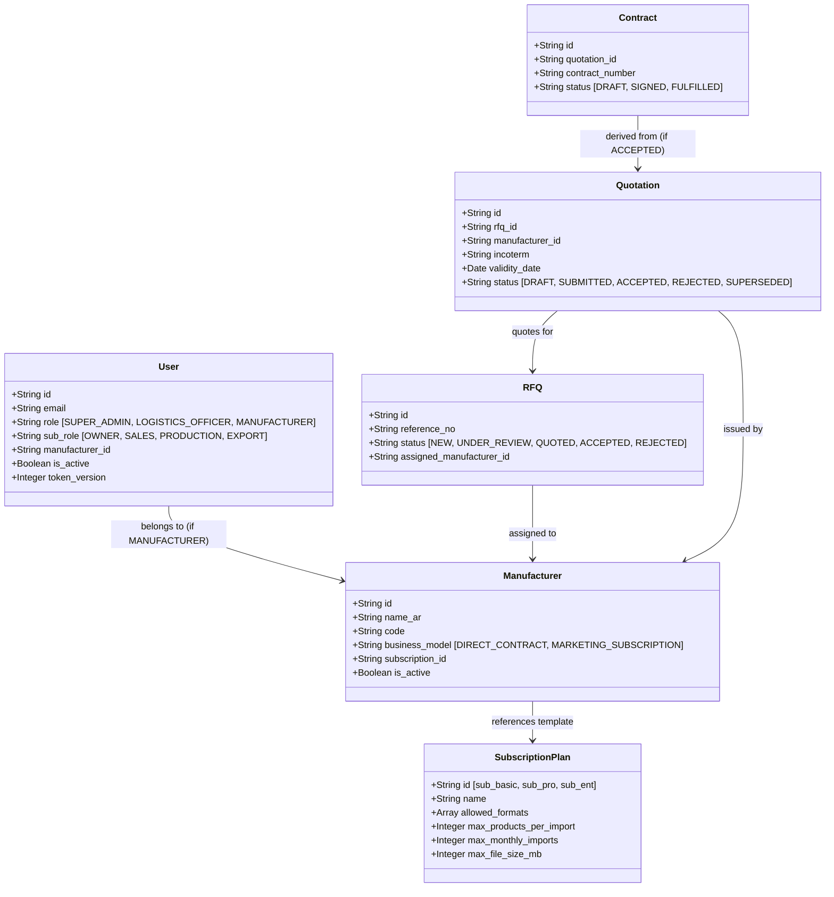
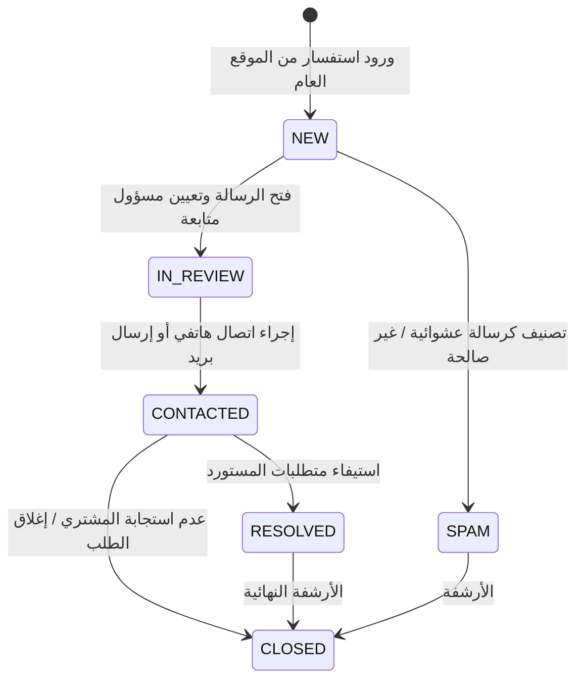
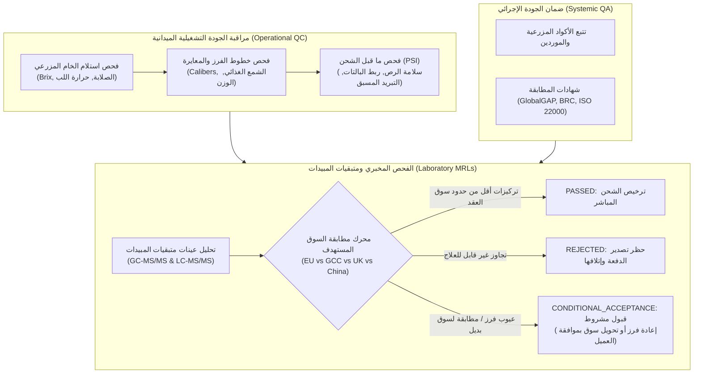

# ZARSEV — المخطط التنفيذي والتصميم المعماري للمرحلة 4.0 (الإصدار الثاني المراجع)
## ZARSEV Phase 4.0 Implementation Blueprint & Business Architecture Validation — Version 2.0
### النسخة المصححة والموسعة لاستكمال بوابات المنظومة، والحوكمة الأمنية، ومصفوفة الجودة واللوجستيات البحرية

---

**معرف الوثيقة:** `BLUEPRINT-ZARSEV-2026-PHASE-4-0-V2`  
**تاريخ الإصدار:** 8 نوفمبر 2026 (12:25:00+02:00)  
**الحالة:** `REVISED ARCHITECTURAL SPECIFICATION — STRICT READ-ONLY — DESIGN ONLY`  
**المرجعية:** ملاحظات المراجعة النقدية على الإصدار V1 ومخرجات خارطة الطريق التجارية.  
**وضع التنفيذ:** `NO DATABASE WRITES — NO CODE COMMITS — DEMO DATA FULLY PROTECTED`

---

## 1. سجل التعديلات والتصحيحات الجوهرية (Version 2.0 Change Ledger)

يوضح الجدول التالي كافة التعديلات والتصحيحات التي أُدخلت على هذه النسخة استجابةً للمراجعة الهندسية الدقيقة:

| البند | موضع التعديل في V1 | المعالجة والتصحيح في V2 | السبب المعماري والتجاري |
| :--- | :--- | :--- | :--- |
| **A. إدارة موظفي الإدارة** | إنشاء مباشر بكلمة مرور | استبدالها بـ **دورة دعوة وتفعيل مشفرة وآمنة (Invitation & Activation Token Flow)** مع تحديد صلاحيات `SUPER_ADMIN` مقابل `LOGISTICS_OFFICER` بدقة، وحظر تجميد آخر مدير عام نشط. | منع وجود كلمات مرور افتراضية أو مكشوفة في قواعد البيانات وضمان استمرارية الإدارة المركزية. |
| **B. باقات الاشتراكات** | غموض مفهوم الجدول | فحص نموذج البيانات الفعلي وتوضيح أن جدول `subscriptions` يمثل **معيار خطط الاشتراك (Plan Templates)** وليس اشتراك المصنع، مع تحديد قواعد حماية المصانع القائمة عند تعديل أي باقة. | منع تعديل باقة بطريقة تكسر أو تؤدي لتجاوز حدود منتجات المنشآت المشتركة مسبقاً. |
| **C. الاستفسارات العامة** | حالة ثنائية بسيطة | توحيد حالات الاستفسارات (6 حالات معتمدة)، وتحديد مصفوفة الانتقالات المسموحة، وإضافة **سجل متابعة ملزم (Follow-up Trail)** يمنع اعتبار الاستفسار منجزاً دون إثبات تواصل حقيقي. | منع الإغلاق العشوائي للاستفسارات وضمان التوثيق الجنائي للمراسلات التجارية الدولية. |
| **D. مستكشف التدقيق المركزي** | استعلامات متباينة | توحيد شكل نتائج سجلات التدقيق في مصفوفة موحدة، مع تطبيق **تطهير إلزامي للبيانات الحساسة (Data Masking)** لحجب كلمات المرور والتوكنات، وتحديد صلاحيات الاطلاع. | منع تسريب أسرار الجلسات أو البيانات الحساسة عبر واجهات الإدارة المركزية. |
| **E. منظومة الإشعارات** | جدول منفصل بدون outbox | تصميم **نمط Outbox متزامن حقيقي** ينشأ داخل نفس المعاملة البنكية (`tx.execute`) للحركة التجارية، مع مفتاح فريد لمنع التكرار (Idempotency)، وعزل المستلمين، وحذف حدث انتهاء المستندات مؤقتاً. | ضمان عدم فقدان الإشعارات، ومنع إرسال إشعارات لحركات تجارية فشلت أو تم عمل Rollback لها. |
| **F. منتجات المصنع المعتمدة** | استعلام عبر معامل URL | فرض **استخراج هوية المصنع حصرياً من توكن المصادقة المشفر في الخادم** لكل من GET و PUT، مع قفل صلاحية النشر `PUBLISHED` للإدارة فقط. | منع ثغرات انتحال المنشآت (Cross-Tenant Manipulation) ومنع نشر منتجات دون موافقة الإدارة. |
| **G. الرقابة النوعية و MRL** | حدود عامة ثابتة ونصوص تسويقية | بناء مصفوفة متكاملة تفصل بين **QC التشغيلي الميداني** و **QA الإجرائي**، وربط نتائج الفحص المخبري بـ **السوق المستهدف المحدد في العقد (EU, GCC, UK, etc.)**، مع توثيق حالات القبول المشروط وسجل الملاحق. | الفحص الزراعي يختلف كلياً باختلاف السوق؛ فالمسموح في الخليج قد يكون ممنوعاً في أوروبا. |
| **H. حوكمة العقود والشحن** | تكامل افتراضي | وضع **شروط ربط تجارية قطعية (Contract Invariants)** تمنع إنشاء عقود من عروض منتهية أو ملغاة، مع إلزامية اجتياز الجودة قبل الشحن، وتوثيق سجل درجات حرارة الحاويات. | منع التنازعات القانونية والتجارية وضمان سلامة سلاسل الإمداد البحرية المبردة. |

---

## 2. التدقيق الجنائي المحدث للـ APIs القائمة



---

### 2.1 إدارة موظفي الإدارة (Staff Management)
- **Current State:** **غير موجود إطلاقاً (Non-Existent).**
- **Evidence:** مراجعة [`src/routes/authRoutes.js`](file:///M:/ZZZ/src/routes/authRoutes.js) و [`src/routes/manufacturerRoutes.js`](file:///M:/ZZZ/src/routes/manufacturerRoutes.js) تؤكد خلو المشروع من أي مسار لإنشاء أو استعراض موظفي النظام.
- **Missing Components:** مسارات CRUD للإدارة، نموذج دعوة وتفعيل، وسجل تدقيق الحسابات الإدارية.
- **Proposed Architecture & Activation Lifecycle:**
  1. **الإنشاء الآمن (Admin Invitation):** يقوم `SUPER_ADMIN` بإدخال البريد الإلكتروني والاسم والدور (`SUPER_ADMIN` أو `LOGISTICS_OFFICER`).
  2. **التوكن المشفر:** يقوم الخادم بتوليد توكن تنشيط عشوائي مشفر بحجم 32 بايت، ويُحفظ تجزئته `SHA-256` في جدول `staff_invitations` مع وقت انتهاء (48 ساعة). **لا يتم حفظ أو تعيين أي كلمة مرور افتراضية.**
  3. **التفعيل الذاتي:** يتلقى الموظف رابط التنشيط لتعيين كلمة مروره الشخصية لأول مرة مستوفية لمعايير التعقيد وتجزئة PBKDF2 (210,000 دورة).
  4. **حماية آخر مدير نشط (Last Active Super Admin Guard):** قيد فحص برمجي يمنع تجميد أو حذف أو تغيير دور أي مستخدم `SUPER_ADMIN` إذا كان عدد المدراء النشطين في المنظومة = 1 (`COUNT <= 1`).
- **مصفوفة الصلاحيات بين الرتب الإدارية:**

| الصلاحية / العملية | المدير العام (SUPER_ADMIN) | ضابط اللوجستيات (LOGISTICS_OFFICER) |
| :--- | :---: | :---: |
| إنشاء وتجميد موظفي الإدارة واللوجستيات | مسموح حصرياً | **ممنوع تماماً (403 Forbidden)** |
| تعديل محددات وباقات الاشتراكات | مسموح حصرياً | **ممنوع تماماً (403 Forbidden)** |
| الاطلاع على مستكشف سجلات التدقيق المركزي | مسموح حصرياً | **ممنوع تماماً (403 Forbidden)** |
| فحص واعتماد/رفض المنتجات والكتالوج | مسموح | مسموح |
| متابعة وتحديث حالات طلبات الأسعار (RFQs) | مسموح | مسموح |
| إدارة الحجوزات البحرية والحاويات وبوالص الشحن B/L | مسموح | مسموح (مسؤولية رئيسية) |
| مراجعة واعتماد محاضر فحص الجودة ومتبقيات المبيدات | مسموح | مسموح |

---

### 2.2 نموذج باقات واشتراكات المصانع (Subscription Plans Disambiguation)
- **Current State:** **خادم مكتمل ومختبر 100%، والواجهة غير متصلة (Headless API).**
- **Evidence:** المسار [`src/routes/subscriptionRoutes.js:88-125`](file:///M:/ZZZ/src/routes/subscriptionRoutes.js#L88-L125) يعمل ومختبر برمز 200 في [`test/test_authorization.js:50-70`](file:///M:/ZZZ/test/test_authorization.js#L50-L70).
- **التوصيف الدقيق لنموذج البيانات الفعلي:**
  - جدول `subscriptions` في [`src/db/schema.sql:17-27`](file:///M:/ZZZ/src/db/schema.sql#L17-L27) يمثل **خطط وقوالب الباقات المعتمدة (Subscription Plan Templates)** (مثل: باقة التعاقد المباشر، باقة التسويق القياسية، باقة الشركات الكبرى).
  - جدول `manufacturers` يرتبط بالباقة عبر المفتاح الأجنبي `subscription_id REFERENCES subscriptions(id)`.
- **أثر تعديل الخطة على المصانع المشتركة وقواعد الحماية:**
  1. **حماية البيانات التاريخية:** إذا قامت الإدارة بتخفيض حد المنتجات لباقة معينة من 100 إلى 50 منتجاً، **يُحظر كلياً حذف أو إخفاء أي منتجات منشورة مسبقاً للمصانع المشتركة بهذه الباقة**.
  2. **تطبيق الحد على العمليات المستقبلية فقط:** ينحصر أثر التعديل على منع عمليات الرفع الجديدة (`POST /api/imports/upload`) عبر الوسيط `checkSubscriptionLimits()` إذا كان الرصيد الحالي للمصنع يتجاوز الحد الجديد.
  3. **حظر التعديلات الكاسرة (Breaking Changes Guard):** يُمنع حذف أي صيغة ملفات مسموحة (`allowed_formats`) إذا كانت هناك عمليات استيراد قيد المعالجة تستخدم تلك الصيغة في نفس اللحظة.

---

### 2.3 الاستفسارات العامة ومراسلات الموقع (Contact Inquiries)
- **Current State:** **الحفظ والاسترجاع يعمل برمجياً، والواجهة ناقصة ومسار تحديث الحالة غير موجود.**
- **Evidence:** [`src/routes/rfqRoutes.js:690-755`](file:///M:/ZZZ/src/routes/rfqRoutes.js#L690-L755) ومختبر بـ [`test/rfq_e2e_verification.js:310-345`](file:///M:/ZZZ/test/rfq_e2e_verification.js#L310-L345).
- **توحيد الحالات ودورة الحياة المعتمدة:**
  - الحالات المسموحة: `NEW` ➔ `IN_REVIEW` ➔ `CONTACTED` ➔ `RESOLVED` (مع حالتي `SPAM` و `CLOSED`).
- **مصفوفة الانتقالات المسموحة وسجل المتابعة:**



- **قاعدة منع الإغلاق الصوري (Proof-of-Contact Rule):**
  - لا يجوز تحويل الحالة إلى `CONTACTED` أو `RESOLVED` إلا عبر إرفاق محضر متابعة إلزامي يتضمن: نوع وسيلة التواصل (بريد رسمي / اتصال)، وتاريخ ووقت التواصل، وهوية الموظف القائم بالاتصال، وملخص ما دار مع المستورد الدولي.

---

### 2.4 مستكشف سجلات التدقيق المركزي (Central Audit Explorer)
- **Current State:** **السجلات متفرقة ومحمية في الخلفية، ولا توجد واجهة استعلام مركزية.**
- **Evidence:** جداول `rfq_audit_logs`, `quotation_audit_logs`, `manufacturer_audit_logs`, `import_logs`.
- **توحيد مخرجات الاستعلام وتطهير البيانات الحساسة (Data Masking Protocol):**
  - عند قيام الإدارة بالبحث في السجلات عبر `GET /api/admin/audit-logs`، يتم توحيد الاستجابة بالهيكل القياسي التالي:
    ```json
    {
      "event_id": "aud_mfg_847192",
      "subsystem": "MANUFACTURER_TEAM",
      "entity_id": "mfg_delta_iqf",
      "actor_id": "usr_mfg_delta_iqf",
      "actor_name": "سامي البستاني",
      "actor_role": "MANUFACTURER (OWNER)",
      "action": "INVITE_MEMBER",
      "status_transition": "PENDING",
      "summary": "إصدار دعوة لعضو جديد (sales@delta.com) بدور SALES",
      "ip_address": "197.35.120.44",
      "timestamp": "2026-11-08T10:15:30Z",
      "details": {
        "email": "sales@delta.com",
        "sub_role": "SALES",
        "token": "[REDACTED_SECURITY_SECRET]",
        "password": "[REDACTED_SECURITY_SECRET]"
      }
    }
    ```
  - **الحماية الصارمة:** يمرر الخادم كافة حقول الـ `details` عبر دالة تطهير تنزع أو تشفر أي مفاتيح تحتوي على `password`, `hash`, `token`, `secret`, `jwt` لمنع أي تسريب أمني عبر شاشة التدقيق.

---

### 2.5 منظومة الإشعارات الداخلية (In-App Notifications Subsystem)
- **Current State:** **خدمة بريد عبر SMTP فقط، ولا توجد إشعارات داخل الواجهة.**
- **Evidence:** [`src/services/notificationService.js`](file:///M:/ZZZ/src/services/notificationService.js).
- **التصميم المعماري لنمط Outbox المتزامن:**
  - يتم إنشاء سجل الإشعار في جدول `notifications` داخل **نفس معاملة قاعدة البيانات (Same Transaction)** الخاصة بالحدث التجاري:
    ```javascript
    await dbClient.transaction(async (tx) => {
        // 1. تنفيذ الحركة التجارية الأصلية (مثل قبول عرض السعر)
        await tx.execute("UPDATE quotations SET status = 'ACCEPTED' WHERE id = ?", [quoteId]);
        await tx.execute("UPDATE rfqs SET status = 'ACCEPTED' WHERE id = ?", [rfqId]);
        
        // 2. توليد الإشعار التلقائي المتزامن في نفس المعاملة
        const notifId = 'notif_' + crypto.randomBytes(8).toString('hex');
        const idempotencyKey = crypto.createHash('sha256')
            .update(`QUOTE_ACCEPTED:${quoteId}:${mfgOwnerUserId}`)
            .digest('hex');
            
        await tx.execute(`
            INSERT INTO notifications (
                id, recipient_user_id, recipient_manufacturer_id, recipient_role,
                event_type, entity_type, entity_id, title_ar, title_en, body_ar, body_en,
                link_url, idempotency_key, is_read, created_at
            ) VALUES (?, ?, ?, 'MANUFACTURER', 'QUOTE_ACCEPTED', 'QUOTATION', ?, ?, ?, ?, ?, ?, ?, false, CURRENT_TIMESTAMP)
        `, [notifId, mfgOwnerUserId, mfgId, quoteId, titleAr, titleEn, bodyAr, bodyEn, linkUrl, idempotencyKey]);
    });
    ```
  - **ضمان Rollback:** إذا فشل تحديث حالة العرض لأي سبب وتراجع الـ Transaction، يتراجع إدراج الإشعار تلقائياً بنسبة 100% ولا يُرسل إشعار عن عملية لم تتم.
  - **تأجيل حدث انتهاء المستندات:** تم استبعاد حدث `DOCUMENT_EXPIRED` من المرحلة 4.0 استجابةً للمراجعة، وتأجيله لحين اكتمال دورة المستندات الرسمية وتواريخ صلاحيتها في المراحل اللاحقة.

---

### 2.6 منتجات المصنع المعتمدة في بوابة المصنع (My Products Management)
- **Current State:** **الخادم جاهز، وبوابة المصنع تفتقر لتبويب عرض منتجاتها المنشورة.**
- **Evidence:** [`src/routes/productRoutes.js:65-115`](file:///M:/ZZZ/src/routes/productRoutes.js#L65-L115).
- **قواعد الأمان والعزل الصارم (Server-Side Tenant Scoping):**
  1. **حظر الثقة بمعاملات المتصفح:** يُمنع تماماً الاعتماد على أي `manufacturer_id` ممرر في الـ Query Params أو الـ Request Body.
  2. **الاستخراج الإلزامي من التوكن:**
     ```javascript
     const mfgId = req.user.manufacturer_id;
     if (!mfgId && req.user.role === 'MANUFACTURER') {
         return res.status(403).json({ code: 'MANUFACTURER_UNLINKED', error: 'حساب غير مربوط بمنشأة' });
     }
     ```
  3. **عزل استعلام القراءة والتعديل:**
     - القراءة: `SELECT * FROM products WHERE manufacturer_id = ? AND status = 'PUBLISHED'` مستخدماً `mfgId` المستخرج من الجلسة حصرياً.
     - التعديل: `UPDATE products SET ... WHERE id = ? AND manufacturer_id = ?`.
  4. **صلاحيات تعديل الأسعار والمواصفات:** مقتصرة على دور `OWNER` ودور `PRODUCTION` (ودور `SALES` بالنسبة لأسعار التصدير الإرشادية).
  5. **حظر النشر الذاتي (Anti-Self-Publishing Guard):** أي تعديل على كود الصنف أو التصنيف أو المكونات يعيد المنتج إلى طابور مراجعة الإدارة (`status = 'PENDING_APPROVAL'`)، ويُحظر على المصنع تحويل المنتج ذاتياً إلى `PUBLISHED`.

---

## 3. مصفوفة الرقابة وضمان الجودة المتقدمة (QC/QA and Multi-Market MRL Architecture)



### 3.1 الهيكل التنظيمي للمطابقة المخبرية ومتبقيات المبيدات (MRL Resolution Engine)
- **رفض الحدود العامة الثابتة:** تم إلغاء أي مفهوم لحد عام ثابت (مثل 0.01 mg/kg لكل المواد)؛ حيث تخضع المواد الفعالة لمحددات دقيقة بحسب كل سوق:
  - **السوق الأوروبي (European Commission - Regulation EC 396/2005):** يعتمد قاعدة بيانات EFSA وقائمة المواد المحظورة وحدود الكشف القصوى.
  - **سوق مجلس التعاون الخليجي (GCC Standardization Organization - GSO 382/383):** يتوافق مع هيئة الغذاء والدواء السعودية (SFDA) وحدود الأمان الإقليمية.
  - **المملكة المتحدة (UK Health and Safety Executive - HSE GB MRLs):** يعتمد السجل البريطاني المستقل بعد البريكست.
- **ربط النتيجة بدفعة الإنتاج والعقد والسوق:**
  يتضمن كل سجل فحص مخبري في قاعدة البيانات البيانات الإلزامية:
  `test_id, contract_id, lot_number, product_id, manufacturer_id, destination_market_code, lab_accreditation_number, chemical_compound_name, detected_level_ppm, max_allowed_limit_ppm, compliance_decision`.

---

## 4. حوكمة العقود والشحن البحري بالحاويات المبردة (Contract & Reefer Logistics Integrity)

### 4.1 شروط التحقق والنزاهة التعاقدية (Contract Validation Invariants)
1. **الارتباط الحصري بعرض مقبول وصالح:**
   ```sql
   -- التحقق عند إنشاء العقد
   SELECT q.id, q.status, q.validity_date, q.manufacturer_id, r.assigned_manufacturer_id
   FROM quotations q
   JOIN rfqs r ON q.rfq_id = r.id
   WHERE q.id = $quotation_id;
   ```
   - يجب أن تكون `q.status = 'ACCEPTED'`.
   - يجب أن يكون `q.validity_date >= CURRENT_DATE`.
   - يجب أن يتطابق `q.manufacturer_id == r.assigned_manufacturer_id`.
   - يُمنع إنشاء عقد إذا كان العرض يحمل حالة `SUPERSEDED` أو `EXPIRED`.
2. **منع تكرار العقود:** قيد فريد يمنع إصدار أكثر من عقد لنفس عرض السعر:
   `CREATE UNIQUE INDEX uq_contract_quotation_id ON contracts(quotation_id);`

### 4.2 حوكمة الشحن وسلامة سلاسل التبريد (Cold Chain Integrity):
1. **شرط بوابة الجودة قبل الشحن (QC Clearance Shipping Gate):**
   - يُحظر برمجياً انتقال حالة الشحنة إلى `STUFFING_APPROVED` أو إصدار إذن دخول الميناء ما لم تكن هناك شهادة فحص جودة معتمدة بحالة `PASSED` أو `CONDITIONAL_RELEASE` لنفس دفعة العقد.
2. **سجل حساسات الحاويات المبردة (Reefer Temperature Sensor Ledger):**
   - جدول مستقل `container_temperature_logs` يحفظ:
     - `container_id`: معرف الحاوية الفريد (مثل `MSCU-7482910`).
     - `reading_timestamp_utc`: التوقيت الموحد للقراءة.
     - `sensor_source`: مصدر القراءة الفعلي (`CARRIER_IOT_TELEMETRY`, `PORT_REEFER_TECHNICIAN`, `ONBOARD_DATA_LOGGER`).
     - `set_point`: درجة الحرارة المستهدفة (مثلاً `+3.5°C`).
     - `supply_temp` و `return_temp`: درجات حرارة هواء الضخ والعودة.
     - `is_deviation`: مؤشر آلي يسجل أي انحراف حراري يتجاوز `±1.5°C` لأكثر من 60 دقيقة متصلة.
3. **التمييز بين بصمة الملف والأصالة السيادية:**
   - **بصمة SHA-256:** تضمن سلامة الملف المحلي على الخادم من التعديل أو العبث الداخلي.
   - **إثبات الأصالة السيادية:** يتم عبر ربط الوثيقة بباركود التحقق الرقمي للحجر الزراعي المصري (E-Phyto QR)، وروابط المصادقة الإلكترونية للغرف التجارية، وأرقام تتبع الخطوط الملاحية العالمية المباشرة.

---

## 5. مصفوفة معايير القبول والاختبارات الآلية (Acceptance Criteria & Test Matrix)

تحدد هذه المصفوفة متطلبات الاختبار الإلزامية لاعتماد إغلاق كل وظيفة في المرحلة 4.0:

| الوظيفة | الاختبار الإيجابي (Positive Test) | الاختبار السلبي (Negative Test) | اختبار الصلاحيات (RBAC Test) | اختبار العزل (Cross-Tenant) | اختبار التراجع (Rollback Test) | إثبات الإغلاق والاعتماد |
| :--- | :--- | :--- | :--- | :--- | :--- | :--- |
| **إدارة موظفي الإدارة** | إنشاء موظف بدعوة مشفرة وتفعيل ناجح | رفض إنشاء موظف ببريد مسجل مسبقاً | منع `LOGISTICS_OFFICER` من إنشاء موظفين (403) | N/A (وظيفة مركزية) | تراجع الإنشاء عند فشل تسجيل سجل التدقيق | كود خروج 0 لاختبار HTTP وسجل تفعيل مكتمل |
| **باقات الاشتراكات** | تحديث سعة المقاعد بنجاح عبر `PUT` | رفض قيم سالبة للمقاعد أو الملفات | منع أي دور غير `SUPER_ADMIN` من التعديل (403) | N/A (وظيفة مركزية) | بقاء القيم الأصلية عند فشل المعاملة | استجابة HTTP 200 وانعكاس فوري على واجهة الإدارة |
| **الاستفسارات العامة** | حفظ ومتابعة استفسار وتحديث حالته | رفض رسائل بلا بريد أو محتوى صالح | منع المصانع من الاطلاع على استفسارات الموقع | عزل تام عن بوابات المصانع | تراجع حفظ المحضر عند فشل المعاملة | مطابقة تامة مع جدول `contact_inquiries` |
| **مستكشف التدقيق** | استرجاع السجلات مع فلاتر زمنية دقيقة | رفض استعلام بنطاق تواريخ غير منطقي | مقتصر على `SUPER_ADMIN` حصرياً | منع استعراض سجلات منشأة أخرى | N/A (قراءة فقط) | إثبات حجب كلمات المرور وتشفير الـ tokens |
| **منظومة الإشعارات** | استلام إشعار متزامن عند قبول عرض السعر | منع تكرار الإشعار لنفس الحدث (Idempotency) | منع مستخدم مصنع من قراءة إشعارات غيره | منع المصنع B من جلب إشعارات المصنع A | إثبات عدم إنشاء إشعار عند فشل الحركة التجارية | التحقق من تصفير العداد واجتياز اختبار التراجع |
| **منتجات المصنع** | استعراض وتعديل منتجات المصنع المعتمدة | رفض تعديل السعر لقيم سالبة | منع تعديل الصنف لتحويله ذاتياً إلى PUBLISHED | منع المصنع A من تعديل منتجات المصنع B (403) | بقاء المواصفات الأصلية عند خطأ التحديث | اختبار HTTP برمز 200 و 403 للعزل التام |

---

## 6. قواعد حماية البيانات التجريبية وبيئة العرض

> [!IMPORTANT]
> **التزام صارم وغير قابل للمساس:**
> 1. تظل منشأة **Delta IQF** (`mfg_delta_iqf`)، ومنشأة **Nile Fruits** (`mfg_nile_fruits`)، والمستخدم التاريخي **`usr_legacy_test_01`**، وكافة سجلات المنتجات والـ RFQs والـ Quotations القائمة محمية تماماً في قواعد البيانات دون حذف أو تنظيف.
> 2. يُحظر تنفيذ أي أمر DDL أو DML أو ترحيل Migration على قواعد بيانات المشروع الحقيقية (`zarsev.db` على SQLite و `zarsev_dev` و `zarsev_test` على المنفذ 5432).
> 3. كافة اختبارات التصميم والتطوير المستقبلية تنفذ على قواعد بيانات مؤقتة منعزلة بالكامل.

---

## 7. شروط التوقف والتوصية الإدارية

تم الانتهاء من إعداد هذا المخطط التنفيذي الموسع (الإصدار V2) في وضع **القراءة فقط التام**.

**التوصية:** عرض هذه الوثيقة المحدثة للاعتماد النهائي، وتجميد أي عمل تنفيذي أو برمجي حتى مصادقة مالك المشروع عليها بالكامل.
