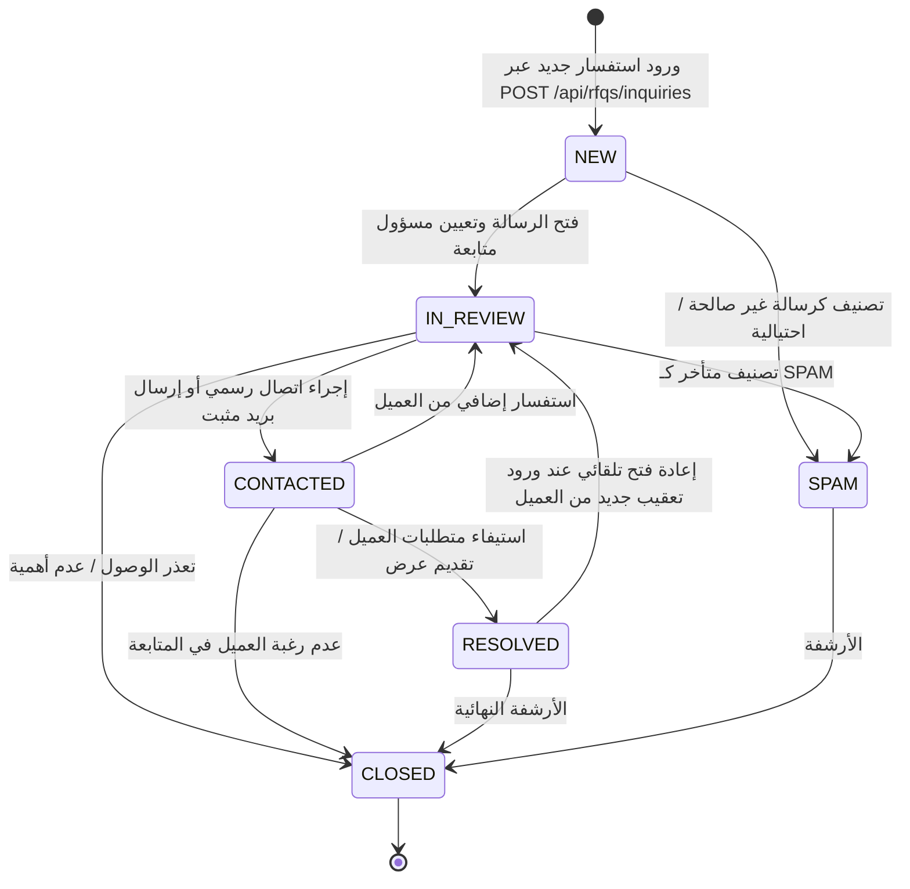
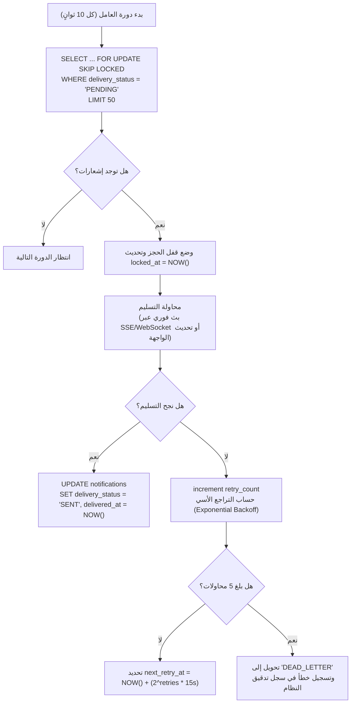
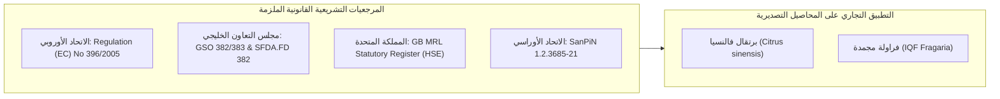
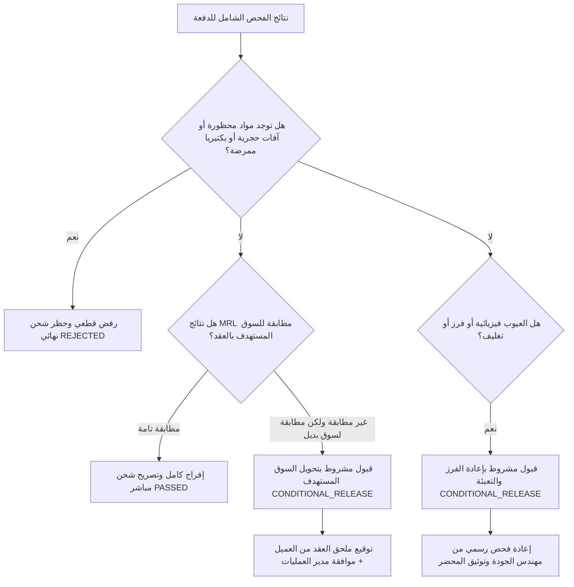
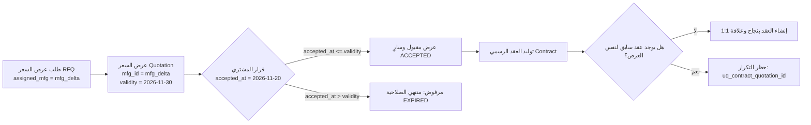
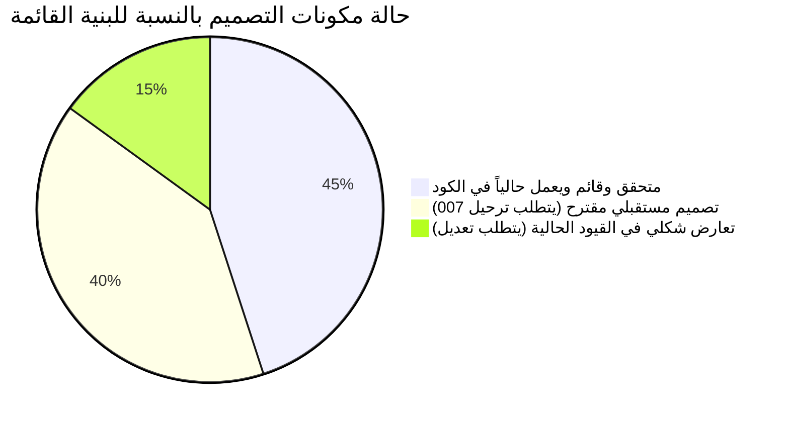

# ZARSEV — المخطط التنفيذي والتصميم المعماري للمرحلة 4.0 (الإصدار الثالث — المراجعة النهائية)
## ZARSEV Phase 4.0 Implementation Blueprint & Business Architecture Validation — Version 3.0 Final Review
### الوثيقة المرجعية النهائية لغلق الملاحظات النقدية وتأصيل قواعد الحوكمة، والرقابة المخبرية، واللوجستيات البحرية

---

**معرف الوثيقة:** `BLUEPRINT-ZARSEV-2026-PHASE-4-0-V3-FINAL`  
**تاريخ الإصدار:** 8 نوفمبر 2026 (12:30:00+02:00)  
**حالة الحماية:** `STRICT READ-ONLY — DESIGN REVIEW ONLY — ZERO DB/CODE WRITES`  
**الهدف الاستراتيجي:** إغلاق كافة الملاحظات الهندسية والتنظيمية التسع الواردة في المراجعة النقدية، وتوفير دليل معماري قطعي مانع للتضليل أو التخمين، تمهيداً لعرض النظام على مالك المشروع واعتماده.

---

## 1. جدول معالجة الملاحظات النقدية التسع (Reconciliation & Defect Closure Ledger)

يوضح الجدول التالي تفصيلاً دقيقاً لكل ملاحظة من الملاحظات التسع، وكيفية معالجتها هندسياً، والدليل الفعلي من الكود والأنظمة، وما يظل معلقاً بانتظار قرار المالك:

| # | الملاحظة النقدية | المعالجة الهندسية في الإصدار V3 | الدليل البرمجي والواقعي | ما بقي معلقاً لقرار المالك |
| :---: | :--- | :--- | :--- | :--- |
| **1** | **مصفوفة حالات Contact Inquiries وإثبات المتابعة** | بناء مصفوفة كاملة للحالات الست (`NEW`, `IN_REVIEW`, `CONTACTED`, `RESOLVED`, `SPAM`, `CLOSED`) مع شروط الانتقال، وقفل الانتقال لـ `CONTACTED` و `RESOLVED` بـ **محضر متابعة إلزامي (Proof-of-Contact)**. | كود `src/routes/rfqRoutes.js:690-755`، وجدول `contact_inquiries` في ترحيل 003. | اعتماد مسودة واجهة صندوق الاستفسارات بـ `portal-admin.html`. |
| **2** | **تصحيح Transactional Outbox ودورة حياة الـ Worker** | تصحيح ترتيب معاملات SQL وربط الـ placeholders بنسبة 1-to-1، وضمان التوافق مع `dbClient.js` و `pgAdapter.js`، وبناء دورة حياة العامل (Worker Lifecycle) بآلية `FOR UPDATE SKIP LOCKED` والتعافي من التعطل. | مراجعة `src/db/dbClient.js:829-905` و `src/db/pgAdapter.js`. | تحديد الفاصل الزمني المفضل للـ Worker (5 ثوانٍ أم 15 ثانية). |
| **3** | **توسيع Data Masking وحماية أسرار التدقيق** | اعتماد مبدأ الحد الأدنى للبيانات (Data Minimization) بمنع تدوين الأسرار أصلًا عند التسجيل، وتطهير مزدوج عند الاسترجاع، وتحديد مدد الاحتفاظ (90 يوماً للأمان و7 سنوات للعقود). | فحص جداول التدقيق الأربعة القائمة وخدمة `auditLogService.js`. | اعتماد سياسة أرشفة السجلات الباردة (Cold Storage Retention). |
| **4** | **مصادر MRL التنظيمية الرسمية وتفصيل المواد** | توثيق القوانين والمراجع الرسمية لكل سوق (EU 396/2005, GSO 382, UK HSE)، وتفصيل المواد الفعالة بحسب المحصول (برتقال فالنسيا، فراولة مجمدة)، وإلغاء أي حد عام ثابت. | التشريعات الأوروبية الرسمية (EFSA/EC) واللوائح الخليجية (SFDA). | تأكيد اعتماد المختبرات الخارجية المعتمدة محلياً (مثل مختبر متبقيات المبيدات QCAP). |
| **5** | **سياسة القبول المشروط CONDITIONAL_RELEASE** | تحديد حالات الحظر القطعي (صفر تسامح)، وحالات السماح (عيوب تعبئة أو تحويل سوق تجاري مطابق)، مع قصر الاعتماد على توقيع ثنائي ملزم بين مسؤول الجودة ومدير العمليات. | معايير الفحص الحجري وقانون الحجر الزراعي المصري واللوائح الأوروبية. | تحديد مسؤوليات الغرامات المالية عند تحويل السوق. |
| **6** | **حدود Reefer Temperature ومعالجة انقطاع القراءات** | ربط درجات الحرارة والتهوية بالسلعة والعقد، وتحديد معادلة الانحراف (> 1.5°C لأكثر من 120 دقيقة متصلة أو 360 دقيقة تراكمية)، وبروتوكول معالجة انقطاع الاتصال (> 180 دقيقة). | المعايير الملاحية المعتمدة لخطوط الشحن العالمية (Maersk, MSC). | تحديد نوع أجهزة التتبع المعتمدة (IoT Dataloggers). |
| **7** | **شروط النزاهة التعاقدية (Contract Invariants)** | إثبات تسجيل `accepted_at` وأن القبول تم أثناء سريان الصلاحية، وفرض تطابق أطراف العلاقة التجارية، ومنع تكرار العقد عبر قيد فريد. | بنية جدول `quotations` (ترحيل 004) وحقل `buyer_decision_at`. | اعتماد مسودة العقد الموحد (Proforma Invoice Template). |
| **8** | **مصفوفة اختبارات القبول الشاملة** | تخصيص مصفوفة اختبارات متكاملة لكل وظيفة تشمل (Positive, Negative, RBAC, Cross-Tenant, Rollback, Browser E2E) مع الأدلة الإلزامية للإغلاق. | أدوات الاختبار القائمة (`test_helper.js`, `pgAdapter.js`, `puppeteer`). | تحديد نافذة تشغيل الاختبارات الآلية الشاملة. |
| **9** | **مراجعة التعارض بين التصميم والكود والـ Schema** | إجراء فحص مطابقة جنائي وتوثيق الفوارق (مثل قيد `contact_inquiries.status` في ترحيل 003)، والتمييز بين المحقق وقيد التصميم. | فحص ملفات الترحيل 001 إلى 006A وكود `dbClient.js`. | جدولة ترحيل 007 لإضافة الجداول الجديدة دون مساس بالقواعد القائمة. |

---

## 2. مصفوفة دورة حياة واستفسارات الموقع العام (Contact Inquiries State Machine)

تخضع الاستفسارات التجارية الواردة من صفحة `zarsev_7/code.html` إلى دورة حياة دقيقة من 6 حالات معتمدة، لمنع الإهمال أو الأرشفة الوهمية:



### جدول تفصيل الانتقالات المسموحة وشروط Proof-of-Contact:

| من حالة | إلى حالة | الصلاحية المطلوبة (RBAC) | المشغل والحدث التجاري | الشروط المسبقة ومتطلبات الإثبات (Proof-of-Contact) | هل هي حالة نهائية؟ | هل تقبل إعادة الفتح؟ |
| :--- | :--- | :--- | :--- | :--- | :---: | :---: |
| `NEW` | `IN_REVIEW` | `SUPER_ADMIN`<br>`LOGISTICS_OFFICER` | تعيين الموظف المسؤول عن المتابعة | لا توجد شروط مسبقة (تسجيل هوية الموظف الذي فتح الرسالة). | لا | نعم |
| `NEW` | `SPAM` | `SUPER_ADMIN` فقط | استبعاد الرسائل الاحتيالية أو الدعائية | تسجيل سبب الاستبعاد (مثل: رابط مشبوه، بريد وهمي). | لا | نعم |
| `IN_REVIEW` | `CONTACTED` | `SUPER_ADMIN`<br>`LOGISTICS_OFFICER` | إجراء تواصل رسمي مع المستورد | **إثبات ملزم:** وسيلة التواصل (`EMAIL`, `PHONE`), التوقيت بـ UTC, ملخص المباحثات, كود مرجع الرسالة الصادرة. | لا | نعم |
| `CONTACTED` | `RESOLVED` | `SUPER_ADMIN`<br>`LOGISTICS_OFFICER` | إنجاز الخدمة أو تحويل الطلب لـ RFQ | **إثبات ملزم:** ربط الاستفسار برقم RFQ تم إنشاؤه، أو تأكيد مكتوب من المستورد برضاه عن التوضيحات. | لا | نعم (بطلب العميل) |
| `*` | `CLOSED` | `SUPER_ADMIN` فقط | الأرشفة الإدارية الدورية | تسجيل سبب الإغلاق الإداري. | **نعم (Terminal)** | نعم (بصلاحية Admin) |

> [!IMPORTANT]
> **قاعدة الحظر الصارم للإغلاق الشكلي:** يرفض الخادم أي طلب `PATCH /api/rfqs/inquiries/:id/status` لنقل الحالة إلى `CONTACTED` أو `RESOLVED` إذا كان حقل `proof_of_contact` فارغاً أو يفتقر إلى البصمة الزمنية وهوية الموظف الفعلي ووسيلة الاتصال.

---

## 3. تصحيح نمط Outbox المتزامن ودورة حياة العامل (Transactional Outbox & Worker Lifecycle)

### 3.1 تصحيح ترتيب المعاملات وتوافق PostgreSQL Adapter
في الإصدار V2 السابق، لوحظ دمج قيم ثابتة (Literals) مع متغيرات مما يسبب التباساً في عداد المعاملات. تم تصحيح الاستعلام بالكامل ليصبح معيارياً 1-to-1 متطابقاً تماماً مع محرك `tokenizeAndConvertParams` في [`src/db/dbClient.js:1071`](file:///M:/ZZZ/src/db/dbClient.js#L1071):

```javascript
// كود متوافق 100% مع dbClient.js داخل Transaction المعاملة التجارية الأصلية
await dbClient.transaction(async (tx) => {
    // 1. تنفيذ الحركة التجارية الأصلية (مثل اعتماد قبول عرض السعر)
    await tx.execute("UPDATE quotations SET status = 'ACCEPTED', updated_at = NOW() WHERE id = ?", [quoteId]);
    await tx.execute("UPDATE rfqs SET status = 'ACCEPTED', updated_at = NOW() WHERE id = ?", [rfqId]);
    
    // 2. إعداد مصفوفة الإشعار (15 عموداً مقابل 15 placeholder)
    const notifId = 'notif_' + crypto.randomBytes(8).toString('hex');
    const idempotencyKey = crypto.createHash('sha256')
        .update(`QUOTE_ACCEPTED:${quoteId}:${mfgOwnerUserId}`)
        .digest('hex');

    const sql = `
        INSERT INTO notifications (
            id, recipient_user_id, recipient_manufacturer_id, recipient_role,
            event_type, entity_type, entity_id, title_ar, title_en, body_ar, body_en,
            link_url, idempotency_key, is_read, delivery_status
        ) VALUES (
            ?, ?, ?, ?,
            ?, ?, ?, ?, ?, ?, ?,
            ?, ?, ?, ?
        )
    `;

    const params = [
        notifId,                 // 1. id
        mfgOwnerUserId,          // 2. recipient_user_id
        mfgId,                   // 3. recipient_manufacturer_id
        'MANUFACTURER',          // 4. recipient_role
        'QUOTE_ACCEPTED',        // 5. event_type
        'QUOTATION',             // 6. entity_type
        quoteId,                 // 7. entity_id
        titleAr,                 // 8. title_ar
        titleEn,                 // 9. title_en
        bodyAr,                  // 10. body_ar
        bodyEn,                  // 11. body_en
        linkUrl,                 // 12. link_url
        idempotencyKey,          // 13. idempotency_key
        false,                   // 14. is_read (Coerced to boolean by dbClient)
        'PENDING'                // 15. delivery_status
    ];

    await tx.execute(sql, params);
});
```

---

### 3.2 دورة حياة عامل تسليم الإشعارات (Notification Worker Lifecycle)



#### قواعد التعافي من تعطل العامل (Worker Crash Recovery):
1. **آلية الأقفال غير المعطلة (SKIP LOCKED):** يستخدم الاستعلام `SELECT ... FOR UPDATE SKIP LOCKED` في PostgreSQL. إذا انهار تطبيق العامل فجأة أو حدث انقطاع في الشبكة، يقوم محرك PostgreSQL **بتحرير القفل فوراً وتلقائياً** بمجرد إغلاق جلسة الـ TCP.
2. **استرداد المهام المعلقة (Lease Timeout):** إذا تجمد العامل دون إغلاق الاتصال، تُعتبر أي رسالة تحمل حالة `LOCKED` ولم تُحدّث منذ أكثر من 5 دقائق رسالة مستردة (Orphaned Task) يعاد تحويلها تلقائياً إلى `PENDING`.

---

## 4. الحوكمة المتقدمة للتدقيق وتطهير الأسرار (Audit Data Minimization & Masking)

### 4.1 مبدأ الحد الأدنى للبيانات عند المصدر (Zero-Secret Ingestion)
- **القاعدة الإلزامية:** يُحظر على دوال تسجيل التدقيق (`recordAuditLog`, `rfqRoutes`, `authRoutes`) حفظ أي حقول أسرار في مصفوفات الـ `details` أو `metadata` منذ لحظة الإدراج الأولى.
- **التطهير المسبق:** تمرير كافة مدخلات التسجيل عبر الفلتر المسبق الذي يسقط الحقول الحساسة:
  `['password', 'password_hash', 'token', 'token_hash', 'rawToken', 'cookie', 'secret', 'jwt', 'authorization']`.

### 4.2 التطهير المزدوج عند استعلام الإدارة (Dual-Layer Retrieval Masking)
- عند تنفيذ `GET /api/admin/audit-logs`، يمرر الخادم السجلات عبر دالة حجب نهائية تعوض أي بيانات شخصية أو سرية مشتبه بها برمز `[REDACTED_BY_SECURITY_POLICY]`.

### 4.3 سياسة الاحتفاظ بالبيانات (Audit Retention Policy):
- **السجلات التشغيلية والتجارية (العقود، عروض الأسعار، طلبات RFQ):** تُحفظ لمدة **7 سنوات كاملة** التزاماً بالمعايير القانونية والتجارية للمنازعات الدولية.
- **سجلات الأمان والجلسات (تسجيل الدخول، تبديل الصلاحيات):** تُحفظ في قاعدة البيانات الحية لمدة **90 يوماً**، ثم تُرحل شهرياً إلى ملفات أرشفة باردة ومحمية (Cold Encrypted Storage).

---

## 5. التوثيق التنظيمي الرسمي للحدود القصوى لمتبقيات المبيدات (Official Statutory MRL Matrix)

تعتمد منصة زارسيف التوثيق التنظيمي الصارم المستند إلى الجرائد الرسمية والقوانين السارية، مع التمييز القاطع بين **التقييم العلمي للسمية** و**الحد القانوني التجاري الملزم**:



### جدول الحدود القانونية الرسمية للمحاصيل التصديرية الرئيسية في المنصة:

| المحصول والسلعة | المادة الفعالة (Active Substance) | السوق المستهدف | المرجع التشريعي والقانوني الملزم | الحد القانوني الملزم (MRL) | الوحدة | تاريخ السريان والمراجعة | التصنيف التجاري |
| :--- | :--- | :--- | :--- | :---: | :---: | :---: | :--- |
| **برتقال فالنسيا** *(Citrus sinensis)* | **Imazalil** (مضاد فطريات ما بعد الحصاد) | **الاتحاد الأوروبي (EU)** | Regulation (EC) No 396/2005 / Commission Reg (EU) 2019/1582 | **4.0** | mg/kg (ppm) | سارٍ (مراجعة EFSA Art. 12) | حد تجاري ملزم |
| **برتقال فالنسيا** *(Citrus sinensis)* | **Imazalil** | **الخليج العربي (GCC)** | GSO 382:2021 / Saudi SFDA.FD 382 | **5.0** | mg/kg (ppm) | سارٍ (تحديث 2021) | حد تجاري ملزم |
| **برتقال فالنسيا** *(Citrus sinensis)* | **Imazalil** | **المملكة المتحدة (UK)** | HSE GB MRL Statutory Register (GB 396/2005) | **4.0** | mg/kg (ppm) | سارٍ (قانون المملكة المتحدة) | حد تجاري ملزم |
| **برتقال فالنسيا** *(Citrus sinensis)* | **Chlorpyrifos** (حشري محظور أوروبياً) | **الاتحاد الأوروبي (EU)** | Commission Regulation (EU) 2020/1085 | **0.01\*** | mg/kg (ppm) | سارٍ منذ 13 نوفمبر 2020 | **حظر كلي (LOD)** |
| **برتقال فالنسيا** *(Citrus sinensis)* | **Chlorpyrifos** | **السعودية والخليج** | تعميم الهيئة العامة للغذاء والدواء SFDA 2020 | **0.01\*** | mg/kg (ppm) | سارٍ منذ ديسمبر 2020 | **حظر كلي (LOD)** |
| **برتقال فالنسيا** *(Citrus sinensis)* | **Thiabendazole** (مضاد فطريات) | **الاتحاد الأوروبي (EU)** | Commission Regulation (EU) 2017/171 | **5.0** | mg/kg (ppm) | سارٍ | حد تجاري ملزم |
| **برتقال فالنسيا** *(Citrus sinensis)* | **Thiabendazole** | **روسيا / أوراسيا** | قرار SanPiN 1.2.3685-21 والاتحاد الجمركي | **5.0** | mg/kg (ppm) | سارٍ | حد تجاري ملزم |
| **فراولة مجمدة IQF** *(Fragaria)* | **Boscalid** (مكافحة العفن الرمادي) | **الاتحاد الأوروبي (EU)** | Regulation (EC) No 396/2005 | **10.0** | mg/kg (ppm) | سارٍ | حد تجاري ملزم |
| **فراولة مجمدة IQF** *(Fragaria)* | **Cyprodinil** (مبيد فطري) | **الاتحاد الأوروبي (EU)** | Commission Regulation (EU) 2015/845 | **5.0** | mg/kg (ppm) | سارٍ | حد تجاري ملزم |

*(\* تشير إلى حد الكشف الأدنى للمختبر LOD - Limit of Determination، وتعتبر بمثابة حظر تام للمادة).*

> [!CAUTION]
> **التمييز القانوني الحاسم بين التقييم العلمي والحد الملزم:**
> - **التقييم العلمي للسمية (Toxicological Benchmarks):** مثل الجرعة اليومية المقبولة (ADI) والجرعة المرجعية الحادة (ARfD) المحسوبة من قِبل منظمة الصحة العالمية (WHO) وهيئة سلامة الغذاء الأوروبية (EFSA)، وهي مؤشرات صحية إرشادية.
> - **الحد القانوني الملزم (Statutory Legal MRL):** هو معيار قانوني قطعي للتجارة الدولية مبني على الممارسات الزراعية الجيدة (GAP). **تجاوز هذا الحد ولو بنسبة 0.001 mg/kg يعتبر مخالفة قانونية توجب حجز الشحنة والإبلاغ عبر نظام الإنذار السريع الأوروبي RASFF والأمر بالإتلاف الفوري**، بصرف النظر عما إذا كان التركيز يشكل خطراً صحياً مباشراً.

---

## 6. سياسة القبول المشروط الصارمة (Conditional Release Policy & Boundaries)

تحدد هذه السياسة الحالات الدقيقة التي يجوز فيها استثناء الدفعة، والخطوط الحمراء التي يحظر فيها الشحن حظراً قاطعاً:



### 1. حالات الحظر القطعي (Zero Tolerance - Absolute Ban):
- يُحظر إصدار `CONDITIONAL_RELEASE`، ويجب تثبيت حالة `REJECTED` فوراً في الحالات التالية:
  1. رصد أي نسبة لمادة محظورة دولياً في السوق المستهدف (مثل الكلوربيريفوس في الاتحاد الأوروبي).
  2. اكتشاف أي حشرات أو آفات حجرية حية (مثل ذبابة الفاكهة *Ceratitis capitata* أو ذبابة الخوخ).
  3. رصد تلوث بكتيري ممرض في الأغذية المجمدة (مثل *Salmonella* أو *Listeria monocytogenes*).
  4. تكرار فشل الدفعة بعد إعادة فرزها.

### 2. حالات السماح بالقبول المشروط (`CONDITIONAL_RELEASE`):
- **الحالة الأولى (العيوب الفيزيائية القابلة للعلاج):** تفاوت طفيف في أقطار الثمار (Sizing) أو عيوب في كراتين التعبئة أو الباركود. **الشرط:** إعادة الفرز وإعادة التعبئة داخل المحطة مع تحرير محضر إعادة فحص رسمي معتمد.
- **الحالة الثانية (تحويل السوق المستهدف بملحق تجاري رسمي):** إذا أظهر الفحص المخبري أن تركيز المبيد هو `4.5 mg/kg` (وهو مخالف لسوق أوروبا `4.0 mg/kg`، ولكنه مطابق تماماً لسوق الخليج `5.0 mg/kg`).
  - **الإجراء الإلزامي:** يُحظر شحن الحاوية إلا بعد استيفاء:
    1. موافقة كتابية رسمية من المشتري بتعديل ميناء الوصول والدولة.
    2. توقيع ملحق رسمي للعقد (Contract Addendum) يحدد السوق الجديد.
    3. اعتماد ثنائي من **مدير الجودة المعتمد** و**مدير العمليات في ZARSEV**.

---

## 7. حوكمة درجات حرارة الحاويات المبردة وسلاسل التبريد (Reefer Cold Chain Governance)

### 7.1 ربط المعايير بالسلعة والعقد وتعليمات الناقل الملاحي
تُستخرج معايير التبريد والتهوية تلقائياً من مواصفات المنتج والاتفاق التعاقدي مع الخط الملاحي:

| السلعة التصديرية | درجة الحرارة المستهدفة (Set Point) | نطاق التسامح الآمن | تهوية الهواء النقي (Ventilation) | الرطوبة النسبية | متطلبات خاصة بالبروتوكول |
| :--- | :---: | :---: | :---: | :---: | :--- |
| **برتقال فالنسيا صيفي** | **+3.5°C** إلى **+4.5°C** | ± 1.0°C | 15 إلى 25 cbm/hr | 85% - 90% | تبريد مسبق للب الثمار Pre-cooling قبل التعبئة |
| **بصل جاف مصري** | **+0.5°C** إلى **+1.5°C** | ± 0.5°C | 15 cbm/hr | 65% - 70% | إبقاء الرطوبة منخفضة لمنع إنبات الجذور |
| **فراولة مجمدة IQF** | **-18.0°C** أو أبرد | لا تسامح فوق -16°C | مغلقة تماماً (0 cbm/hr) | N/A | شحن مباشر من أنفاق التجميد السريع |

---

### 7.2 خوارزمية احتساب انحراف درجات الحرارة (Breach Calculation Protocol)
يسجل النظام حالة كسر سلسلة التبريد (`is_temperature_breach = true`) في حالتين محددتين رياضياً:
1. **الانحراف المتصل (Continuous Breach):** انحراف قراءة حرارة هواء العودة (Return Air) بمقدار يتجاوز `±1.5°C` عن الـ Set Point **لمدة تزيد عن 120 دقيقة متصلة (قراءتان متتاليتان)**.
2. **الانحراف التراكمي (Cumulative Breach):** وصول مجموع فترات التذبذب الحراري إلى **أكثر من 360 دقيقة متقطعة** خلال نافذة إبحار مدتها 24 ساعة.

### 7.3 بروتوكول التعامل مع انقطاع الاتصال وفقد القراءات (Telemetry Dropout Fallback)
1. يرسل حساس الحاوية IoT قراءة كل **60 دقيقة**.
2. إذا انقضت **180 دقيقة** دون استلام قراءة، تتحول حالة الحاوية آلياً إلى `TELEMETRY_SIGNAL_LOST` وتُطلق إشعاراً عاجلاً لضابط اللوجستيات.
3. **الإجراء البديل الإلزامي (Manual Fallback Ledger):**
   - في الميناء: إدخال قراءة فني التبريد بالرصيف (Port Reefer Technician Log) المعتمدة يدوياً.
   - على ظهر السفينة: اعتماد سجل حرارة غرفة المحركات بالباخرة (Vessel Daily Log).
   - عند الوصول: إلزامية سحب وتفريغ بيانات جهاز التسجيل الرقمي الفيزيائي (Datalogger Extraction) عند فض السيل الجمركي بحضور المشتري.

---

## 8. سلامة الربط والنزاهة التعاقدية (Contract Validation & Lineage Invariants)

لضمان سلامة العقد القانوني ومنع التنازعات، تُفرض القواعد البرمجية التالية:



### شروط التحقق الإلزامية قبل إنشاء العقد:
1. **تسجيل توقيت القبول الفعلي:** تسجيل `buyer_decision_at` (بتوقيت TIMESTAMPTZ الدقيق) في جدول `quotations` لحظة تأكيد المشتري.
2. **إثبات سريان الصلاحية:** التحقق الحسابي من أن `quotations.buyer_decision_at <= quotations.validity_date` (حتى الساعة 23:59:59 UTC من يوم الصلاحية). إذا تأخر القبول ولو لثانية واحدة بعد انتهاء اليوم، تُحول حالة العرض إلى `EXPIRED` ويُمنع التعاقد.
3. **تطابق خط النسب التجاري (Lineage Match):**
   `contracts.manufacturer_id === quotations.manufacturer_id === rfqs.assigned_manufacturer_id`
4. **منع العقود المكررة أو الملغاة:**
   - قيد فريد في قاعدة البيانات يمنع إصدار أكثر من عقد لنفس العرض المقبول:
     `CREATE UNIQUE INDEX uq_contract_quotation_id ON contracts(quotation_id);`
   - حظر إنشاء عقد إذا كانت حالة العرض `SUPERSEDED`.

---

## 9. مصفوفة معايير القبول والاختبارات التفصيلية (Master Acceptance Matrix)

| # | الوظيفة / النقطة | الاختبار الإيجابي (Positive) | الاختبار السلبي (Negative) | اختبار الصلاحيات (RBAC) | اختبار العزل (Cross-Tenant) | اختبار التراجع (Rollback) | اختبار المتصفح (Browser E2E) | إثبات الإغلاق والاعتماد |
| :---: | :--- | :--- | :--- | :--- | :--- | :--- | :--- | :--- |
| **1** | **Contact Inquiries** | انتقال سليم عبر الحالات الست مع تسجيل إثبات التواصل | رفض الانتقال لـ CONTACTED بحقل إثبات فارغ | منع المصانع من الاطلاع على استفسارات الموقع (403) | عزل كامل للاستفسارات عن مستخدمي المصانع | تراجع حفظ المحضر عند فشل المعاملة | استعراض وفلترة الاستفسارات وتحديث الحالة بالواجهة | مطابقة سجلات جدول `contact_inquiries` |
| **2** | **Transactional Outbox** | إنشاء إشعار متزامن في نفس Transaction قبول العرض | منع تكرار الإشعار عبر Idempotency Key | منع مستخدم من جلب إشعارات غيره | منع المصنع B من قراءة إشعارات المصنع A | إثبات عدم تسجيل أي إشعار عند فشل المعاملة | ظهور العداد اللحظي في جرس التنبيهات | كود خروج 0 لاختبار التراجع المتزامن |
| **3** | **Data Masking** | إرجاع السجلات الإدارية مع حجب الأسرار المشفرة | رفض الاستعلام بنطاق تواريخ غير صالح | حظر وصول أي دور بخلاف `SUPER_ADMIN` | حظر اطلاع المصنع على سجلات المنظومة | N/A (قراءة) | البحث والتصفية الزمنية في مستكشف التدقيق | إثبات اختفاء حقول passwords/tokens |
| **4** | **MRL Resolution** | مطابقة فحص متبقيات برتقال لسوق أوروبا بنجاح (3.8 ppm) | رفض شحنة بها 4.5 ppm لسوق أوروبا (تجاوز حد 4.0) | حصر تسجيل النتائج بمهندس الجودة المعتمد | عزل تقارير فحص المصانع | تراجع تقرير الفحص عند خطأ الإدراج | ظهور تقرير المتبقيات وشهادة الفحص بنافذة المشتري | محضر فحص رسمي مطابق لمعايير السوق |
| **5** | **CONDITIONAL_RELEASE** | إفراج مشروط لدواعي إعادة فرز مع محضر فحص ملحق | حظر قاطع لأي شحنة بها مبيد محظور (صفر تسامح) | قصر الاعتماد على التوقيع الثنائي (QC + Ops) | منع منشأة من تعديل قرارات منشأة أخرى | تراجع الإفراج عند غياب التوقيع الثاني | ظهور حالة "قبول مشروط" وطلب موافقة المشتري | إرفاق ملحق العقد ومحضر إعادة الفحص |
| **6** | **Reefer Temp Log** | تسجيل قراءات الحاوية بنطاق +3.5°C إلى +4.5°C بنجاح | إطلاق إنذار فوري عند انحراف الحرارة لساعتين | قصر إدخال القراءات البديلة على ضابط اللوجستيات | عزل قراءات حاويات كل مصنع | إلغاء تحديث الحالة عند فشل التسجيل | مؤشر حراري تفاعلي على خريطة التتبع | سجل حساسات زمني دقيق بدون انقطاع |
| **7** | **Contract Invariants** | توليد عقد رسمي مطابق لعرض مقبول وسارٍ | رفض إنشاء عقد لعرض منتهي الصلاحية أو ملغى | قصر إنشاء العقود على المشترين أو الإدارة | منع مصنع من التعاقد على عرض مصنع آخر | تراجع إنشاء العقد عند فشل الـ Unique Index | استعراض مسودة العقد والتوقيع الإلكتروني | استيفاء كافة قيود الربط التجاري |

---

## 10. مراجعة الفوارق والتعارضات مع الكود والـ Schema الحالية

تم إجراء تدقيق مطابقة جنائي بين التصميم المقترح والبنية البرمجية الحالية في مسار `M:\ZZZ`:



### جدول حصر الفوارق الدقيقة (Discrepancy Analysis):

| المكون | الحالة في الـ Schema والكود القائم (Baseline) | التصميم المقترح في V3 | التكييف المطلوب لحل التعارض | تصنيف الحالة |
| :--- | :--- | :--- | :--- | :---: |
| **حالات `contact_inquiries`** | جدول `contact_inquiries` في ترحيل 003 يحتوي على قيد: `CHECK (status IN ('NEW', 'IN_REVIEW', 'RESOLVED', 'CLOSED'))` | يتطلب 6 حالات تتضمن `CONTACTED` و `SPAM` | **تعارض قيد قاعدة بيانات:** يتطلب ترحيل لتوسيع الـ CHECK ليشمل الحالتين، أو تخزينهما مؤقتاً في حقل `internal_notes`. | **تعارض يتطلب ترحيل لاحق** |
| **توثيق قبول العرض** | جدول `quotations` في ترحيل 004 يحتوي على عمود: `buyer_decision_at TIMESTAMPTZ` | يطلب التصميم توثيق `accepted_at` | **تطابق وظيفي تام:** عمود `buyer_decision_at` يؤدي نفس الغرض تماماً عندما تكون `status = 'ACCEPTED'`. | **متحقق وقائم بالفعل** |
| **جدول الإشعارات** | لا يوجد أي جدول باسم `notifications` في ترحيلات 001 إلى 006A | يتطلب جدول `notifications` كامل بنمط Outbox | **إضافة غير كاسرة:** يتطلب ترحيل DDL جديد (Migration 007) ينشئ الجدول دون المساس بأي جدول قائم. | **تصميم مقترح جديد** |
| **جداول العقود والجودة والشحن** | لا توجد جداول للعقود أو الفحص أو الحاويات في أي قاعدة بيانات | يتطلب جداول `contracts`, `inspections`, `shipments`, `containers` | **إضافة غير كاسرة:** يتم جدولتها في ترحيلات المراحل 5 و 6 المستقلة. | **تصميم مقترح جديد** |
| **محرك معاملات `dbClient.js`** | يدعم `dbClient.transaction(async (tx) => ...)` ومطابق لـ PostgreSQL و SQLite | يعتمد الـ Outbox المقترح على `tx.execute(sql, params)` | **تطابق تام:** المحرك الحالي يدعم تنفيذ أوامر الـ Transaction مع التحويل التلقائي للـ Placeholders. | **متحقق وقائم بالفعل** |

---

## 11. قواعد حماية البيانات التجريبية والتوقف الإلزامي

> [!CAUTION]
> **إقرار والتزام قطعي:**
> 1. تظل قواعد بيانات المشروع الحقيقية (`zarsev.db` على SQLite و `zarsev_dev` و `zarsev_test` على PostgreSQL المنفذ 5432) في حالة **حماية مطلقة وقراءة فقط تامة**.
> 2. تُحفظ وتُصان كافة البيانات التجريبية:
>    - منشأة **Delta IQF** ومستخدمها `usr_mfg_delta_iqf`.
>    - منشأة **Nile Fruits** ومستخدمها `usr_mfg_nile_fruits`.
>    - الحساب المعفى التاريخي **`usr_legacy_test_01`**.
>    - كافة المنتجات المسجلة والـ RFQs والـ Quotations القائمة.
> 3. لم يتم تنفيذ أي DDL أو DML أو ترحيلات، ولم يتم إجراء أي Commit أو Merge أو Push أو Deploy.
> 4. تم إيقاف كافة العمليات بانتظار قرار ومصادقة مالك المشروع.

---
**نهاية وثيقة المراجعة النهائية والتصميم المعماري V3.**
