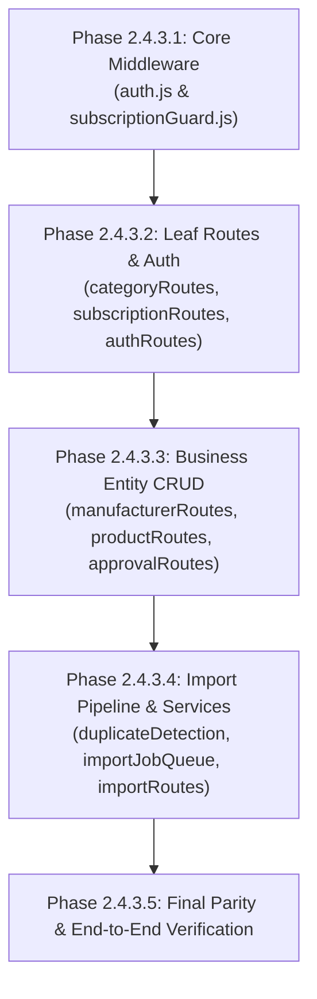

# ZARSEV — Phase 2.4.3.0: Critical Routes Integration Plan & Dependency Audit

**Repository:** `M:\ZZZ`  
**Branch:** `feature/postgres-foundation`  
**Base HEAD:** `377c546b608fba3c24db2718fff91732be724385`  
**Mode:** Strictly **READ-ONLY** (Architectural Planning & Static Code Inspection)

---

## 1. Executive Summary & Inspection Verification

Following the successful remediation in Phase 2.4.2.5, this document establishes the production integration plan for transitioning all critical application routes, middleware, and services from synchronous SQLite (`node:sqlite`) to the asynchronous, multi-engine database facade ([`src/db/dbClient.js`](file:///m:/ZZZ/src/db/dbClient.js)).

### Actual Code State Verification
A thorough inspection of [`src/db/dbClient.js`](file:///m:/ZZZ/src/db/dbClient.js), [`src/db/database.js`](file:///m:/ZZZ/src/db/database.js), [`src/db/pgAdapter.js`](file:///m:/ZZZ/src/db/pgAdapter.js), and [`src/db/pgMigrator.js`](file:///m:/ZZZ/src/db/pgMigrator.js) confirms that all Phase 2.4.2.5 fixes are physically present in the codebase:

1. **SQLite Shared-Connection Mutex Coverage:**
   - [`executeQueryOne`](file:///m:/ZZZ/src/db/dbClient.js#L665-L686) and [`executeQueryAll`](file:///m:/ZZZ/src/db/dbClient.js#L707-L726) check `inTx = options.inTransaction || (engine === 'sqlite' && txStorage.getStore()?.engine === 'sqlite')`.
   - When `!inTx`, both methods acquire `getSqliteMutex(runner).acquire()` and release the lock inside guaranteed `finally` blocks.
   - Reentrancy is fully protected: intra-transaction calls and nested savepoints reuse the active context without re-acquiring the mutex.
2. **Transaction Context Lifecycle & AsyncLocalStorage Isolation:**
   - `TransactionContext` tracks `isActive` and rejects closed transactions with `TRANSACTION_CLOSED`.
   - `outerTxCtx.close()` recursively invalidates all nested child contexts.
   - `resolveRunner` asserts `activeTx._assertActive()`, strictly preventing asynchronous operations or delayed callbacks (`setTimeout`) from executing on released pool clients.
3. **Lexical Numbered-Parameter Detection:**
   - Raw-string pre-scan regex was completely eliminated.
   - [`scanLexicalNumberedParams(sql)`](file:///m:/ZZZ/src/db/dbClient.js#L189-L281) parses SQL character-by-character, strictly skipping `$N` inside single-quoted strings (`'Total $100'`), E-strings (`E'...'`), double quotes (`"..."`), line comments (`--`), block comments (`/* */`), and dollar quotes (`$$...$$`).
4. **PostgreSQL JSONB Operators & Placeholder Separation:**
   - Operators `?|` and `?&` are preserved verbatim.
   - Escape sequence `??` unescapes cleanly to `?`.
   - Standalone `?` followed by string literal operands (`? 'key'`) is preserved as the JSONB operator.
   - Mixed positional and native parameters validate and execute without collision.
5. **Parameter-Count Validation:**
   - Both engines strictly validate `placeholderCount === params.length` before statement execution, rejecting mismatches with unified `PARAM_COUNT_MISMATCH`.
6. **Connection Release & Rollback Diagnostics:**
   - `DbError` retains `originalError`, `rollbackError`, and `savepointRollbackError`.
   - Credential strings, database passwords, and JWTs in URIs or query strings are sanitized with `****` and `[REDACTED]`.

---

## 2. Critical Route Integration Inventory & Dependency Matrix

The application codebase currently contains 11 modules requiring conversion from synchronous `node:sqlite` calls (`getDb().prepare(...)`) to `await dbClient`:

| Module Path | Primary Functions / Endpoints | Sync DB Calls | Transaction Required? | Key Dialect / Data Type Dependencies | Tenant Isolation & Security Rules |
| :--- | :--- | :--- | :--- | :--- | :--- |
| **1. `src/middlewares/auth.js`** | `authMiddleware`<br>`optionalAuthMiddleware` | 4 calls (`users`, `manufacturers`, `subscriptions`) | No | `user.is_active !== 1` must become `!user.is_active` (PG boolean). | Validates JWT, token_version, active status, and resolves trusted server-side identity. |
| **2. `src/middlewares/subscriptionGuard.js`** | `checkSubscriptionLimits` | 3 calls (`manufacturers`, `subscriptions`, `imports`) | No | `strftime('%Y-%m', created_at)` is SQLite-specific; `sub.allowed_formats` is JSON string (SQLite) vs parsed array (PG). | Enforces monthly import quotas and file format restrictions per manufacturer subscription tier. |
| **3. `src/routes/authRoutes.js`** | `/login`<br>`/me`<br>`/logout`<br>`/dev-login`<br>`/personas` | 5 calls (`users`, `manufacturers`) | Optional (Atomic rehash) | `LOWER(email) = LOWER(?)`; `u.is_active = 1` (SQLite) vs `u.is_active = true` (PG); `password_hash` optimistic rehash. | Timing-safe login, in-memory rate limiting, token_version increment on logout, dev-login disabled in production. |
| **4. `src/routes/categoryRoutes.js`** | `GET /` | 2 calls (`categories` parent & sub) | No | Standard ANSI SQL; hierarchical in-memory tree assembly. | Public catalog categories tree. |
| **5. `src/routes/subscriptionRoutes.js`** | `GET /plans`<br>`PUT /plans/:id` | 3 calls (`subscriptions`) | Optional | `allowed_formats` JSON string vs parsed object; boolean conversion (`ai_extraction_enabled`, `bulk_import_enabled`). | Super Admin only for plan modifications; public read for plan listing. |
| **6. `src/routes/productRoutes.js`** | `GET /`<br>`GET /:id`<br>`PUT /:id` | 4 calls (`products`, `product_images`, `manufacturers`, `categories`) | No | Dynamic `WHERE 1=1` filter; `p.is_demo = 0` (SQLite) vs `p.is_demo = false` (PG); `is_primary = 1` vs `true`. | Public only sees `PUBLISHED` & non-demo; manufacturers can only edit their own products (`manufacturer_id` check). |
| **7. `src/routes/manufacturerRoutes.js`** | `GET /`<br>`GET /:id`<br>`GET /match`<br>`POST /` | 6 calls (`manufacturers`, `subscriptions`, `products`) | No | Subquery `(SELECT COUNT(*) FROM products)`; `is_demo = 0` vs `false`; duplicate name/code check. | Public serializer strips private contacts; manufacturer user only sees own record; Super Admin/Logistics manages profiles. |
| **8. `src/routes/approvalRoutes.js`** | `GET /queue`<br>`POST /:productId/decide`<br>`POST /:productId/resubmit` | 6 calls (`products`, `manufacturers`, `categories`, `product_images`) | No | Status transitions (`PENDING_APPROVAL` $\rightarrow$ `PUBLISHED` / `REJECTED`); `specifications` JSON parsing. | Super Admin/Logistics Officer only for queue and decisions; manufacturer can only resubmit own rejected products. |
| **9. `src/services/duplicateDetectionService.js`** | `checkForDuplicateProduct`<br>`findMatchingManufacturer` | 5 calls (`products`, `manufacturers`, `product_images`) | No | `LOWER(p.sku) = LOWER(?)`; `pi.dhash IS NOT NULL`; in-memory Jaccard and Hamming token matching. | Read-only detection checks; prevents duplicate SKUs, names, and images across imports. |
| **10. `src/services/importJobQueue.js`** | `logImportStep`<br>`updateImportProgress`<br>`processImportJob` | 6 calls (`imports`, `import_logs`, `manufacturers`, `categories`) | Recommended | Dynamic `UPDATE imports SET ...`; background worker execution via `setImmediate`. | Background pipeline; logs execution steps; updates progress percentage and item extraction state. |
| **11. `src/routes/importRoutes.js`** | `/upload`<br>`/status/:id`<br>`/:id/items`<br>`/:id/items/:itemId`<br>`/:id/bulk-update`<br>`/:id/save-draft`<br>`/:id/submit-approval`<br>`/history`<br>`/error-report` | 13 calls (`imports`, `import_items`, `products`, `product_images`) | **CRITICAL (Atomic Batch)** | Batch `INSERT INTO products` + `product_images` in `submit-approval`; dynamic `IN (?,?,?)` queries; JSON column handling. | Strict tenant access guard (`checkImportAccess`); marketing manufacturers locked to own ID; atomic submission transaction. |

---

## 3. SQL Dialect Conversion Inventory

To preserve 100% cross-engine compatibility between SQLite and PostgreSQL, the following dialect divergences must be handled uniformly:

### 1. Boolean Expressions and Filters
* **Divergence:**
  - SQLite: Booleans are stored and returned as integers `1` and `0`. Queries use `= 1` or `= 0`.
  - PostgreSQL: Booleans are native `BOOLEAN`. Comparing `boolean = integer` throws PostgreSQL error `42883: operator does not exist: boolean = integer`.
* **Required Resolution:**
  - In SQL filters: Replace raw `is_demo = 0` and `is_active = 1` with dialect-agnostic constructs or dual-dialect queries:
    ```javascript
    // Dual dialect query object
    {
        sqlite: "SELECT * FROM users WHERE is_active = 1 AND (is_demo = 0 OR is_demo IS NULL)",
        postgres: "SELECT * FROM users WHERE is_active = true AND (is_demo = false OR is_demo IS NULL)"
    }
    ```
  - In JavaScript conditions: Replace strict identity `user.is_active !== 1` with truthy evaluation `!user.is_active` or `Boolean(user.is_active)`.
  - In Parameter values: Always pass native JavaScript booleans (`true` / `false`). `dbClient` automatically normalizes `true` $\rightarrow$ `1` for SQLite and passes native `true` to PostgreSQL.

### 2. Date Formatting & Quota Scopes
* **Divergence:**
  - SQLite: Uses `strftime('%Y-%m', created_at) = strftime('%Y-%m', 'now')` in [`src/middlewares/subscriptionGuard.js#L61`](file:///m:/ZZZ/src/middlewares/subscriptionGuard.js#L61).
  - PostgreSQL: `strftime` is not a PostgreSQL function. PostgreSQL uses `to_char(created_at, 'YYYY-MM') = to_char(CURRENT_TIMESTAMP, 'YYYY-MM')` or `date_trunc('month', created_at) = date_trunc('month', CURRENT_TIMESTAMP)`.
* **Required Resolution:**
  - Use dual-dialect query:
    ```javascript
    const countSql = {
        sqlite: `SELECT COUNT(*) as count FROM imports WHERE manufacturer_id = ? AND strftime('%Y-%m', created_at) = strftime('%Y-%m', 'now')`,
        postgres: `SELECT COUNT(*)::int as count FROM imports WHERE manufacturer_id = $1 AND to_char(created_at, 'YYYY-MM') = to_char(CURRENT_TIMESTAMP, 'YYYY-MM')`
    };
    ```

### 3. JSON and JSONB Parsing
* **Divergence:**
  - SQLite: Stores JSON as `TEXT`. Returns raw string (e.g. `'["xlsx","csv"]'`), requiring `JSON.parse()`.
  - PostgreSQL: Stores as `JSONB`. Returns native parsed JavaScript object or array. Invoking `JSON.parse()` on an already-parsed object throws `SyntaxError: Unexpected token o in JSON at position 1`.
* **Required Resolution:**
  - Use an idempotent JSON parsing utility across all route formatters:
    ```javascript
    function safeJson(val, fallback = {}) {
        if (val === null || val === undefined) return fallback;
        if (typeof val === 'object') return val;
        try { return JSON.parse(val); } catch (_) { return fallback; }
    }
    ```

### 4. Dynamic `IN (?, ?, ?)` Parameter Clauses
* **Divergence:**
  - In [`src/routes/importRoutes.js#L444`](file:///m:/ZZZ/src/routes/importRoutes.js#L444): `selected_item_ids.map(() => '?').join(',')`.
* **Required Resolution:**
  - `dbClient.parseAndConvertSql` accurately translates variable numbers of `?` into `$1, $2, ...` in positional order. No special manual rewriting required; `dbClient` handles dynamic placeholder arrays out of the box.

---

## 4. Phased Integration Architecture & Migration Sequencing

To prevent runtime race conditions or partial conversion failures (where an asynchronous caller awaits data that a synchronous callee cannot provide, or vice versa), the integration must proceed in strictly dependency-ordered phases.



### Partial Conversion Avoidance Strategy
1. **Middleware Precedence:**  
   Every route in the application depends on `authMiddleware` or `optionalAuthMiddleware` to attach `req.user`, `req.manufacturer`, and `req.subscription`. By converting `auth.js` and `subscriptionGuard.js` first, downstream handlers receive pre-resolved JavaScript objects on `req`.
2. **Express Async Handler Contract:**  
   Express handles asynchronous middleware and route handlers seamlessly as long as promises are awaited and rejections are passed to `next(err)`. All converted route handlers will be wrapped in standard async error handlers or try/catch blocks routing to `next(err)`.
3. **Transaction Boundary Containment:**  
   All transaction logic is contained within dedicated operations:
   - In [`src/routes/importRoutes.js`](file:///m:/ZZZ/src/routes/importRoutes.js), `submit-approval` will wrap product creation and image insertion inside a single `await dbClient.transaction(async (tx) => { ... })`.
   - All inner queries inside the transaction will execute on `tx`, guaranteeing that under PostgreSQL the same checked-out client from the pool executes the entire batch atomically.

---

## 5. Security, Isolation & Business Logic Protection

During integration, the following core platform invariants must remain strictly inviolate:

1. **Strict Tenant Isolation:**
   - In [`src/routes/importRoutes.js#L79`](file:///m:/ZZZ/src/routes/importRoutes.js#L79), client-supplied `manufacturer_id` must be ignored for `MANUFACTURER` users. The server MUST enforce `targetManufacturerId = req.user.manufacturer_id`.
   - In [`src/routes/productRoutes.js#L101`](file:///m:/ZZZ/src/routes/productRoutes.js#L101), manufacturers attempting to edit products belonging to another manufacturer must receive HTTP 403 Forbidden.
2. **Role Boundaries:**
   - `SUPER_ADMIN` and `LOGISTICS_OFFICER` retain global administrative privileges.
   - Logistics Officers can only assign products under `DIRECT_CONTRACT` manufacturers.
   - `MANUFACTURER` users cannot access administrative endpoints or approve products.
3. **Product Approval Lifecycle Integrity:**
   - Regular manufacturer imports and resubmissions MUST enter `PENDING_APPROVAL` status.
   - Only `SUPER_ADMIN` with explicit `direct_publish = true` can transition items directly to `PUBLISHED`.
   - Public product queries (`GET /api/products`) MUST strictly enforce `status = 'PUBLISHED'`.
4. **Reversible Quarantine & Demo Isolation:**
   - Records created with `is_demo = true` (or `1`) must be excluded from public catalog listings and public manufacturer lists.
5. **Subscription Quota Enforcement:**
   - Quotas on maximum monthly imports (`max_monthly_imports`) and products per import (`max_products_per_import`) must be strictly evaluated prior to file processing.

---

## 6. Comprehensive Test Strategy

The integration will be verified using isolated test harnesses with zero modification to production records:

| Test Scope | Verification Methodology | Target Database / Engine |
| :--- | :--- | :--- |
| **Authentication & Token Revocation** | Verify JWT validation, user status, and session invalidation upon `token_version` increment. | Real SQLite & Real PostgreSQL (`zarsev_test`) |
| **Tenant & Role Isolation** | Assert that marketing manufacturers cannot access or modify records of other manufacturers. | Real SQLite & Real PostgreSQL (`zarsev_test`) |
| **Quota Enforcement** | Test monthly import quota limits and file format whitelist rejection. | Real SQLite & Real PostgreSQL (`zarsev_test`) |
| **Approval Workflow** | Verify product transition from `DRAFT` $\rightarrow$ `PENDING_APPROVAL` $\rightarrow$ `PUBLISHED` / `REJECTED`. | Real SQLite & Real PostgreSQL (`zarsev_test`) |
| **Atomic Import Submission** | Verify batch insertion of products and images within a transaction; verify total rollback on simulated mid-batch failure. | Real PostgreSQL (`zarsev_test`) |
| **Cross-Engine Parity** | Execute all 10 existing test suites (`test/run_all_tests.js`) and all async facade test suites to confirm 100% pass rate. | Both engines |

---

## 7. Baseline Immutability Verification (Pre-Integration)

Prior to any integration work, the baseline integrity was verified:

* **`zarsev.db` SHA256:** `BDC1A3D940050F1ECB089D588175A67DF49FFA1F883D95C942B2551787E5D7EB` (MATCH)
* **`zarsev.db.bak` SHA256:** `77E32117AA24639364FDA5EA046149599054D4347D4D1C17E6EE9BFC917B72CD` (MATCH)
* **`zarsev.db.phase1_2_prequarantine.bak` SHA256:** `F86FC491D2ED9E082684EFF1871A6E2DA92B628D8B368F3437972DDFB4DF35A8` (MATCH)
* **`zarsev_test` Records:** Exactly 342 records across 9 business tables (UNCHANGED).
* **`zarsev_dev` Schema:** 0 public application tables (UNTOUCHED).
* **Git Commit HEAD:** `377c546b608fba3c24db2718fff91732be724385` (UNCHANGED).

---

## 8. Exact Recommended Scope for Phase 2.4.3.1

When authorized to begin implementation, **Phase 2.4.3.1** should focus strictly on **Core Middleware & Foundational Leaf Routes**:

1. Convert [`src/middlewares/auth.js`](file:///m:/ZZZ/src/middlewares/auth.js) (`authMiddleware`, `optionalAuthMiddleware`) to asynchronous `dbClient.queryOne`.
2. Convert [`src/middlewares/subscriptionGuard.js`](file:///m:/ZZZ/src/middlewares/subscriptionGuard.js) (`checkSubscriptionLimits`) to asynchronous `dbClient.queryOne` with dual-dialect date querying.
3. Convert [`src/routes/categoryRoutes.js`](file:///m:/ZZZ/src/routes/categoryRoutes.js) to asynchronous `dbClient.queryAll`.
4. Convert [`src/routes/subscriptionRoutes.js`](file:///m:/ZZZ/src/routes/subscriptionRoutes.js) to asynchronous `dbClient.queryAll` and `dbClient.execute`.
5. Implement dedicated regression test suite validating these 4 converted modules across both SQLite and PostgreSQL without altering the existing 342 records.

---

> [!IMPORTANT]
> **Mandatory Stop:** Phase 2.4.3.0 Critical Routes Integration Plan & Dependency Audit is complete. No source files were modified. All baseline hashes and record counts remain intact. Awaiting your approval before proceeding to **Phase 2.4.3.1**.
