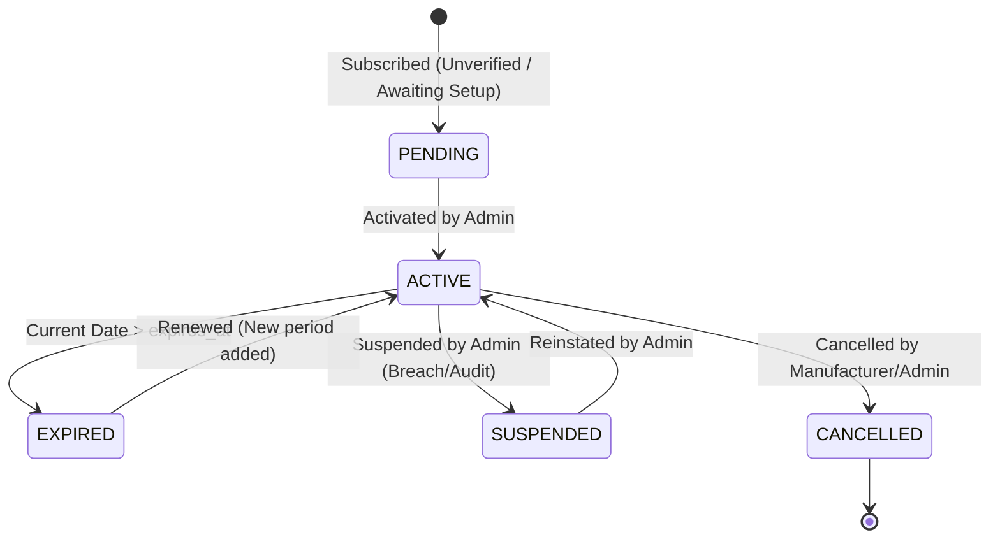
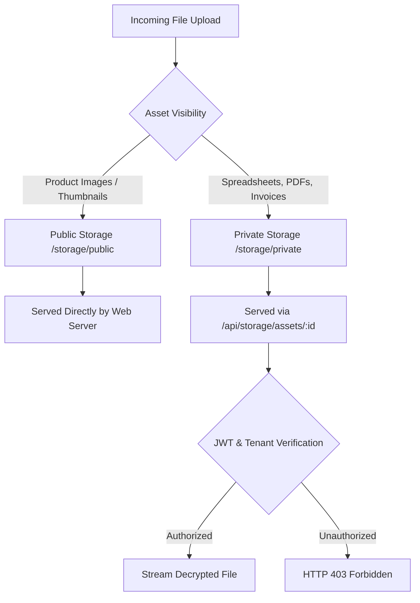

# ZARSEV — Phase 2 Business Rules & Logic Specification

**Branch:** `phase2-data-and-business-architecture`  
**Base Commit:** `eb5544a`  
**Target Environment:** Local Verified SQLite (`M:\ZZZ\zarsev.db`)  
**Specification Date:** 2026-11-02

---

## 1. Classification Legend

- `[VERIFIED CURRENT BEHAVIOR]`: Confirmed by querying `zarsev.db` and inspecting verified source code in `M:\ZZZ\src`.
- `[PROPOSED FUTURE BEHAVIOR]`: Architectural requirement and schema design planned for Phase 2 implementation.
- `[UNVERIFIED ASSUMPTIONS]`: Existing assumption that has not yet been validated against external systems or real production workflows.
- `[OPEN BUSINESS DECISIONS]`: Strategic trade, export, or administrative choice requiring leadership sign-off.

---

## 2. Product Pricing Business Rules

### 2.1 Authoritative Source & Backward-Compatible Projections
`[PROPOSED FUTURE BEHAVIOR]`

1. **Authoritative Master Table (`product_prices`):**
   - The `product_prices` table is the single source of truth for all pricing data, multi-currency support, volume tiers, Incoterms, validity windows, and quotation modes.
2. **Backward-Compatible Projections (`products` table):**
   - The legacy columns in `products` (`price`, `currency`, `price_unit`, `moq`) are retained as materialized read projections.
   - Legacy frontend screens, Stitch UI pages, search filters, and legacy endpoints reading `products.price` continue to work without modification.
3. **Deterministic Synchronization Rule:**
   - Whenever a price record in `product_prices` is created, updated, or marked `is_primary = 1`, the system executes an automated synchronization to the parent `products` record:
     ```sql
     UPDATE products
     SET price = ?,
         currency = ?,
         price_unit = ?,
         moq = ?,
         updated_at = CURRENT_TIMESTAMP
     WHERE id = ?;
     ```
   - For `QUOTATION_ONLY` products, `products.price` is projected as `NULL`, and `products.moq` reflects the quotation minimum quantity.

### 2.2 Invariants: Primary Price & Non-Overlapping Volume Tiers
`[PROPOSED FUTURE BEHAVIOR]`

1. **Single Active Primary Price Invariant:**
   - For any product, there can be **at most one active primary price** per currency and Incoterm at any given point in time.
   - Enforced by a partial unique index in SQLite:
     ```sql
     CREATE UNIQUE INDEX IF NOT EXISTS uidx_product_prices_primary 
     ON product_prices(product_id, currency, incoterm) 
     WHERE is_primary = 1 AND (valid_to IS NULL OR valid_to > CURRENT_TIMESTAMP);
     ```
2. **Tiered Quantity Overlap Prevention:**
   - For tiered pricing under the same applicable context (`product_id`, `currency`, `incoterm`, overlapping validity window), quantity ranges must be strictly contiguous and non-overlapping:
     $$\text{Tier } N.\text{max\_quantity} < \text{Tier } (N+1).\text{min\_quantity} \quad \text{or} \quad \text{Tier } (N+1).\text{min\_quantity} = \text{Tier } N.\text{max\_quantity} + \epsilon$$
   - Overlapping quantity validation runs in application service logic prior to transaction commit. Any insertion violating range contiguity is rejected with `HTTP 422 Unprocessable Entity`.
3. **Price Validity Windows (Past, Active, Future):**
   - **Active:** `valid_from <= CURRENT_TIMESTAMP AND (valid_to IS NULL OR valid_to >= CURRENT_TIMESTAMP)`.
   - **Future / Scheduled:** `valid_from > CURRENT_TIMESTAMP`. Stored in DB, ignored in public catalog until the effective timestamp.
   - **Expired:** `valid_to < CURRENT_TIMESTAMP`. Kept for historical audit; excluded from active catalog queries.
4. **Historical Price Preservation:**
   - Price updates do not overwrite historical records. When a manufacturer or admin updates an existing active price, the current active record has its `valid_to` set to `CURRENT_TIMESTAMP`, and a new price record is inserted with `valid_from = CURRENT_TIMESTAMP`.

### 2.3 Valid Price Type Combinations Matrix
`[PROPOSED FUTURE BEHAVIOR]`

| Price Type (`price_type`) | `price` Value | `min_quantity` (MOQ) | `max_quantity` | `incoterm` | Public Catalog Display |
| :--- | :--- | :--- | :--- | :--- | :--- |
| `FIXED` | Numeric (`> 0`) | Required (`>= 1.0`) | `NULL` | Required (`FOB`, `CIF`, etc.) | Direct Price (e.g. `$750 / MT (FOB Damietta)`) |
| `TIERED` | Numeric (`> 0`) | Required (`>= 1.0`) | Numeric or `NULL` (for final tier) | Required | Tiered Table (e.g. `1–10 MT: $800`, `11–50 MT: $750`) |
| `QUOTATION_ONLY` | `NULL` | Optional / Minimum MOQ | `NULL` | Optional | "سعر عند الطلب (Quotation on Request)" + RFQ Button |

### 2.4 API Fallback Behavior When No Active Primary Price Exists
`[PROPOSED FUTURE BEHAVIOR]`

When an API client queries `GET /api/products/:id`:
1. Check `product_prices` for an active primary price (`is_primary = 1` and currently valid).
2. If found, format the response with `price`, `currency`, `incoterm`, and the full `prices: [...]` array.
3. If no active primary price exists in `product_prices`:
   - Fall back to the legacy `products.price` column if non-null.
   - If `products.price` is also null or legacy data is missing, return `price: null, is_quotation_only: true, quotation_label: "سعر عند الطلب (Quotation on Request)"`.

---

## 3. Subscription Lifecycle & Usage Ledger Rules

### 3.1 Direct Contract Exemption
`[VERIFIED CURRENT BEHAVIOR]` & `[PROPOSED FUTURE BEHAVIOR]`

- Direct Contract manufacturers (`business_model = 'DIRECT_CONTRACT'`) are **100% exempt** from:
  - Subscription expiration dates.
  - Quota checks (`max_monthly_imports`, `max_products_per_import`).
  - Suspension blocks.
- In `subscriptionGuard.js`, the check `if (mfg.business_model === 'DIRECT_CONTRACT') return next();` guarantees non-blocking execution for sovereign and ZARSEV-managed facilities.

### 3.2 Subscription State Machine (`manufacturer_subscriptions`)
`[PROPOSED FUTURE BEHAVIOR]`



#### State Transition Matrix

| Current State | Target State | Trigger / Condition | Actor | Quota Action |
| :--- | :--- | :--- | :--- | :--- |
| `PENDING` | `ACTIVE` | Initial verification & plan activation | `SUPER_ADMIN` | Start billing cycle, quota initialized |
| `ACTIVE` | `EXPIRED` | System cron or request middleware detects `NOW > expires_at` | System | Restrict to read-only; block uploads |
| `ACTIVE` | `SUSPENDED` | Manual administrative freeze | `SUPER_ADMIN` | Freeze all catalog additions; block uploads |
| `SUSPENDED` | `ACTIVE` | Administrative reinstatement | `SUPER_ADMIN` | Restore privileges for remaining period |
| `EXPIRED` | `ACTIVE` | Subscription renewal | `SUPER_ADMIN` | Extend `expires_at`, reset usage cycle |
| `ACTIVE` | `CANCELLED` | Explicit cancellation | `SUPER_ADMIN` | Close subscription, retain data |

### 3.3 Auditable Usage Ledger (`subscription_usage`)
`[PROPOSED FUTURE BEHAVIOR]`

Instead of a single mutable counter, all usage is recorded in an immutable ledger:

```sql
CREATE TABLE IF NOT EXISTS subscription_usage (
    id TEXT PRIMARY KEY,
    subscription_id TEXT NOT NULL,
    manufacturer_id TEXT NOT NULL,
    usage_type TEXT NOT NULL CHECK(usage_type IN ('IMPORT_SESSION', 'PRODUCT_UPLOAD', 'AI_EXTRACTION', 'ADMIN_ADJUSTMENT')),
    quantity INTEGER NOT NULL DEFAULT 1,
    billing_period TEXT NOT NULL, -- Format: YYYY-MM
    related_import_id TEXT NULL,
    actor_user_id TEXT NOT NULL,
    idempotency_key TEXT UNIQUE NOT NULL,
    notes TEXT NULL,
    created_at DATETIME DEFAULT CURRENT_TIMESTAMP,
    FOREIGN KEY(manufacturer_id) REFERENCES manufacturers(id),
    FOREIGN KEY(actor_user_id) REFERENCES users(id)
);
```

### 3.4 Quota Calculation & Concurrency Protection
`[PROPOSED FUTURE BEHAVIOR]`

- Current month usage is calculated dynamically via ledger aggregation:
  ```sql
  SELECT COALESCE(SUM(quantity), 0) as used_count
  FROM subscription_usage
  WHERE manufacturer_id = ? 
    AND billing_period = strftime('%Y-%m', 'now')
    AND usage_type = 'IMPORT_SESSION';
  ```
- **Concurrency Protection:** Upload requests submit an `idempotency_key` (hash of file batch + manufacturer ID + timestamp hour). An atomic transaction inserts into `subscription_usage` only if `used_count + 1 <= max_monthly_imports`.

### 3.5 Permissions Matrix for Expired Manufacturers
`[PROPOSED FUTURE BEHAVIOR]`

| Platform Action | Active Manufacturer | Expired Manufacturer | Suspended Manufacturer |
| :--- | :--- | :--- | :--- |
| **Browse Public Catalog** | Allowed | Allowed | Allowed |
| **View Own Products** | Allowed | Allowed | Allowed |
| **Edit Existing Drafts** | Allowed | Allowed | Blocked |
| **Upload New Catalog Files** | **Allowed** | **BLOCKED (HTTP 403)** | **BLOCKED (HTTP 403)** |
| **Submit Drafts for Approval** | **Allowed** | **BLOCKED (HTTP 403)** | **BLOCKED (HTTP 403)** |
| **Export Own Product Data** | Allowed | Allowed | Allowed |

### 3.6 Payment Processing Boundary
`[VERIFIED CURRENT BEHAVIOR]` & `[PROPOSED FUTURE BEHAVIOR]`

- **Zero External Payment Gateways in Phase 2:**
  No Stripe, PayPal, or Paymob dependencies are introduced.
- Subscription activation is recorded as administrative or bank-transfer verified (`payment_status IN ('WAIVED', 'INVOICED', 'BANK_TRANSFER_VERIFIED')`).

---

## 4. Durable Import Queue Business Rules

### 4.1 Worker Heartbeat & Lease Expiration
`[PROPOSED FUTURE BEHAVIOR]`

1. **Lease Duration:** When a worker claims an import job from `import_jobs`, it obtains a lease for **10 minutes** (`lease_expires_at = CURRENT_TIMESTAMP + 10 minutes`).
2. **Heartbeat:** Every 60 seconds during processing, the worker updates `last_heartbeat_at = CURRENT_TIMESTAMP` and extends `lease_expires_at`.
3. **Safe Crash Recovery (No Blind Re-queuing):**
   - On server reboot, the system queries jobs with `status = 'PROCESSING'`.
   - A job is **NOT** re-queued if its lease is still valid.
   - If `lease_expires_at < CURRENT_TIMESTAMP` (stale crashed worker):
     - If `attempts < max_attempts` (default 3): Job is re-queued with a log entry: `"استعادة المعالجة تلقائياً بعد توقف الخادم (Server Restart Recovery)"`.
     - If `attempts >= max_attempts`: Job transitions to `FAILED` with error: `"تجاوزت المهمة الحد الأقصى للمحاولات (Terminal Failure)"`.

### 4.2 Prevention of Duplicate Products & Duplicate Processing
`[PROPOSED FUTURE BEHAVIOR]`

1. **Upload Idempotency:** An import session cannot be submitted twice. The `import_jobs` table enforces a unique constraint on `import_id`.
2. **Partial Extraction Resume:**
   - If a job fails midway during spreadsheet extraction, items already written to `import_items` with `status IN ('AWAITING_REVIEW', 'READY')` are checked before reprocessing.
3. **Product Creation Idempotency:**
   - Products are only created when an admin or user explicitly approves items in `approvalRoutes.js`.
   - The duplicate detection service checks for identical `(manufacturer_id, sku)` and `(manufacturer_id, name_ar similarity >= 0.70)` before drafting new products.

---

## 5. Storage & Private File Security Rules

### 5.1 Public vs Private Asset Separation
`[PROPOSED FUTURE BEHAVIOR]`



### 5.2 Storage Security Invariants
`[PROPOSED FUTURE BEHAVIOR]`

1. **Storage Keys vs Client Filenames:**
   - Physical disk filenames are cryptographically generated UUIDs: `asset_<random_hex_12>.<sanitized_ext>`.
   - Client-provided filenames (e.g. `قائمة_أسعار_أكتوبر.xlsx`) are stored strictly in `file_assets.original_name` and never used as disk paths.
2. **Path Traversal Defense:**
   - Client filenames are stripped of all `../`, `..\\`, null bytes, and path delimiters.
3. **Private File Authorization:**
   - Every download request to `/api/storage/assets/:id` checks:
     - Is the user `SUPER_ADMIN`? -> Allowed.
     - Is the user `LOGISTICS_OFFICER` and the asset belongs to a `DIRECT_CONTRACT` manufacturer? -> Allowed.
     - Is the user `MANUFACTURER` and `asset.manufacturer_id === user.manufacturer_id`? -> Allowed.
     - Otherwise -> `HTTP 403 Forbidden`.
4. **MIME Verification:**
   - Uploads are validated against magic numbers (first bytes) rather than trusting client HTTP headers.
5. **Future S3 Compatibility:**
   - All file operations go through `StorageDriver.put()`, `get()`, `delete()`.
   - Local storage is the default. S3 driver is an architectural interface skeleton only.

---

## 6. Open Business Decisions & Unverified Assumptions

### 6.1 `[OPEN BUSINESS DECISIONS]`
1. **Decision 1: Incoterm Freight Responsibility for Marketing Subscription:**
   - *Question:* Should Marketing Subscription manufacturers be allowed to quote `CIF` (Cost, Insurance & Freight) directly, or must maritime shipping be routed through ZARSEV logistics?
   - *Recommendation:* Allow manufacturers to specify CIF if they possess export licenses; otherwise default to FOB / EXW with a "Request ZARSEV Maritime Shipping" addon.
2. **Decision 2: Quotation Expiration Window:**
   - *Question:* What is the default expiration period for custom trade quotations? (e.g., 7 days, 14 days, 30 days).
   - *Recommendation:* Default to 14 days due to maritime freight rate volatility.
3. **Decision 3: Quota Rollover Policy:**
   - *Question:* Do unused monthly imports roll over to the next month?
   - *Recommendation:* No rollover for Standard/Pro tiers; optional rollover for Enterprise contracts.

### 6.2 `[UNVERIFIED ASSUMPTIONS]`
1. **Currency Exchange Rates:** Assumed in Phase 2 that currencies are stated independently without live algorithmic exchange rate conversion.
2. **Single Currency per Tier Record:** Assumed that each price tier specifies an explicit currency rather than dynamic cross-currency conversions.
