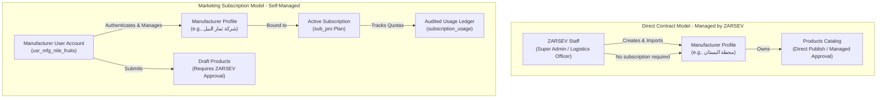

# ZARSEV — Phase 2 Current Database Schema & Business Model Inventory

**Branch:** `phase2-data-and-business-architecture`  
**Base Commit:** `eb5544a`  
**Target Environment:** Local Verified SQLite (`M:\ZZZ\zarsev.db`)  
**Audit Timestamp:** 2026-11-02T10:22:00+02:00

---

## 1. Classification Legend

Every architectural section and data definition in this inventory is strictly tagged with one of the following classification markers:

- `[VERIFIED CURRENT BEHAVIOR]`: Confirmed by querying `zarsev.db` and inspecting verified source code in `M:\ZZZ\src`.
- `[PROPOSED FUTURE BEHAVIOR]`: Architectural requirement and schema design planned for Phase 2 implementation.
- `[UNVERIFIED ASSUMPTIONS]`: Existing assumption that has not yet been validated against external systems or real production workflows.
- `[OPEN BUSINESS DECISIONS]`: Strategic trade, export, or administrative choice requiring leadership sign-off.

---

## 2. Verified Current Schema Inventory (`zarsev.db`)

`[VERIFIED CURRENT BEHAVIOR]`  
The active working database `zarsev.db` contains exactly **9 tables**, 12 auto-indexes, and 0 explicit custom secondary indexes. Total record counts verified on November 2, 2026:

| Table Name | Verified Record Count | Primary Purpose |
| :--- | :--- | :--- |
| `users` | 6 | Platform users, credentials, roles, and tenant associations. |
| `subscriptions` | 3 | Template subscription plans (`Standard`, `Pro`, `Enterprise`). |
| `manufacturers` | 4 | Registered production stations, packhouses, and exporters. |
| `categories` | 14 | Two-level product classification hierarchy (e.g. Citrus, Vegetables). |
| `products` | 42 | Products catalog (8 published real, 15 pending, 19 demo/quarantined). |
| `product_images` | 2 | Primary and secondary product gallery images and dHash fingerprints. |
| `imports` | 35 | Batch import session tracking records. |
| `import_items` | 65 | Extracted raw and normalized items awaiting review. |
| `import_logs` | 75 | Structured audit logs for import pipeline steps. |

---

### 2.1 Table: `users`
`[VERIFIED CURRENT BEHAVIOR]`

```sql
CREATE TABLE users (
    id TEXT PRIMARY KEY,
    name TEXT NOT NULL,
    email TEXT UNIQUE NOT NULL,
    password_hash TEXT NULL,
    role TEXT NOT NULL CHECK(role IN ('SUPER_ADMIN', 'LOGISTICS_OFFICER', 'MANUFACTURER')),
    manufacturer_id TEXT NULL,
    is_active INTEGER NOT NULL DEFAULT 1,
    is_demo INTEGER NOT NULL DEFAULT 0,
    token_version INTEGER NOT NULL DEFAULT 1,
    created_at DATETIME DEFAULT CURRENT_TIMESTAMP,
    FOREIGN KEY(manufacturer_id) REFERENCES manufacturers(id) -- Note: not defined in original DDL but logical
);
```

- **Columns & Constraints:**
  - `id`: Unique user identifier (e.g., `usr_super_admin`, `usr_mfg_nile_fruits`).
  - `email`: UNIQUE constraint, normalized lowercase in auth routes.
  - `role`: CHECK constraint restricting to `SUPER_ADMIN`, `LOGISTICS_OFFICER`, `MANUFACTURER`.
  - `manufacturer_id`: NULL for admins and logistics officers; populated only for `MANUFACTURER` users.
  - `is_active`: `1` = active, `0` = deactivated/banned. Enforced in `auth.js` and login route.
  - `is_demo`: `0` = real user, `1` = demo persona.
  - `token_version`: `INTEGER NOT NULL DEFAULT 1`. Incremented on logout to revoke sessions across devices.
- **Current Data Inventory:**
  - 2 `SUPER_ADMIN` accounts (`admin@zarsev.com`, `owner@zarsev.gov`).
  - 1 `LOGISTICS_OFFICER` account (`logistics@zarsev.com`).
  - 2 active `MANUFACTURER` accounts bound to `mfg_nile_fruits` and `mfg_delta_iqf`.
  - 1 test `MANUFACTURER` account (`legacy_user@test.com`) with NULL `manufacturer_id`.

---

### 2.2 Table: `manufacturers`
`[VERIFIED CURRENT BEHAVIOR]`

```sql
CREATE TABLE manufacturers (
    id TEXT PRIMARY KEY,
    name_ar TEXT NOT NULL,
    name_en TEXT NOT NULL,
    code TEXT UNIQUE NOT NULL,
    business_model TEXT NOT NULL CHECK(business_model IN ('DIRECT_CONTRACT', 'MARKETING_SUBSCRIPTION')),
    subscription_id TEXT NULL,
    country TEXT NOT NULL DEFAULT 'مصر',
    city TEXT NOT NULL,
    contact_email TEXT NULL,
    contact_phone TEXT NULL,
    is_verified INTEGER NOT NULL DEFAULT 1,
    is_demo INTEGER NOT NULL DEFAULT 0,
    created_at DATETIME DEFAULT CURRENT_TIMESTAMP,
    FOREIGN KEY(subscription_id) REFERENCES subscriptions(id)
);
```

- **Current Data Inventory:**
  - `mfg_bustan_citrus`: Direct Contract (`DIRECT_CONTRACT`), managed by ZARSEV staff. No manufacturer user account exists.
  - `mfg_damietta_agro`: Direct Contract (`DIRECT_CONTRACT`), managed by ZARSEV staff. No manufacturer user account exists.
  - `mfg_nile_fruits`: Marketing Subscription (`MARKETING_SUBSCRIPTION`), bound to user `usr_mfg_nile_fruits`, `subscription_id = 'sub_pro'`.
  - `mfg_delta_iqf`: Marketing Subscription (`MARKETING_SUBSCRIPTION`), bound to user `usr_mfg_delta_iqf`, `subscription_id = 'sub_standard'`.

---

### 2.3 Table: `subscriptions`
`[VERIFIED CURRENT BEHAVIOR]`

```sql
CREATE TABLE subscriptions (
    id TEXT PRIMARY KEY,
    name TEXT NOT NULL,
    allowed_formats TEXT NOT NULL, -- JSON array e.g. ["xlsx","csv","images"]
    max_products_per_import INTEGER NOT NULL,
    max_monthly_imports INTEGER NOT NULL,
    max_file_size_mb INTEGER NOT NULL,
    ai_extraction_enabled INTEGER NOT NULL DEFAULT 1,
    bulk_import_enabled INTEGER NOT NULL DEFAULT 1,
    created_at DATETIME DEFAULT CURRENT_TIMESTAMP
);
```

- **Current Limitation `[PROPOSED FUTURE BEHAVIOR]`:**
  This table acts strictly as a *plan template catalog*. It lacks:
  - Plan pricing (`price_monthly`, `currency`).
  - Active vs archived plan flag (`is_active`).
  - Quota for maximum active products in catalog (`max_active_products`).
  - Association with specific subscription start/end dates.

---

### 2.4 Table: `products`
`[VERIFIED CURRENT BEHAVIOR]`

```sql
CREATE TABLE products (
    id TEXT PRIMARY KEY,
    manufacturer_id TEXT NOT NULL,
    category_id TEXT NULL,
    subcategory_id TEXT NULL,
    sku TEXT NULL,
    name_ar TEXT NOT NULL,
    name_en TEXT NULL,
    description_ar TEXT NULL,
    description_en TEXT NULL,
    specifications TEXT NULL, -- JSON object
    packaging_info TEXT NULL,
    country_of_origin TEXT NOT NULL DEFAULT 'مصر',
    price REAL NULL,
    currency TEXT NOT NULL DEFAULT 'USD',
    price_unit TEXT NOT NULL DEFAULT 'MT',
    moq TEXT NULL,
    available_quantity TEXT NULL,
    status TEXT NOT NULL DEFAULT 'DRAFT' CHECK(status IN ('DRAFT', 'PENDING_APPROVAL', 'APPROVED', 'PUBLISHED', 'REJECTED')),
    rejection_reason TEXT NULL,
    source_import_id TEXT NULL,
    is_demo INTEGER NOT NULL DEFAULT 0,
    created_at DATETIME DEFAULT CURRENT_TIMESTAMP,
    updated_at DATETIME DEFAULT CURRENT_TIMESTAMP,
    FOREIGN KEY(manufacturer_id) REFERENCES manufacturers(id),
    FOREIGN KEY(category_id) REFERENCES categories(id)
);
```

- **Current Pricing Architecture Limitations `[PROPOSED FUTURE BEHAVIOR]`:**
  - `price` is a single nullable REAL column.
  - `currency` is a single flat string (defaults to `USD`).
  - `price_unit` is a single flat string (defaults to `MT` - Metric Ton).
  - No representation for quantity price breaks (e.g. 1–10 MT vs 11–50 MT).
  - No Incoterms (FOB, CIF, CFR, EXW).
  - No price validity period (`valid_from`, `valid_to`).
  - No explicit flag for products requiring quotation on request (`QUOTATION_ONLY`).

---

### 2.5 Table: `product_images`
`[VERIFIED CURRENT BEHAVIOR]`

```sql
CREATE TABLE product_images (
    id TEXT PRIMARY KEY,
    product_id TEXT NOT NULL,
    url TEXT NOT NULL,
    thumbnail_url TEXT NULL,
    is_primary INTEGER NOT NULL DEFAULT 0,
    display_order INTEGER NOT NULL DEFAULT 0,
    dhash TEXT NULL,
    file_size INTEGER NULL,
    created_at DATETIME DEFAULT CURRENT_TIMESTAMP,
    FOREIGN KEY(product_id) REFERENCES products(id) ON DELETE CASCADE
);
```

---

### 2.6 Table: `imports`
`[VERIFIED CURRENT BEHAVIOR]`

```sql
CREATE TABLE imports (
    id TEXT PRIMARY KEY,
    user_id TEXT NOT NULL,
    manufacturer_id TEXT NULL,
    source_files TEXT NOT NULL, -- JSON array of file metadata
    status TEXT NOT NULL DEFAULT 'PENDING' CHECK(status IN ('PENDING', 'PARSING', 'EXTRACTING', 'REVIEW_READY', 'SAVED_DRAFT', 'SUBMITTED', 'FAILED')),
    total_detected INTEGER NOT NULL DEFAULT 0,
    total_valid INTEGER NOT NULL DEFAULT 0,
    total_failed INTEGER NOT NULL DEFAULT 0,
    progress_percent INTEGER NOT NULL DEFAULT 0,
    error_summary TEXT NULL,
    is_demo INTEGER NOT NULL DEFAULT 0,
    created_at DATETIME DEFAULT CURRENT_TIMESTAMP,
    updated_at DATETIME DEFAULT CURRENT_TIMESTAMP,
    FOREIGN KEY(user_id) REFERENCES users(id),
    FOREIGN KEY(manufacturer_id) REFERENCES manufacturers(id)
);
```

---

### 2.7 Table: `import_items`
`[VERIFIED CURRENT BEHAVIOR]`

```sql
CREATE TABLE import_items (
    id TEXT PRIMARY KEY,
    import_id TEXT NOT NULL,
    suggested_manufacturer_id TEXT NULL,
    suggested_category_id TEXT NULL,
    raw_data TEXT NULL, -- JSON
    extracted_data TEXT NOT NULL, -- JSON product fields
    confidence_score REAL NOT NULL DEFAULT 1.0,
    validation_warnings TEXT NULL, -- JSON array of warnings
    is_duplicate INTEGER NOT NULL DEFAULT 0,
    duplicate_matched_id TEXT NULL,
    duplicate_reason TEXT NULL,
    assigned_images TEXT NULL, -- JSON array
    status TEXT NOT NULL DEFAULT 'AWAITING_REVIEW' CHECK(status IN ('AWAITING_REVIEW', 'READY', 'SKIPPED', 'SAVED', 'FAILED')),
    error_message TEXT NULL,
    created_at DATETIME DEFAULT CURRENT_TIMESTAMP,
    FOREIGN KEY(import_id) REFERENCES imports(id) ON DELETE CASCADE
);
```

---

### 2.8 Table: `import_logs`
`[VERIFIED CURRENT BEHAVIOR]`

```sql
CREATE TABLE import_logs (
    id TEXT PRIMARY KEY,
    import_id TEXT NOT NULL,
    step TEXT NOT NULL,
    message TEXT NOT NULL,
    severity TEXT NOT NULL DEFAULT 'INFO' CHECK(severity IN ('INFO', 'WARNING', 'ERROR')),
    timestamp DATETIME DEFAULT CURRENT_TIMESTAMP,
    FOREIGN KEY(import_id) REFERENCES imports(id) ON DELETE CASCADE
);
```

---

## 3. Preservation of the Two Manufacturer Business Models

`[VERIFIED CURRENT BEHAVIOR]` & `[PROPOSED FUTURE BEHAVIOR]`

A core principle of the ZARSEV Sovereign Platform is the clear distinction between the two operational manufacturer models:



### Detailed Business Model Comparison Matrix

| Property | Direct Contract (`DIRECT_CONTRACT`) | Marketing Subscription (`MARKETING_SUBSCRIPTION`) |
| :--- | :--- | :--- |
| **User Account** | **Not Required.** No external portal login is created. | **Required.** Dedicated manufacturer account (`role = 'MANUFACTURER'`). |
| **Subscription Requirement** | **None.** Does not require an active paid subscription plan. | **Mandatory.** Must have an active subscription in `manufacturer_subscriptions`. |
| **Quota Enforcement** | **Exempt.** Unlimited imports, files, and products managed by ZARSEV staff. | **Strictly Enforced.** Bounded by plan limits (`max_monthly_imports`, `max_products_per_import`). |
| **Product Approval** | ZARSEV staff publish directly or approve internally. | Manufacturer submits drafts to `PENDING_APPROVAL`; ZARSEV approves or rejects. |
| **Tenant Isolation** | Accessible to `SUPER_ADMIN` and `LOGISTICS_OFFICER`. | Strictly isolated to the authenticated manufacturer user (`user.manufacturer_id`). |
| **Expiration Impact** | **Immune.** Direct Contract operations never expire based on subscription rules. | When subscription expires or suspends, uploads and submissions are blocked. |

> [!IMPORTANT]
> `[PROPOSED FUTURE BEHAVIOR]`  
> New tables (`manufacturer_subscriptions`, `subscription_usage`) must **NEVER** add a `NOT NULL` constraint requiring every manufacturer to possess a subscription. Direct Contract manufacturers must remain completely functional with `subscription_id = NULL` or an exempt flag.
