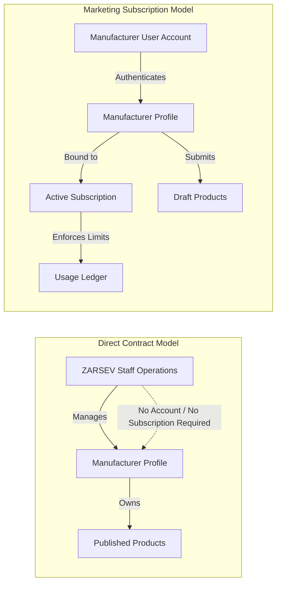
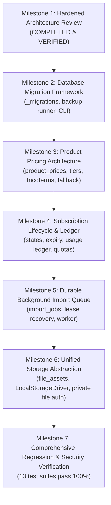

# ZARSEV — Phase 2 Data & Business Architecture Implementation Plan (Hardened)

**Branch:** `phase2-data-and-business-architecture`  
**Base Commit:** `eb5544a`  
**Target Environment:** Local Verified SQLite (`M:\ZZZ\zarsev.db`)  
**Revision Date:** 2026-11-02  
**Status:** Architecture Specification Awaiting Milestone 2 Authorization

---

## 1. Classification Legend

Every architectural section, schema definition, and business rule in this implementation plan is strictly tagged:

- `[VERIFIED CURRENT BEHAVIOR]`: Confirmed by querying `zarsev.db` and inspecting verified source code in `M:\ZZZ\src`.
- `[PROPOSED FUTURE BEHAVIOR]`: Architectural requirement and schema design planned for Phase 2 implementation.
- `[UNVERIFIED ASSUMPTIONS]`: Existing assumption that has not yet been validated against external systems or real production workflows.
- `[OPEN BUSINESS DECISIONS]`: Strategic trade, export, or administrative choice requiring leadership sign-off.

---

## 2. Supporting Architecture Documentation Index

This master plan is supported by 5 detailed specifications:

1. **[phase2_current_schema_inventory.md](file:///M:/ZZZ/docs/phase2_current_schema_inventory.md):** Complete inventory of all 9 current tables, columns, indexes, constraints, and business model topologies.
2. **[phase2_business_rules.md](file:///M:/ZZZ/docs/phase2_business_rules.md):** Authoritative rules for multi-currency pricing, deterministic partial indexes, volume tiers, Incoterms, subscription state machine, usage ledger, worker fencing tokens (`lease_generation`), and private storage.
3. **[phase2_migration_safety_plan.md](file:///M:/ZZZ/docs/phase2_migration_safety_plan.md):** 8-phase SQLite backup protocol, WAL checkpoint busy retry, `PRAGMA integrity_check`, schema/count validation, atomic promotion, anti-tamper checksums, concurrency locks, and transactional DDL rules.
4. **[phase2_security_and_tenant_matrix.md](file:///M:/ZZZ/docs/phase2_security_and_tenant_matrix.md):** Detailed RBAC and tenant isolation matrix across `SUPER_ADMIN`, `LOGISTICS_OFFICER`, `MANUFACTURER`, and `ANONYMOUS_PUBLIC`.
5. **[phase2_test_strategy.md](file:///M:/ZZZ/docs/phase2_test_strategy.md):** Specifications for 5 new automated test suites covering migrations, pricing boundaries, subscription quotas, worker resilience, and private asset protection.

---

## 3. Preservation of the Two Manufacturer Business Models

`[VERIFIED CURRENT BEHAVIOR]` & `[PROPOSED FUTURE BEHAVIOR]`

The ZARSEV platform operates two distinct manufacturer business models:



### Core Invariants
1. **Direct Contract / Managed by ZARSEV (`DIRECT_CONTRACT`):**
   - **No user account required.** ZARSEV staff (`SUPER_ADMIN` and `LOGISTICS_OFFICER`) manage the manufacturer profile and product catalog directly.
   - **No subscription required.** Direct Contract manufacturers do **NOT** require an entry in `manufacturer_subscriptions`.
   - **Zero quota restrictions.** Free from import limits or monthly caps.
   - **Immediate/Managed publishing.** ZARSEV staff can approve and publish products directly.
2. **Marketing Subscription / Self-Managed (`MARKETING_SUBSCRIPTION`):**
   - **Authenticated account required.** Exporter logs in with their own credentials (`role = 'MANUFACTURER'`).
   - **Active subscription required.** Must possess an active record in `manufacturer_subscriptions`.
   - **Quotas strictly enforced.** Bounded by plan limits tracked in `subscription_usage`.
   - **Approval gatekeeper.** All products are created as `DRAFT` or `PENDING_APPROVAL` and require ZARSEV review before publication.
   - **Tenant isolation.** Strictly barred from viewing other manufacturers' products, prices, or documents.

---

## 4. Milestone 2: Versioned Database Migration Framework

`[PROPOSED FUTURE BEHAVIOR]`

### 4.1 Architecture & 8-Phase Safety Protocol
- **Tracking Table:** `_migrations` (columns: `id, name, batch, checksum, applied_at`).
- **Concurrency Locking:** `_migration_lock` ensures single-process migration execution.
- **Pre-Migration Backup Protocol:**
  1. Acquire migration execution lock.
  2. Issue `PRAGMA wal_checkpoint(TRUNCATE)` with exponential backoff on `busy`.
  3. Create live temporary snapshot via `VACUUM INTO ...temp.db`.
  4. Verify database integrity via `PRAGMA integrity_check`.
  5. Verify critical schema tables and row counts (`users >= 6`, `products >= 42`).
  6. Atomically promote temporary file to permanent `backup_pre_migration_<name>_<timestamp>.db`.
  7. Preserve all historical backup files.
  8. Enforce fatal abort if any backup verification step fails (migration strictly blocked).
- **Transactional DDL:** Every migration runs inside `BEGIN TRANSACTION ... COMMIT`. On any error, an immediate `ROLLBACK` is triggered.
- **Anti-Tampering Checksum:** Migration runner calculates the SHA-256 hash of each file and compares it with `_migrations.checksum`. Any alteration aborts immediately.
- **Zero Auto-Rollback on Live Database:** Failed migrations roll back within their transaction, preserving existing database tables and backups without destructive drops.

---

## 5. Milestone 3: Advanced Product Pricing Architecture

`[PROPOSED FUTURE BEHAVIOR]`

### 5.1 Architecture & Invariants
- **Authoritative Table (`product_prices`):**
  Supports multi-currency (`USD`, `EUR`, `EGP`, `SAR`, etc.), volume discount tiers, Incoterms (`FOB`, `CIF`, `CFR`, `EXW`, `DDP`), and validity dates (`valid_from`, `valid_to`).
- **Deterministic Partial Unique Index:**
  Replaced non-deterministic predicate with a 100% deterministic partial index:
  ```sql
  CREATE UNIQUE INDEX IF NOT EXISTS uidx_product_prices_primary 
  ON product_prices(product_id, currency, incoterm) 
  WHERE is_primary = 1;
  ```
- **Atomic Primary Replacement (`BEGIN IMMEDIATE`):**
  Activating a primary price demotes existing primary (`is_primary = 0`, `valid_to = CURRENT_TIMESTAMP`) and inserts the new primary inside an immediate write transaction.
- **Deterministic Legacy Projection Policy:**
  Legacy columns `products.price`, `currency`, `price_unit`, `moq` project the primary price according to strict priority:
  `is_default_projection = 1` -> USD -> FOB -> lowest MOQ -> most recent `valid_from`.
- **Explicit Quotation-Only Mode:**
  `price = NULL`, `is_quotation_only = 1`. Unpriced items without this explicit flag remain incomplete drafts with warnings, NOT quotation-only.
- **Non-Overlapping Quantity Tiers:**
  Tier ranges for the same context are validated in application service logic prior to insertion, rejecting overlaps with `HTTP 422`.
- **Historical Price Preservation:**
  Updating an active price sets `valid_to = CURRENT_TIMESTAMP` on the old record and inserts a new active record, preserving full pricing history.

---

## 6. Milestone 4: Manufacturer Subscription Lifecycle & Auditable Ledger

`[PROPOSED FUTURE BEHAVIOR]`

### 6.1 Architecture & State Machine
- **Independent Subscription Status vs Payment Status:**
  - `status`: `PENDING`, `ACTIVE`, `EXPIRED`, `SUSPENDED`, `CANCELLED`.
  - `payment_status`: `UNPAID`, `PENDING_VERIFICATION`, `PAID`, `WAIVED`, `REFUNDED`.
- **Auditable Usage Ledger (`subscription_usage`):**
  Replaces mutable counter with an append-only ledger tracking:
  - `id, subscription_id, manufacturer_id, usage_type, quantity, billing_period, related_import_id, actor_user_id, idempotency_key, created_at`.
- **Atomic Quota Consumption Transaction (`BEGIN IMMEDIATE`):**
  SQLite write serialization prevents race-condition quota overruns under concurrent requests.
- **Scoped Idempotency Protection:**
  `UNIQUE(manufacturer_id, idempotency_key)` guarantees network retries cannot double-charge quotas.
- **Expiration Gatekeeper:**
  Expired manufacturers are restricted to read-only access (can view catalog and own products; uploads and submissions blocked with `HTTP 403`).
- **Administrative Adjustments:**
  Super Admin can inject audited `ADMIN_ADJUSTMENT` entries with logged rationale.

---

## 7. Milestone 5: Durable Background Import Processing

`[PROPOSED FUTURE BEHAVIOR]`

### 7.1 Architecture & Resilience
- **Durable Job Queue (`import_jobs`):**
  Replaces in-memory `setImmediate` with persistent SQLite job tracking.
- **Fencing Token (`lease_generation`):**
  Monotonically increasing token incremented on every job claim. Every worker write verifies:
  `locked_by = workerId AND lease_generation = expectedGen AND lease_expires_at > CURRENT_TIMESTAMP`.
- **Stale Worker Halting:**
  An expired worker attempting to finalize an import after its lease expired affects 0 rows, halts immediately, and discards results without overwriting the newer worker.
- **Worker Heartbeat & Lease Expiration:**
  Workers claim jobs with a **10-minute lease** (`lease_expires_at`). Ongoing workers update `last_heartbeat_at` every 60 seconds.
- **Safe Crash Recovery (No Blind Re-queuing):**
  On server boot, only jobs in `PROCESSING` whose `lease_expires_at < CURRENT_TIMESTAMP` are evaluated. If `attempts < max_attempts`, re-queue with an audit log; otherwise transition to `FAILED`.
- **Upload Idempotency:**
  `import_id` is unique in `import_jobs`. Duplicate submissions are rejected.
- **Storage Path Sanitization:**
  Internal filesystem paths (`M:\ZZZ\storage\...`) are stripped from all client-facing responses.

---

## 8. Milestone 6: Unified Storage Abstraction & Private File Security

`[PROPOSED FUTURE BEHAVIOR]`

### 8.1 Architecture & Gatekeeper
- **StorageDriver Abstraction:**
  Uniform interface (`put()`, `get()`, `delete()`, `getUrl()`). Local storage is default; S3 driver is a future interface specification.
- **File Metadata Ledger (`file_assets`):**
  Tracks `id, storage_driver, file_key, original_name, mime_type, file_size, visibility, owner_user_id, manufacturer_id, sha256`.
- **Public vs Private Isolation:**
  - Public thumbnails/images served via `/storage/public`.
  - Raw supplier spreadsheets, PDFs, and invoices stored in `/storage/private` and served exclusively through `/api/storage/assets/:id` requiring JWT authentication and tenant ownership validation.
- **Path Traversal Defense:**
  Disk keys generated as cryptographic hex IDs. User filenames stored in metadata only.

---

## 9. Phased Execution Roadmap



---

## 10. Verification Gates & Execution Invariants

Prior to authorizing Milestone 2:
1. `phase2-data-and-business-architecture` remains the active branch.
2. Base commit `eb5544a` remains unchanged.
3. No database mutations, migrations, or code changes have been executed.
4. All 5 supporting architecture specifications are committed and available for review.
