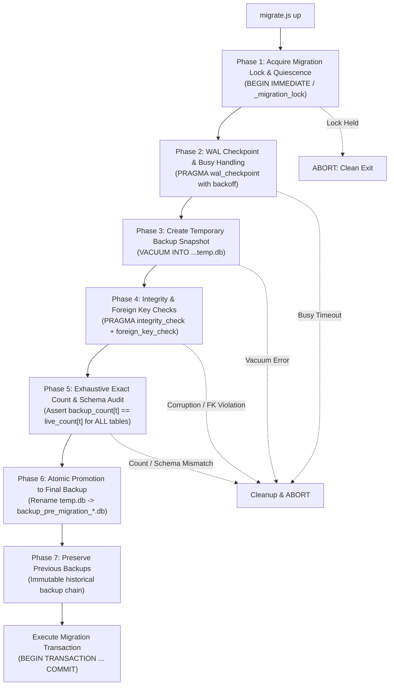

# ZARSEV — Phase 2 Database Migration & Backup Safety Plan (Revised)

**Branch:** `phase2-data-and-business-architecture`  
**Base Commit:** `eb5544a`  
**Target Environment:** Local Verified SQLite (`M:\ZZZ\zarsev.db`)  
**Specification Date:** 2026-11-02  
**Status:** Hardened Technical Safety Specification

---

## 1. Classification Legend

- `[VERIFIED CURRENT BEHAVIOR]`: Confirmed by querying `zarsev.db` and inspecting verified source code in `M:\ZZZ\src`.
- `[PROPOSED FUTURE BEHAVIOR]`: Architectural requirement and schema design planned for Phase 2 implementation.
- `[UNVERIFIED ASSUMPTIONS]`: Existing assumption that has not yet been validated against external systems or real production workflows.
- `[OPEN BUSINESS DECISIONS]`: Strategic trade, export, or administrative choice requiring leadership sign-off.

---

## 2. Current Migration Mechanism vs Target Migration Framework

### 2.1 Current Implementation Audit
`[VERIFIED CURRENT BEHAVIOR]`

- Currently, schema migrations are implemented ad-hoc in [`src/db/database.js`](file:///M:/ZZZ/src/db/database.js#L32-L43):
  ```javascript
  function runMigrations(db) {
      ensureColumn(db, 'users', 'is_active', 'INTEGER NOT NULL DEFAULT 1');
      ensureColumn(db, 'users', 'password_hash', 'TEXT NULL');
      ensureColumn(db, 'users', 'is_demo', 'INTEGER NOT NULL DEFAULT 0');
      ensureColumn(db, 'users', 'token_version', 'INTEGER NOT NULL DEFAULT 1');
      ensureColumn(db, 'manufacturers', 'is_demo', 'INTEGER NOT NULL DEFAULT 0');
      ensureColumn(db, 'products', 'is_demo', 'INTEGER NOT NULL DEFAULT 0');
      ensureColumn(db, 'imports', 'is_demo', 'INTEGER NOT NULL DEFAULT 0');
  }
  ```
- **Critical Gaps in Current System:**
  1. No history of when a change was applied.
  2. No migration rollback capability.
  3. No checksums to detect migration tampering.
  4. No pre-migration database backup trigger.
  5. Cannot perform complex schema transformations (e.g. creating tables, rebuilding with foreign keys).

---

## 3. Comprehensive Migration Backup Protocol & Integrity Gatekeeper

`[PROPOSED FUTURE BEHAVIOR]`

A migration must **NEVER** start if its pre-migration backup cannot be completely created, verified, and promoted. The protocol consists of **8 mandatory sequential phases**:



### Phase 1: Migration Execution Lock & Write-Quiescence Strategy
- **Process Isolation & Fencing:**
  The migration runner acquires an exclusive lock via `_migration_lock`:
  ```sql
  UPDATE _migration_lock 
  SET is_locked = 1, locked_by = ?, locked_at = CURRENT_TIMESTAMP, owner_pid = ?, owner_token = ?
  WHERE id = 1 AND is_locked = 0;
  ```
  - Lock owner identity incorporates hostname, PID, timestamp, and a cryptographically random owner token.
  - Before committing any migration transaction, the runner asserts lock ownership (Fencing Token). If ownership was superseded or lost, execution halts immediately.
  - Safe crash recovery: If lock acquisition fails, the runner checks if `owner_pid` is confirmed dead (`process.kill(pid, 0)` throws `ESRCH`) and stale grace period has elapsed. If dead, the orphaned lock is safely reclaimed. If alive, the runner aborts fail-closed to prevent split-brain execution.

### Phase 2: Explicit Handling of Active SQLite Connections & WAL Checkpoint
- In SQLite WAL mode, readers holding read locks can block checkpointing.
- The runner issues:
  ```sql
  PRAGMA wal_checkpoint(TRUNCATE);
  ```
- **Busy Handling with Exponential Backoff:**
  If the checkpoint returns `busy = 1` (readers holding active transactions):
  - The runner pauses for 500ms, retrying up to 3 times (500ms, 1000ms, 2000ms).
  - If still busy after 3 retries, the runner logs:  
    `"Unable to checkpoint SQLite WAL due to active read locks. Aborting migration."`
  - The migration lock is released, and the process exits with code 1 **without touching any data or schema**.

### Phase 3: Temporary Backup Snapshot Creation (`VACUUM INTO`)
- Live SQLite snapshots must be taken cleanly without tearing pages.
- Backup is written to a temporary staging path:
  ```javascript
  const backupDir = path.join(__dirname, '..', '..', 'storage', 'backups', 'migrations');
  if (!fs.existsSync(backupDir)) fs.mkdirSync(backupDir, { recursive: true });

  const tempBackupPath = path.join(backupDir, `temp_backup_${Date.now()}_${randomHex}.db`);
  db.exec(`VACUUM INTO '${tempBackupPath.replace(/'/g, "''")}';`);
  ```

### Phase 4: SQLite Database Integrity & Foreign Key Checks
- Open the temporary backup file in a separate, isolated SQLite connection:
  ```javascript
  const backupDb = new DatabaseSync(tempBackupPath);
  
  // 1. PRAGMA integrity_check
  const integrity = backupDb.prepare('PRAGMA integrity_check;').get();
  if (!integrity || integrity.integrity_check !== 'ok') {
      backupDb.close();
      if (fs.existsSync(tempBackupPath)) fs.unlinkSync(tempBackupPath);
      throw new Error(`[CRITICAL] Pre-migration backup failed integrity check: ${JSON.stringify(integrity)}`);
  }

  // 2. PRAGMA foreign_key_check
  const fkViolations = backupDb.prepare('PRAGMA foreign_key_check;').all();
  if (fkViolations.length > 0) {
      backupDb.close();
      if (fs.existsSync(tempBackupPath)) fs.unlinkSync(tempBackupPath);
      throw new Error(`[CRITICAL] Pre-migration backup contains ${fkViolations.length} foreign key violations!`);
  }
  ```

### Phase 5: Strategy B Snapshot-Internal Structural & Schema Parity Verification
- **Strategy B Justification:**
  SQLite's `VACUUM INTO` creates an atomic point-in-time ACID snapshot of the database at the instant the command executes. In SQLite, `VACUUM INTO` cannot be executed inside a multi-statement transaction. Comparing live table row counts queried *after* `VACUUM INTO` against the snapshot produces false-positive mismatches if asynchronous writes occur between snapshot completion and verification.
- **Deep Parity Invariants:**
  1. Exhaustive dynamic table discovery from `sqlite_master` in live DB.
  2. Confirm every application table exists in the snapshot `sqlite_master`.
  3. Validate exact 1:1 column schema definition parity (`PRAGMA table_info`) for all tables.
  4. Validate all index schema definitions (`sqlite_master` type='index') exist in snapshot.
  5. Validate each table in the snapshot is queryable.
  6. Optional strict write-quiescence mode (`requireWriteQuiescence: true`): Asserts baseline counts before `VACUUM INTO` match live counts throughout verification, aborting if concurrent writes occur.

### Phase 6: Atomic Promotion to Permanent Verified Backup
- Only when all integrity, foreign key, table existence, and schema index parity checks pass 100%, the temporary backup is promoted to its permanent filename with timestamp and random suffix to eliminate collisions:
  ```javascript
  const timestamp = new Date().toISOString().replace(/[:.]/g, '-');
  const finalBackupPath = path.join(backupDir, `backup_pre_migration_${migrationName}_${timestamp}_${randomSuffix}.db`);
  fs.renameSync(tempBackupPath, finalBackupPath);
  console.log(`✅ Pre-migration backup verified & promoted: ${path.basename(finalBackupPath)}`);
  ```

### Phase 7: Preservation of All Historical Backups
- The migration framework **never deletes or overwrites** historical backups.
- All existing backups (`zarsev.db.bak`, `zarsev.db.phase1_2_prequarantine.bak`, and past migration snapshots) remain immutable on disk.

### Phase 8: Safe Failure Behavior & Absolute Invariant
- If **any** step fails during Phases 1–6:
  1. Temporary `.db` files are deleted.
  2. The migration lock is cleanly released.
  3. The error is written to stdout and audit log.
  4. The migration runner terminates with exit code 1.
  5. **Absolute Invariant:** A migration is **NEVER** allowed to start if its pre-migration backup cannot be verified. Never automatically delete or overwrite the only valid backup.

### Phase 8: Safe Failure Behavior & Invariant
- If **any** step fails during Phases 1–6:
  1. Temporary `.db` files are deleted.
  2. The migration lock is cleanly released.
  3. The error is written to stdout and audit log.
  4. The migration runner terminates with exit code 1.
  5. **Absolute Invariant:** A migration is **NEVER** allowed to start if its pre-migration backup cannot be verified.

---

## 4. SQLite Transaction Behavior & DDL Limitations

### 4.1 Supported Transactional DDL in SQLite
`[PROPOSED FUTURE BEHAVIOR]`

SQLite natively supports transactional DDL for:
- `CREATE TABLE`, `CREATE INDEX`, `CREATE VIEW`, `CREATE TRIGGER`.
- `DROP TABLE`, `DROP INDEX`, `DROP VIEW`, `DROP TRIGGER`.
- `ALTER TABLE ADD COLUMN`.
- `ALTER TABLE RENAME TO`.

Every migration runs enclosed within:
```sql
BEGIN TRANSACTION;
-- Migration DDL & DML statements
COMMIT;
```
If an error occurs, SQLite triggers an automatic `ROLLBACK`, leaving existing database tables untouched.

### 4.2 Handling Unsupported DDL (The 12-Step Rebuild Pattern)
`[PROPOSED FUTURE BEHAVIOR]`

SQLite does not support altering column types or constraints post-creation. When modifying existing columns or constraints is required, the migration **MUST** use the official 12-step table rebuild pattern:
1. `PRAGMA foreign_keys = OFF;`
2. `BEGIN TRANSACTION;`
3. `CREATE TABLE products_new (...);`
4. `INSERT INTO products_new SELECT ... FROM products;`
5. `DROP TABLE products;`
6. `ALTER TABLE products_new RENAME TO products;`
7. Recreate indexes and triggers.
8. `PRAGMA foreign_key_check;`
9. `COMMIT;`
10. `PRAGMA foreign_keys = ON;`

---

## 5. Checksum Verification & Anti-Tampering Protocol

### 5.1 Architecture of `_migrations` Table
`[PROPOSED FUTURE BEHAVIOR]`

```sql
CREATE TABLE IF NOT EXISTS _migrations (
    id INTEGER PRIMARY KEY AUTOINCREMENT,
    name TEXT UNIQUE NOT NULL,
    batch INTEGER NOT NULL,
    checksum TEXT NOT NULL, -- SHA-256 hash of migration file content
    applied_at DATETIME DEFAULT CURRENT_TIMESTAMP
);
```

### 5.2 Anti-Tampering Check
`[PROPOSED FUTURE BEHAVIOR]`

When `migrate.js` runs:
1. Fetch all records from `_migrations` ordered by `id ASC`.
2. For each applied migration, compute the SHA-256 hash of the corresponding file on disk.
3. If `currentChecksum !== record.checksum`:
   - Throw a fatal security error:
     `"[SECURITY VIOLATION] Migration file checksum mismatch for ${record.name}. Historical migration files must NEVER be modified. Aborting."`
   - Release lock and exit immediately.

---

## 7. Hardened Database Restore Protocol (`restoreFromBackup`)
`[IMPLEMENTED BEHAVIOR]`

Restoring an SQLite database from backup is protected by a 7-phase gatekeeper:
1. **Source Backup Validation:** Executes `PRAGMA integrity_check` and `PRAGMA foreign_key_check` on the backup file before touching the target.
2. **Active Contention Gatekeeper:** Asserts write quiescence on target database via `PRAGMA wal_checkpoint(TRUNCATE)`; refuses restoration if busy.
3. **Pre-Restore Target Safety Snapshot:** Generates and verifies a safety backup of the existing target database (`pre_restore_<target>_<timestamp>_<rnd>.bak`).
4. **Safe WAL & SHM Sidecar Isolation:** Archives existing `${targetDbPath}-wal` and `${targetDbPath}-shm` files to prevent catastrophic header salt replay corruption.
5. **Staging Database Verification:** Stages restored file in target filesystem directory and runs full integrity/foreign key validation prior to promotion.
6. **Safe Two-Step File Swap with Automated Rollback:** Uses staging swap with automated catch-rollback restoring original target if filesystem replacement fails.
7. **Post-Restoration Target Verification:** Re-opens target database after replacement and confirms `PRAGMA integrity_check` returns `ok` and 0 foreign key violations.

---

## 8. Persistent Migration Failure Audit (`_migration_failures`)
`[IMPLEMENTED BEHAVIOR]`

When any migration fails during execution:
1. The migration transaction is immediately rolled back via `ROLLBACK;`.
2. A separate transaction records the failure in `_migration_failures`:
   ```sql
   CREATE TABLE IF NOT EXISTS _migration_failures (
       id INTEGER PRIMARY KEY AUTOINCREMENT,
       name TEXT NOT NULL,
       batch INTEGER NOT NULL,
       checksum TEXT NOT NULL,
       error_message TEXT NOT NULL,
       error_stack TEXT NULL,
       failed_at DATETIME DEFAULT CURRENT_TIMESTAMP
   );
   ```
3. The failed migration is **never** recorded in `_migrations`.
4. The migration CLI surfaces recent failure records during `status` queries.

