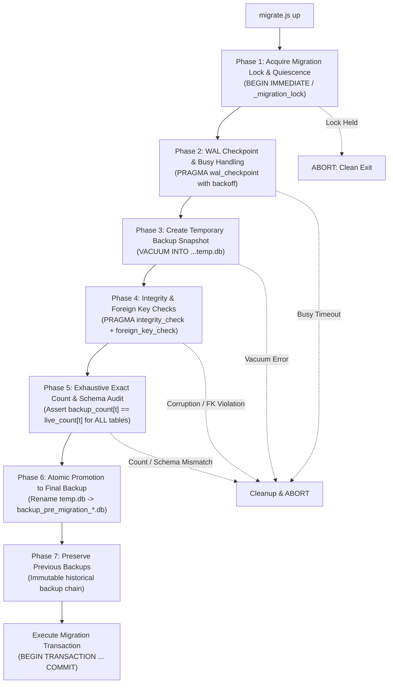

# ZARSEV — Phase 2 Database Migration & Backup Safety Plan (Revised)

**Branch:** `phase2-data-and-business-architecture`  
**Base Commit:** `eb5544a`  
**Target Environment:** Local Verified SQLite (`M:\ZZZ\zarsev.db`)  
**Specification Date:** 2026-11-02  
**Status:** Hardened Technical Safety Specification

---

## 1. Classification Legend

- `[VERIFIED CURRENT BEHAVIOR]`: Confirmed by querying `zarsev.db` and inspecting verified source code in `M:\ZZZ\src`.
- `[PROPOSED FUTURE BEHAVIOR]`: Architectural requirement and schema design planned for Phase 2 implementation.
- `[UNVERIFIED ASSUMPTIONS]`: Existing assumption that has not yet been validated against external systems or real production workflows.
- `[OPEN BUSINESS DECISIONS]`: Strategic trade, export, or administrative choice requiring leadership sign-off.

---

## 2. Current Migration Mechanism vs Target Migration Framework

### 2.1 Current Implementation Audit
`[VERIFIED CURRENT BEHAVIOR]`

- Currently, schema migrations are implemented ad-hoc in [`src/db/database.js`](file:///M:/ZZZ/src/db/database.js#L32-L43):
  ```javascript
  function runMigrations(db) {
      ensureColumn(db, 'users', 'is_active', 'INTEGER NOT NULL DEFAULT 1');
      ensureColumn(db, 'users', 'password_hash', 'TEXT NULL');
      ensureColumn(db, 'users', 'is_demo', 'INTEGER NOT NULL DEFAULT 0');
      ensureColumn(db, 'users', 'token_version', 'INTEGER NOT NULL DEFAULT 1');
      ensureColumn(db, 'manufacturers', 'is_demo', 'INTEGER NOT NULL DEFAULT 0');
      ensureColumn(db, 'products', 'is_demo', 'INTEGER NOT NULL DEFAULT 0');
      ensureColumn(db, 'imports', 'is_demo', 'INTEGER NOT NULL DEFAULT 0');
  }
  ```
- **Critical Gaps in Current System:**
  1. No history of when a change was applied.
  2. No migration rollback capability.
  3. No checksums to detect migration tampering.
  4. No pre-migration database backup trigger.
  5. Cannot perform complex schema transformations (e.g. creating tables, rebuilding with foreign keys).

---

## 3. Comprehensive Migration Backup Protocol & Integrity Gatekeeper

`[PROPOSED FUTURE BEHAVIOR]`

A migration must **NEVER** start if its pre-migration backup cannot be completely created, verified, and promoted. The protocol consists of **8 mandatory sequential phases**:



### Phase 1: Migration Execution Lock & Write-Quiescence Strategy
- **Consistent Snapshot vs Live Mutating Database:**
  Comparing backup row counts against a live database that is actively receiving application writes produces false positive mismatches (e.g. an import completes and increments counts during the backup window). More dangerously, unquiesced concurrent writes can interleave with DDL operations.
- **Write-Quiescence Strategy:**
  1. The migration runner acquires an exclusive write lock on `_migration_lock`:
     ```sql
     UPDATE _migration_lock 
     SET is_locked = 1, locked_by = ?, locked_at = CURRENT_TIMESTAMP 
     WHERE id = 1 AND is_locked = 0;
     ```
  2. The runner immediately acquires an SQLite write transaction lock (`BEGIN IMMEDIATE`), ensuring write quiescence across the migration window.
  3. If safe write-quiescence cannot be established, the migration runner aborts immediately without modifying any schema.

### Phase 2: Explicit Handling of Active SQLite Connections & WAL Checkpoint
- In SQLite WAL mode, readers holding read locks can block checkpointing.
- The runner issues:
  ```sql
  PRAGMA wal_checkpoint(TRUNCATE);
  ```
- **Busy Handling with Exponential Backoff:**
  If the checkpoint returns `busy = 1` (readers holding active transactions):
  - The runner pauses for 500ms, retrying up to 3 times (500ms, 1000ms, 2000ms).
  - If still busy after 3 retries, the runner logs:  
    `"Unable to checkpoint SQLite WAL due to active read locks. Aborting migration."`
  - The migration lock is released, and the process exits with code 1 **without touching any data or schema**.

### Phase 3: Temporary Backup Snapshot Creation (`VACUUM INTO`)
- Live SQLite snapshots must be taken cleanly without tearing pages.
- Backup is written to a temporary staging path:
  ```javascript
  const backupDir = path.join(__dirname, '..', '..', 'storage', 'backups', 'migrations');
  if (!fs.existsSync(backupDir)) fs.mkdirSync(backupDir, { recursive: true });

  const tempBackupPath = path.join(backupDir, `temp_backup_${Date.now()}.db`);
  db.exec(`VACUUM INTO '${tempBackupPath.replace(/'/g, "''")}';`);
  ```

### Phase 4: SQLite Database Integrity & Foreign Key Checks
- Open the temporary backup file in a separate, isolated SQLite connection:
  ```javascript
  const backupDb = new DatabaseSync(tempBackupPath);
  
  // 1. PRAGMA integrity_check
  const integrity = backupDb.prepare('PRAGMA integrity_check;').get();
  if (!integrity || integrity.integrity_check !== 'ok') {
      backupDb.close();
      if (fs.existsSync(tempBackupPath)) fs.unlinkSync(tempBackupPath);
      throw new Error(`[CRITICAL] Pre-migration backup failed integrity check: ${JSON.stringify(integrity)}`);
  }

  // 2. PRAGMA foreign_key_check
  const fkViolations = backupDb.prepare('PRAGMA foreign_key_check;').all();
  if (fkViolations.length > 0) {
      backupDb.close();
      if (fs.existsSync(tempBackupPath)) fs.unlinkSync(tempBackupPath);
      throw new Error(`[CRITICAL] Pre-migration backup contains ${fkViolations.length} foreign key violations!`);
  }
  ```

### Phase 5: Exhaustive Exact Count & Schema Audit (Rejection of Heuristics)
- **Heuristic Lower Bounds Rejected:** Simple checks such as `users >= 6` and `products >= 42` are strictly rejected as insufficient because they cannot detect truncated rows, dropped tables, or partial data corruption in unmonitored tables.
- **Exhaustive Table-by-Table Exact Count Verification:**
  The runner dynamically discovers **ALL** existing application tables from `sqlite_master` and asserts an exact 1:1 row count equality between the live database snapshot and the backup:
  ```javascript
  // 1. Discover all non-internal application tables
  const tables = db.prepare(`
      SELECT name FROM sqlite_master 
      WHERE type = 'table' 
        AND name NOT LIKE 'sqlite_%' 
        AND name NOT LIKE '_migration%'
  `).all().map(r => r.name);

  // 2. Verify table existence and exact row counts for EVERY table
  for (const table of tables) {
      const backupTableExists = backupDb.prepare("SELECT name FROM sqlite_master WHERE type = 'table' AND name = ?").get(table);
      if (!backupTableExists) {
          backupDb.close();
          fs.unlinkSync(tempBackupPath);
          throw new Error(`[CRITICAL] Table ${table} is missing from verified backup!`);
      }

      const liveCount = db.prepare(`SELECT count(*) as c FROM ${table}`).get().c;
      const backupCount = backupDb.prepare(`SELECT count(*) as c FROM ${table}`).get().c;
      if (backupCount !== liveCount) {
          backupDb.close();
          fs.unlinkSync(tempBackupPath);
          throw new Error(`[CRITICAL] Exact row count mismatch on table '${table}': live=${liveCount}, backup=${backupCount}!`);
      }
  }

  // 3. Verify all indexes exist in backup
  const liveIndexes = db.prepare("SELECT name FROM sqlite_master WHERE type = 'index' AND name NOT LIKE 'sqlite_%'").all().map(r => r.name);
  const backupIndexes = backupDb.prepare("SELECT name FROM sqlite_master WHERE type = 'index' AND name NOT LIKE 'sqlite_%'").all().map(r => r.name);
  for (const idx of liveIndexes) {
      if (!backupIndexes.includes(idx)) {
          backupDb.close();
          fs.unlinkSync(tempBackupPath);
          throw new Error(`[CRITICAL] Index ${idx} is missing from verified backup!`);
      }
  }
  backupDb.close();
  ```

### Phase 6: Atomic Promotion to Final Backup Name
- Only when all integrity, foreign key, exact table counts, and schema index checks pass 100%, the temporary backup is atomically renamed to its permanent filename:
  ```javascript
  const timestamp = new Date().toISOString().replace(/[:.]/g, '-');
  const finalBackupPath = path.join(backupDir, `backup_pre_migration_${migrationName}_${timestamp}.db`);
  fs.renameSync(tempBackupPath, finalBackupPath);
  console.log(`✅ Pre-migration backup verified & promoted: ${path.basename(finalBackupPath)}`);
  ```

### Phase 7: Preservation of All Historical Backups
- The migration framework **never deletes or overwrites** historical backups.
- All existing backups (`zarsev.db.bak`, `zarsev.db.phase1_2_prequarantine.bak`, and past migration snapshots) remain immutable on disk.

### Phase 8: Safe Failure Behavior & Absolute Invariant
- If **any** step fails during Phases 1–6:
  1. Temporary `.db` files are deleted.
  2. The migration lock is cleanly released.
  3. The error is written to stdout and audit log.
  4. The migration runner terminates with exit code 1.
  5. **Absolute Invariant:** A migration is **NEVER** allowed to start if its pre-migration backup cannot be verified. Never automatically delete or overwrite the only valid backup.

### Phase 8: Safe Failure Behavior & Invariant
- If **any** step fails during Phases 1–6:
  1. Temporary `.db` files are deleted.
  2. The migration lock is cleanly released.
  3. The error is written to stdout and audit log.
  4. The migration runner terminates with exit code 1.
  5. **Absolute Invariant:** A migration is **NEVER** allowed to start if its pre-migration backup cannot be verified.

---

## 4. SQLite Transaction Behavior & DDL Limitations

### 4.1 Supported Transactional DDL in SQLite
`[PROPOSED FUTURE BEHAVIOR]`

SQLite natively supports transactional DDL for:
- `CREATE TABLE`, `CREATE INDEX`, `CREATE VIEW`, `CREATE TRIGGER`.
- `DROP TABLE`, `DROP INDEX`, `DROP VIEW`, `DROP TRIGGER`.
- `ALTER TABLE ADD COLUMN`.
- `ALTER TABLE RENAME TO`.

Every migration runs enclosed within:
```sql
BEGIN TRANSACTION;
-- Migration DDL & DML statements
COMMIT;
```
If an error occurs, SQLite triggers an automatic `ROLLBACK`, leaving existing database tables untouched.

### 4.2 Handling Unsupported DDL (The 12-Step Rebuild Pattern)
`[PROPOSED FUTURE BEHAVIOR]`

SQLite does not support altering column types or constraints post-creation. When modifying existing columns or constraints is required, the migration **MUST** use the official 12-step table rebuild pattern:
1. `PRAGMA foreign_keys = OFF;`
2. `BEGIN TRANSACTION;`
3. `CREATE TABLE products_new (...);`
4. `INSERT INTO products_new SELECT ... FROM products;`
5. `DROP TABLE products;`
6. `ALTER TABLE products_new RENAME TO products;`
7. Recreate indexes and triggers.
8. `PRAGMA foreign_key_check;`
9. `COMMIT;`
10. `PRAGMA foreign_keys = ON;`

---

## 5. Checksum Verification & Anti-Tampering Protocol

### 5.1 Architecture of `_migrations` Table
`[PROPOSED FUTURE BEHAVIOR]`

```sql
CREATE TABLE IF NOT EXISTS _migrations (
    id INTEGER PRIMARY KEY AUTOINCREMENT,
    name TEXT UNIQUE NOT NULL,
    batch INTEGER NOT NULL,
    checksum TEXT NOT NULL, -- SHA-256 hash of migration file content
    applied_at DATETIME DEFAULT CURRENT_TIMESTAMP
);
```

### 5.2 Anti-Tampering Check
`[PROPOSED FUTURE BEHAVIOR]`

When `migrate.js` runs:
1. Fetch all records from `_migrations` ordered by `id ASC`.
2. For each applied migration, compute the SHA-256 hash of the corresponding file on disk.
3. If `currentChecksum !== record.checksum`:
   - Throw a fatal security error:
     `"[SECURITY VIOLATION] Migration file checksum mismatch for ${record.name}. Historical migration files must NEVER be modified. Aborting."`
   - Release lock and exit immediately.

---

## 6. Rollback Safety & Invariants

`[PROPOSED FUTURE BEHAVIOR]`

1. **Reversible Migrations:**
   - New tables (`product_prices`, `manufacturer_subscriptions`, `subscription_usage`, `import_jobs`, `file_assets`) have explicit `down` scripts (`DROP TABLE <name>;`).
2. **Irreversible Migrations:**
   - Migrations that backfill or transform legacy data must document that automatic down migration cannot regenerate dropped state.
3. **No Automatic Destructive Rollback on Live Database:**
   - The system will **NEVER** run an automated destructive rollback against the live database upon an error. Failed transactions roll back in-place, preserving data, and point the administrator to the verified backup snapshot.
