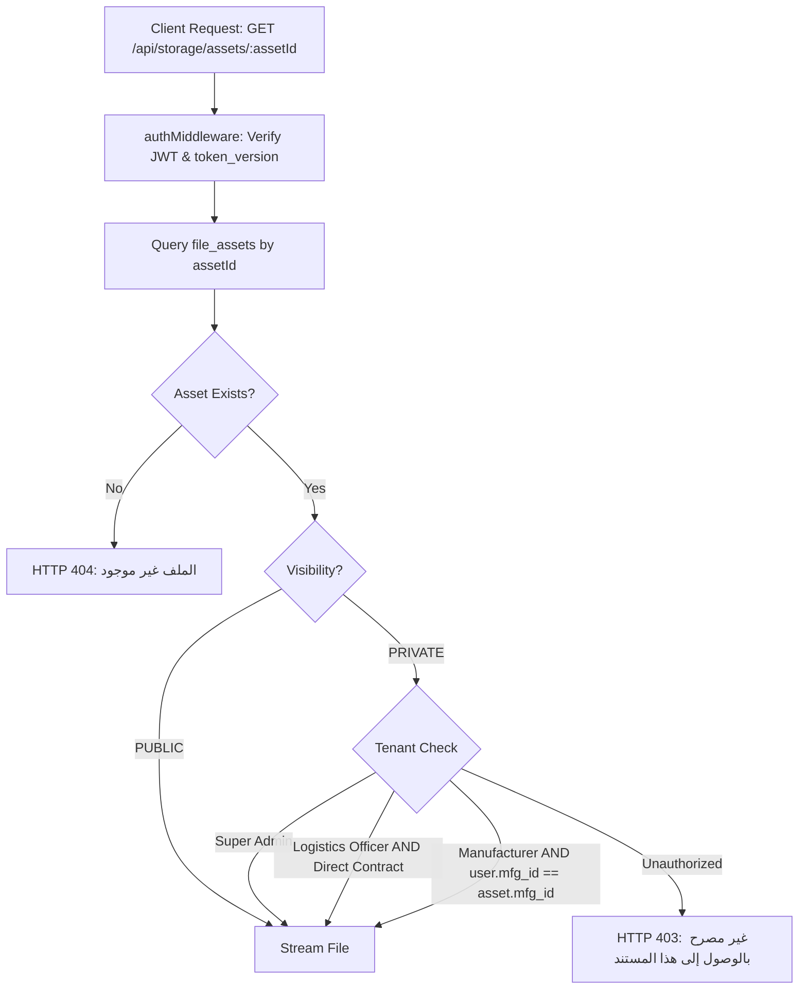

# ZARSEV — Phase 2 Security, RBAC & Tenant Isolation Matrix

**Branch:** `phase2-data-and-business-architecture`  
**Base Commit:** `eb5544a`  
**Target Environment:** Local Verified SQLite (`M:\ZZZ\zarsev.db`)  
**Specification Date:** 2026-11-02

---

## 1. Classification Legend

- `[VERIFIED CURRENT BEHAVIOR]`: Confirmed by querying `zarsev.db` and inspecting verified source code in `M:\ZZZ\src`.
- `[PROPOSED FUTURE BEHAVIOR]`: Architectural requirement and schema design planned for Phase 2 implementation.
- `[UNVERIFIED ASSUMPTIONS]`: Existing assumption that has not yet been validated against external systems or real production workflows.
- `[OPEN BUSINESS DECISIONS]`: Strategic trade, export, or administrative choice requiring leadership sign-off.

---

## 2. Platform Persona & Actor Taxonomy

`[VERIFIED CURRENT BEHAVIOR]`

1. **`SUPER_ADMIN` (ZARSEV Executive & Platform Leadership):**
   - Full read/write access across all tenants, products, subscriptions, imports, and system configurations.
   - Authorized to provision root administrators via `scripts/createAdmin.js`.
2. **`LOGISTICS_OFFICER` (ZARSEV Maritime & Port Operations):**
   - Manages Direct Contract packhouses and stations (`business_model = 'DIRECT_CONTRACT'`).
   - Cannot view or manipulate independent Marketing Subscription tenants (`business_model = 'MARKETING_SUBSCRIPTION'`).
3. **`MANUFACTURER` (Self-Managed Exporter / Marketing Subscription):**
   - Authenticated user strictly bound to a single `manufacturer_id`.
   - Complete isolation from other manufacturers' products, prices, drafts, imports, and logs.
4. **`ANONYMOUS_PUBLIC` (International Buyers & Catalog Visitors):**
   - Unauthenticated access to published products (`status = 'PUBLISHED'`), active primary prices, categories, and public marketing material.
   - Zero access to unapproved products, internal drafts, raw imports, private documents, or tenant contact details.

---

## 3. Entity-by-Entity RBAC & Tenant Isolation Matrix

`[VERIFIED CURRENT BEHAVIOR]` & `[PROPOSED FUTURE BEHAVIOR]`

| Entity / Resource | `SUPER_ADMIN` | `LOGISTICS_OFFICER` | `MANUFACTURER` (Self-Managed) | `ANONYMOUS_PUBLIC` | Primary Enforcement Mechanism |
| :--- | :--- | :--- | :--- | :--- | :--- |
| **`users`** | Full CRUD | Read-only own profile | Read-only own profile | **BLOCKED (401)** | `authMiddleware` + `requireRole(['SUPER_ADMIN'])` |
| **`manufacturers` (Private Fields)** | Full CRUD (includes tax ID, commercial register) | Full CRUD on `DIRECT_CONTRACT`; Blocked on `MARKETING_SUBSCRIPTION` | Read/Update own manufacturer profile | Stripped (Public Serializer: name & city only) | `serializePublicManufacturer` in `src/routes/manufacturerRoutes.js` |
| **`subscriptions` (Plans)** | Full CRUD (Edit limits, quotas) | Read-only | Read-only plan catalog | Read-only plan catalog | `requireRole(['SUPER_ADMIN'])` on `PUT /api/subscriptions/plans/:id` |
| **`manufacturer_subscriptions` (Active)** | Full CRUD (Activate, suspend, cancel) | Read-only on Direct Contract | Read-only own subscription status | **BLOCKED (401/403)** | Dynamic `subscriptionGuard.js` checks against `req.user.manufacturer_id` |
| **`products` (Drafts & Pending)** | Full CRUD & Approval Oversight | Full CRUD on `DIRECT_CONTRACT` products | CRUD on own products only | **BLOCKED (404/403)** | `status = 'PUBLISHED'` filter in public queries; `manufacturer_id` check in updates |
| **`products` (Published)** | Full CRUD | Full CRUD on `DIRECT_CONTRACT` | Can view & edit own products | Read-only (Non-demo only) | `p.is_demo = 0` gatekeeper filter in `GET /api/products` |
| **`product_prices` (Authoritative)** | Full CRUD | CRUD on `DIRECT_CONTRACT` products | CRUD on own products only | Read-only active primary prices | Tenant boundary `WHERE product_id IN (SELECT id FROM products WHERE manufacturer_id = ?)` |
| **`subscription_usage` (Ledger)** | Full CRUD & Manual Adjustment | **BLOCKED (403)** | Read-only aggregated monthly usage | **BLOCKED (401/403)** | Enforced in `src/routes/subscriptionRoutes.js` |
| **`imports` & `import_items`** | Global Access | Access `DIRECT_CONTRACT` imports only | Strictly limited to `imp.manufacturer_id === user.manufacturer_id` | **BLOCKED (401)** | `checkImportAccess()` helper in `src/routes/importRoutes.js` |
| **`import_jobs` (Durable Queue)** | Full Oversight & Restart Recovery | Direct Contract imports | Own imports only | **BLOCKED (401)** | Background worker inherits tenant credentials from `import_jobs.user_id` |
| **`file_assets` (Private Files)** | Full Access | Direct Contract private files | Own files only | **BLOCKED (401/403)** | Authenticated streaming endpoint `/api/storage/assets/:id` |

---

## 4. Private File Security & Path Traversal Prevention

### 4.1 Asset Download Gatekeeper Architecture
`[PROPOSED FUTURE BEHAVIOR]`

Public static serving of the entire `/storage` directory via `express.static` will be divided into two distinct zones:



### 4.2 Security Controls Against Malicious Uploads
`[PROPOSED FUTURE BEHAVIOR]`

1. **Path Traversal Defense:**
   - Physical disk keys are generated as:
     ```javascript
     const safeFilename = `asset_${crypto.randomBytes(12).toString('hex')}${path.extname(cleanOriginalName)}`;
     const safeDiskPath = path.resolve(config.PRIVATE_STORAGE_DIR, safeFilename);
     // Invariant verification: ensure target path is strictly within PRIVATE_STORAGE_DIR
     if (!safeDiskPath.startsWith(path.resolve(config.PRIVATE_STORAGE_DIR))) {
         throw new Error('Path traversal detected');
     }
     ```
2. **File Magic Byte / Content Validation:**
   - Uploads are checked against their binary headers (e.g. `PK\x03\x04` for zip/docx/xlsx, `%PDF` for pdf, `\xFF\xD8\xFF` for jpeg, `\x89PNG` for png).
   - Reject any disguised executable, script, or polyglot file.
3. **Upload Size Quotas:**
   - Enforce plan-level `max_file_size_mb` during Multer streaming.

---

## 5. Quarantined Demo Data Isolation Invariant

`[VERIFIED CURRENT BEHAVIOR]`

The Phase 1.2 quarantine of the **9 confirmed test products** must remain impenetrable throughout Phase 2:

- **Quarantine Identifier:**
  `is_demo = 1` AND `rejection_reason LIKE '%[QUARANTINE_TEST_DATA]%'`.
- **Enforcement Rules:**
  1. `GET /api/products`: Automatically appends `AND (p.is_demo = 0 OR p.is_demo IS NULL)`.
  2. `GET /api/products/:id`: For non-admin callers, appends `AND (p.is_demo = 0 OR p.is_demo IS NULL)` (returns 404 for quarantined items).
  3. `product_prices`: Quarantined products inherit `is_demo = 1` on their associated price records, preventing them from appearing in international buyer searches.
  4. `scripts/quarantine_test_products.js`: Provides instantaneous reversible control via `--apply` and `--rollback`.
