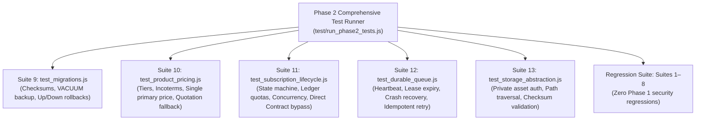

# ZARSEV — Phase 2 Automated Testing & Quality Assurance Strategy

**Branch:** `phase2-data-and-business-architecture`  
**Base Commit:** `eb5544a`  
**Target Environment:** Local Verified SQLite (`M:\ZZZ\zarsev.db`)  
**Specification Date:** 2026-11-02

---

## 1. Classification Legend

- `[VERIFIED CURRENT BEHAVIOR]`: Confirmed by querying `zarsev.db` and inspecting verified source code in `M:\ZZZ\src`.
- `[PROPOSED FUTURE BEHAVIOR]`: Architectural requirement and schema design planned for Phase 2 implementation.
- `[UNVERIFIED ASSUMPTIONS]`: Existing assumption that has not yet been validated against external systems or real production workflows.
- `[OPEN BUSINESS DECISIONS]`: Strategic trade, export, or administrative choice requiring leadership sign-off.

---

## 2. Existing Test Coverage Baseline

`[VERIFIED CURRENT BEHAVIOR]`

The current test runner [`test/run_all_tests.js`](file:///M:/ZZZ/test/run_all_tests.js) executes **8 distinct test suites** with 100% pass rate in ~2.3 seconds:

1. `test_extraction.js`: Parsing of Excel, CSV, images (dHash), ZIPs, and zero-hallucination verification.
2. `test_manufacturer_assignment.js`: Direct Contract vs Marketing Subscription auto-matching and security boundaries.
3. `test_authorization.js`: RBAC role validation, subscription plan format filtering, and super admin updates.
4. `test_duplicate_detection.js`: SKU exact match, Arabic text normalization & Jaccard token similarity, dHash Hamming distance.
5. `test_approval_workflow.js`: Product lifecycle (`DRAFT` -> `PENDING_APPROVAL` -> `PUBLISHED` / `REJECTED`).
6. `e2e_flow_verification.js`: Complete upload-to-published catalog integration flow.
7. `test_security_p0.js`: 12 P0 security lockdown checks (auth bypass, x-user-id rejection, IDOR protection, demo data isolation).
8. `test_phase1_1_remediation.js`: Production JWT secret enforcement, PBKDF2 210,000 iterations, timing-safe equal, CSRF origin matching, `token_version` revocation, dual rate-limiting, and quarantine rollback verification.

---

## 3. Phase 2 Test Suites Specification

`[PROPOSED FUTURE BEHAVIOR]`

Phase 2 introduces **5 new dedicated test suites** corresponding to each milestone. These suites will run on isolated test databases (`test/phase2_*.db`) without ever mutating `zarsev.db`:

---

### 3.1 Suite 9: `test_migrations.js` (Migration Framework Verification)
`[PROPOSED FUTURE BEHAVIOR]`

- **Test 1: Clean Up/Down Execution:**
  Verify that running `migrate.js up` applies all pending migrations in order, populates `_migrations` with batch numbers and checksums, and `migrate.js down` safely rolls back the batch.
- **Test 2: Pre-Migration Backup Verification:**
  Confirm that `storage/backups/migrations/` receives a verified `.db` snapshot before any DDL runs, and that `PRAGMA integrity_check` passes on the snapshot.
- **Test 3: Anti-Tamper Checksum Detection:**
  Manually alter 1 byte in a previously applied migration file; verify that `migrate.js up` aborts with a security violation.
- **Test 4: Migration Lock Invariant:**
  Simulate two concurrent migration processes; verify that the second process fails immediately due to `_migration_lock`.
- **Test 5: Transactional Rollback on Error:**
  Introduce a syntax error in migration file $N$; verify that migration $N$ fails, rolls back completely, and leaves database at version $N-1$.

---

### 3.2 Suite 10: `test_product_pricing.js` (Pricing Architecture)
`[PROPOSED FUTURE BEHAVIOR]`

- **Test 1: Single Primary Price Enforcement:**
  Attempt to insert two primary prices for the same product, currency, and Incoterm; verify database rejects with unique constraint violation.
- **Test 2: Non-Overlapping Tier Boundaries:**
  Insert tier 1 (1–10 MT @ $800); attempt to insert tier 2 (8–20 MT @ $750); verify rejection with `HTTP 422`.
- **Test 3: Synchronized Legacy Projections:**
  Insert a new primary price in `product_prices`; verify that `products.price`, `currency`, `price_unit`, and `moq` are immediately updated.
- **Test 4: Quotation-Only Mode Fallback:**
  Create a product with `price_type = 'QUOTATION_ONLY'`; verify public catalog returns `price: null, is_quotation_only: true`.
- **Test 5: Historical Price Preservation:**
  Update an active price; verify that the old price record remains in `product_prices` with `valid_to <= NOW` and the new price is active with `valid_from = NOW`.
- **Test 6: Expired Price Exclusion:**
  Verify that prices with `valid_to < NOW` do not appear in public active search results.

---

### 3.3 Suite 11: `test_subscription_lifecycle.js` (Subscriptions & Usage Ledger)
`[PROPOSED FUTURE BEHAVIOR]`

- **Test 1: Direct Contract Immunity:**
  Verify that Direct Contract manufacturers (`business_model = 'DIRECT_CONTRACT'`) can import unlimited products even with `subscription_id = NULL`.
- **Test 2: Expiration Gatekeeper:**
  Set `expires_at = NOW - 1 day` for a Marketing Subscription; verify that `POST /api/imports/upload` returns `HTTP 403 Subscription Expired`.
- **Test 3: Usage Ledger Quota Tracking:**
  Execute 10 imports on a plan with `max_monthly_imports = 10`; verify import 11 is blocked with `HTTP 429 Quota Exceeded`.
- **Test 4: Concurrent Quota Reservation:**
  Simulate 5 simultaneous upload requests on a plan with 2 imports remaining; verify exactly 2 succeed and 3 receive `HTTP 429`.
- **Test 5: Administrative Usage Adjustment:**
  Super Admin injects an `ADJUSTMENT` record in `subscription_usage`; verify usage reflects the adjustment in the next quota calculation.

---

### 3.4 Suite 12: `test_durable_queue.js` (Durable Import Processing)
`[PROPOSED FUTURE BEHAVIOR]`

- **Test 1: Server Restart Recovery (No Blind Re-queuing):**
  Create an import job with `status = 'PROCESSING'` and expired lease (`lease_expires_at = NOW - 5 minutes`); boot recovery routine; verify job is re-queued with attempt count incremented.
- **Test 2: Valid Lease Protection:**
  Create an import job with `status = 'PROCESSING'` and active lease (`lease_expires_at = NOW + 5 minutes`); boot recovery routine; verify job is NOT disturbed.
- **Test 3: Terminal Failure & Dead-Letter:**
  Simulate 3 repeated failures on an import job; verify status transitions to `FAILED` and does not re-queue.
- **Test 4: Upload Idempotency:**
  Submit the same upload batch with the same idempotency key; verify duplicate job is rejected.

---

### 3.5 Suite 13: `test_storage_abstraction.js` (Storage & Private Asset Security)
`[PROPOSED FUTURE BEHAVIOR]`

- **Test 1: Unauthenticated Private File Access:**
  Request `GET /api/storage/assets/:privateAssetId` without JWT token; verify `HTTP 401 Unauthorized`.
- **Test 2: Cross-Tenant Private File IDOR:**
  Request private asset belonging to Manufacturer A using valid JWT for Manufacturer B; verify `HTTP 403 Forbidden`.
- **Test 3: Super Admin Universal Access:**
  Request private asset belonging to Manufacturer A using Super Admin JWT; verify `HTTP 200 OK` and file stream.
- **Test 4: Path Traversal Attack Defense:**
  Attempt upload with malicious filename `../../../../etc/passwd`; verify physical disk key is sanitized to `asset_<hex>.<ext>` inside private storage directory.
- **Test 5: SHA-256 Checksum Verification:**
  Verify that `file_assets.sha256` matches the exact hash of the file bytes on disk.
