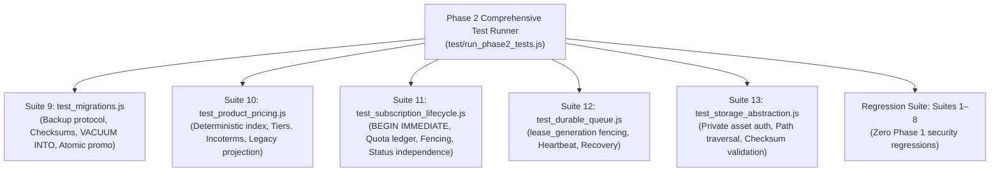

# ZARSEV — Phase 2 Automated Testing & Quality Assurance Strategy (Revised)

**Branch:** `phase2-data-and-business-architecture`  
**Base Commit:** `eb5544a`  
**Target Environment:** Local Verified SQLite (`M:\ZZZ\zarsev.db`)  
**Specification Date:** 2026-11-02  
**Status:** Hardened QA & Automated Testing Specification

---

## 1. Classification Legend

- `[VERIFIED CURRENT BEHAVIOR]`: Confirmed by querying `zarsev.db` and inspecting verified source code in `M:\ZZZ\src`.
- `[PROPOSED FUTURE BEHAVIOR]`: Architectural requirement and schema design planned for Phase 2 implementation.
- `[UNVERIFIED ASSUMPTIONS]`: Existing assumption that has not yet been validated against external systems or real production workflows.
- `[OPEN BUSINESS DECISIONS]`: Strategic trade, export, or administrative choice requiring leadership sign-off.

---

## 2. Existing Test Coverage Baseline

`[VERIFIED CURRENT BEHAVIOR]`

The current test runner [`test/run_all_tests.js`](file:///M:/ZZZ/test/run_all_tests.js) executes **8 distinct test suites** with 100% pass rate in ~2.3 seconds:

1. `test_extraction.js`: Parsing of Excel, CSV, images (dHash), ZIPs, and zero-hallucination verification.
2. `test_manufacturer_assignment.js`: Direct Contract vs Marketing Subscription auto-matching and security boundaries.
3. `test_authorization.js`: RBAC role validation, subscription plan format filtering, and super admin updates.
4. `test_duplicate_detection.js`: SKU exact match, Arabic text normalization & Jaccard token similarity, dHash Hamming distance.
5. `test_approval_workflow.js`: Product lifecycle (`DRAFT` -> `PENDING_APPROVAL` -> `PUBLISHED` / `REJECTED`).
6. `e2e_flow_verification.js`: Complete upload-to-published catalog integration flow.
7. `test_security_p0.js`: 12 P0 security lockdown checks (auth bypass, x-user-id rejection, IDOR protection, demo data isolation).
8. `test_phase1_1_remediation.js`: Production JWT secret enforcement, PBKDF2 210,000 iterations, timing-safe equal, CSRF origin matching, `token_version` revocation, dual rate-limiting, and quarantine rollback verification.

---

## 3. Phase 2 Test Suites Specification

`[PROPOSED FUTURE BEHAVIOR]`

Phase 2 introduces **5 new dedicated test suites** corresponding to each milestone. These suites run on isolated test databases (`test/phase2_*.db`) without ever mutating `zarsev.db`:

---

### 3.1 Suite 9: `test_migrations.js` (Migration Framework & Comprehensive Backup Protocol)
`[PROPOSED FUTURE BEHAVIOR]`

- **Test 1: Clean Up/Down Execution:**
  Verify that running `migrate.js up` applies all pending migrations in order, populates `_migrations` with batch numbers and checksums, and `migrate.js down` safely rolls back the batch.
- **Test 2: Anti-Tamper Checksum Detection:**
  Manually alter 1 byte in a previously applied migration file; verify that `migrate.js up` aborts with a security violation.
- **Test 3: Migration Lock Invariant:**
  Simulate two concurrent migration processes; verify that the second process fails immediately due to `_migration_lock`.
- **Test 4: Transactional Rollback on Error:**
  Introduce a syntax error in migration file $N$; verify that migration $N$ fails, rolls back completely, and leaves database at version $N-1$.
- **Test 5: 8-Phase Backup Protocol Verification:**
  - Verify that active connections trigger `PRAGMA wal_checkpoint(TRUNCATE)` with exponential backoff on `busy`.
  - Verify temporary backup creation via `VACUUM INTO ...temp.db`.
  - Verify that `PRAGMA integrity_check` executes and confirms `ok`.
  - Verify schema validation: checks that `users`, `manufacturers`, `products`, `subscriptions`, `imports` exist and baseline record counts match live counts.
  - Verify atomic promotion: temporary file is renamed to `backup_pre_migration_<name>_<timestamp>.db`.
  - Verify preservation: historical backups remain intact.
  - Verify failure behavior: if integrity check or count check fails, temporary backup is deleted, lock is released, and migration is strictly prevented from starting.

---

### 3.2 Suite 10: `test_product_pricing.js` (Pricing Architecture & Deterministic Projections)
`[PROPOSED FUTURE BEHAVIOR]`

- **Test 1: SQLite Deterministic Partial Unique Index:**
  - Verify verified SQLite behavior: creating an index with `CURRENT_TIMESTAMP` in `WHERE` fails with `non-deterministic functions prohibited in partial index WHERE clauses`.
  - Verify deterministic index creation: `CREATE UNIQUE INDEX uidx_product_prices_primary ON product_prices(product_id, currency, incoterm) WHERE is_primary = 1;`.
  - Verify rejection of duplicate primary prices for the same `(product_id, currency, incoterm)`.
- **Test 2: Atomic Primary Replacement (`BEGIN IMMEDIATE`):**
  - Execute `setPrimaryPrice()`: verify existing primary is demoted (`is_primary = 0`, `valid_to = CURRENT_TIMESTAMP`) and new primary is promoted (`is_primary = 1`, `valid_to = NULL`).
- **Test 3: Non-Overlapping Tier Boundaries:**
  - Insert tier 1 (1–10 MT @ $800); attempt to insert tier 2 (8–20 MT @ $750); verify rejection with `HTTP 422`.
- **Test 4: Deterministic Legacy Projection Policy:**
  - Create multiple primary prices: USD FOB ($750), EUR CIF (€800), and EGP EXW (EGP 35,000).
  - Verify `products.price` projects `$750`, `currency` projects `USD`, and `price_unit` projects `MT` based on strict priority (`is_default_projection` -> USD -> FOB -> lowest MOQ).
  - Explicitly set `is_default_projection = 1` on the EUR price; verify `products` immediately projects EUR.
- **Test 5: Explicit Quotation-Only Mode:**
  - Create unpriced draft product without quotation flag; verify it remains incomplete draft with warning `"السعر غير متوفر"`, NOT quotation-only.
  - Set `price_type = 'QUOTATION_ONLY'`; verify public catalog returns `price: null, is_quotation_only: true, quotation_label: "سعر عند الطلب (Quotation on Request)"`.
- **Test 6: Historical Price Preservation:**
  - Update an active price; verify that the old price record remains in `product_prices` with historical `valid_to` and the new price is active with `valid_from = NOW`.

---

### 3.3 Suite 11: `test_subscription_lifecycle.js` (Subscriptions & Usage Ledger)
`[PROPOSED FUTURE BEHAVIOR]`

- **Test 1: Direct Contract Complete Immunity:**
  - Verify that Direct Contract manufacturers (`business_model = 'DIRECT_CONTRACT'`) bypass all subscription quota checks even with `subscription_id = NULL`.
- **Test 2: Atomic Quota Consumption (`BEGIN IMMEDIATE`):**
  - Simulate 10 concurrent quota requests on a plan with remaining quota of 2; verify that `BEGIN IMMEDIATE` write lock serialization allows exactly 2 to consume quota and 8 receive `HTTP 429 Quota Exceeded`.
- **Test 3: Idempotency Protection:**
  - Submit two requests with identical `(manufacturer_id, idempotency_key)`; verify the second returns the existing transaction result without double-charging quota.
- **Test 4: Independent Subscription Status vs Payment Status:**
  - Verify state transitions where `status = 'ACTIVE'` and `payment_status = 'WAIVED'`.
  - Verify `status = 'ACTIVE'` with `payment_status = 'UNPAID'` during grace period.
  - Verify `status = 'SUSPENDED'` while retaining `payment_status = 'PAID'`.
- **Test 5: Expiration Gatekeeper:**
  - Set `expires_at = NOW - 1 day` for a Marketing Subscription; verify that `POST /api/imports/upload` returns `HTTP 403 Subscription Expired`.
- **Test 6: Administrative Usage Adjustment:**
  - Super Admin injects an `ADMIN_ADJUSTMENT` record in `subscription_usage`; verify subsequent quota calculations reflect the adjustment.

---

### 3.4 Suite 12: `test_durable_queue.js` (Durable Queue & Worker Fencing)
`[PROPOSED FUTURE BEHAVIOR]`

- **Test 1: Worker Fencing Token Increment (`lease_generation`):**
  - Claim a job with worker $A$; verify `lease_generation = 1`.
  - Simulate worker $A$ pausing past `lease_expires_at`.
  - Claim the job with worker $B$; verify `lease_generation = 2`.
- **Test 2: Stale Worker Fencing Defense:**
  - Simulate worker $A$ waking up and attempting to finalize the job with `lease_generation = 1`; verify SQLite conditional update affects **0 rows**.
  - Verify worker $A$ detects it was fenced out, halts, and discards results without overwriting worker $B$.
- **Test 3: Server Restart Recovery (No Blind Re-queuing):**
  - Job in `PROCESSING` with valid lease is NOT disturbed on server startup.
  - Job in `PROCESSING` with expired lease and `attempts < max_attempts` is safely re-queued with attempt count incremented.
- **Test 4: Terminal Failure & Dead-Letter:**
  - Job reaching `attempts >= max_attempts` transitions to `FAILED` and is not re-queued.

---

### 3.5 Suite 13: `test_storage_abstraction.js` (Storage & Private Asset Security)
`[PROPOSED FUTURE BEHAVIOR]`

- **Test 1: Unauthenticated Private File Access:**
  - Request `GET /api/storage/assets/:privateAssetId` without JWT token; verify `HTTP 401 Unauthorized`.
- **Test 2: Cross-Tenant Private File IDOR:**
  - Request private asset belonging to Manufacturer A using valid JWT for Manufacturer B; verify `HTTP 403 Forbidden`.
- **Test 3: Super Admin Universal Access:**
  - Request private asset belonging to Manufacturer A using Super Admin JWT; verify `HTTP 200 OK` and file stream.
- **Test 4: Path Traversal Attack Defense:**
  - Attempt upload with malicious filename `../../../../etc/passwd`; verify physical disk key is sanitized to `asset_<hex>.<ext>` inside private storage directory.
- **Test 5: SHA-256 Checksum Verification:**
  - Verify that `file_assets.sha256` matches the exact hash of the file bytes on disk.
